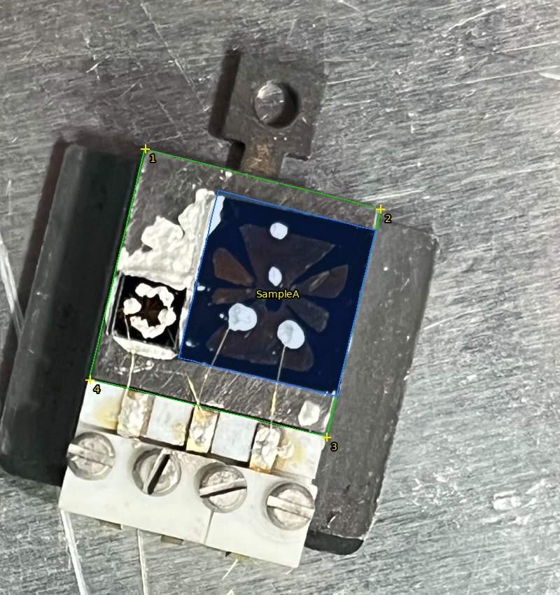

# Agent: MCP server and internal API

The three tools — **QuickAlignment** (find samples), **RealSampleCalibration** and **GoldFrameCalibration** — can be
driven by an AI agent (Claude Desktop, Claude Code, or any MCP client) or from Python. Same computations as the
windows; no Qt needed.

What a conversation looks like:

1. You send one or a few photos of the sample plate (file paths) or just say what you want.
2. The agent asks: **find samples or calibrate?**, **which sample plate** (standard / gating / custom) and **which
   optic** (capillary / zone plate).
3. **Find samples**: the agent looks at the photo with a pixel grid, zooms on the four corners of the riser /
   sample area, registers the photo on the plate model, finds the samples and devices (colour detection and its own
   reading of the photo), shows you the overlay to confirm, asks the sample heights, and gives the **ST / SZ / SN** of
   every sample. It then asks whether you are **satisfied**; if not, you tell it what to change, or switch to **manual
   annotation**: the photo window opens on your screen with the photo already registered, you mark the samples
   yourself and press OK, and the agent reads them back. For a photo not taken from straight above, an optional **3D
   correction** (off by default) uses points at several heights (sample-area corners, back plate and tab corners).
   You report where a sample was really found → it corrects the model (*found here*). You ask for
   another SRn / SRz, or to turn an edge along the slit, or for a Brillouin-zone point → it gives the new **ST / SZ /
   SN and optic position**, with range and collision checks.
4. **Calibrate**: the agent asks *real sample* or *gold frame*, then leads you one step at a time (what to set, what
   to read), fits, shows the result, and saves the configuration only when you say so.



## Setup

Requirements: Python ≥ 3.9 with `numpy`, `matplotlib` (Pillow comes with it), and `h5py` for the gold-frame `.nxs`
files: `pip install -r requirements.txt`. The server uses only the standard library for the protocol (no MCP SDK).

**Claude Code**: `.mcp.json` at the repository root registers the server; open Claude Code in the repository and
approve the `quickalignment` server.

**Claude Desktop**: add to `claude_desktop_config.json` (Settings → Developer → Edit config), with your paths:

```json
{
  "mcpServers": {
    "quickalignment": {
      "command": "C:\\Path\\To\\python.exe",
      "args": ["C:\\Path\\To\\QuickAlignment\\Agent\\quickalignment_mcp.py"]
    }
  }
}
```

Photos must be files the server can read: give the agent their paths (photos only pasted into the chat can be read by
eye, with less precision and without colour detection). Options: `--configs FOLDER` (another configuration folder),
`--list-tools`.

Check from a console:

```bash
python Agent/quickalignment_mcp.py --list-tools
```

## Python API

```python
import sys; sys.path.insert(0, "src")          # or: pip install -e .
from quickalignment.agent import AgentAPI

api = AgentAPI()
a = api.alignment
a.start("gating", "capillary")
a.register_photo([[207, 212], [543, 298], [466, 624], [128, 542]], path="tests/data/gating_plate_photo.jpg")
a.add_sample_from_photo([[312, 272], [536, 329], [480, 566], [255, 511]], height=0.525, name="SampleA")
print(a.sample_positions())
print(a.rotate(140, -10, target="SampleA"))

r = api.real_sample.start("optics", "capillary", "standard", feature_x=0.5, feature_y=1.0, feature_height=0.3)
api.gold_frame.start("capillary", gold_height=0.05)
plan = api.gold_frame.plan()["lines"]
```

Every method returns a JSON-friendly dict (images as PNG bytes under `image_png`) or raises `APIError` with a message
for the user. Code: `src/quickalignment/agent/` (`alignment.py`, `real_sample.py`, `gold_frame.py`, `photos.py`,
`workflow.py` = the instructions the agent follows, `mcp_server.py`). Tests: `tests/test_agent.py`.

## Tools
**General**

| tool | what it does |
|---|---|
| `workflow` | How to lead the user through alignment or calibration (read when unsure). |
| `status` | What each tool (alignment, real-sample calibration, gold frame) is doing now. |

**Find samples (QuickAlignment)**

| tool | what it does |
|---|---|
| `align_plates` | The sample plates known (standard, gating, custom) and their sample area. |
| `align_configurations` | The calibration configurations in configs/ (newest first). |
| `align_start` | Start finding samples on a plate: plate type, optic and (default newest) configuration. Clears the samples. |
| `align_status` | Plate, configuration, samples, photos and stage position of the session. |
| `align_photo_corners` | The four sample-area corners to read on a plate photo, in their order, with their plate coordinates. |
| `align_photo_info` | Size in pixels of a photo file (after its EXIF rotation). |
| `align_photo_grid` | A photo (or a zoomed region of it) with a pixel grid labelled in photo pixels, to read positions precisely; optional marks to check points. Use a path, or photo_id of a registered photo. |
| `align_register_photo` | Map a plate photo onto the plate from the 4 sample-area corners (photo px, order of align_photo_corners). |
| `align_photo_points_3d` | OPTIONAL 3D correction: the plate points at several heights that can be read on an oblique photo. |
| `align_register_photo_3d` | OPTIONAL (off by default): register an oblique photo with a camera model from >= 6 points at 2+ heights (sample-area corners + back plate / tab corners). Use only when the photo is clearly not from straight above or the user asks for it. |
| `align_manual_annotation` | Open the photo window on the user's screen (photo already registered) so the user marks the samples by hand. Use when the user is not satisfied with the samples found. |
| `align_load_annotation` | Read the samples the user marked in the manual-annotation window (after they pressed OK). |
| `align_photo_overlay` | The registered plate photo with the model drawn on it (sample area, samples, devices): check it. |
| `align_plate_view` | Drawing of the plate model with samples and devices (mm). |
| `align_photo_to_plate` | Photo pixels -> plate mm. |
| `align_plate_to_photo` | Plate mm -> photo pixels. |
| `align_detect_samples` | Samples found by colour on the registered plate photo (boxes in plate mm; nothing is added). |
| `align_add_sample` | Add a rectangular sample (plate mm). |
| `align_add_sample_from_photo` | Add a sample from its corners read on the plate photo (4 corners, or 2 opposite corners). |
| `align_update_sample` | Change a sample (centre, size, height, name). |
| `align_remove_sample` | Remove a sample. |
| `align_clear_samples` | Remove all samples. |
| `align_add_device` | Add a device on a substrate at plate (x, y) mm or at a pixel of a registered photo (plate or microscope). |
| `align_remove_device` | Remove a device ('sample/device'). |
| `align_register_device_photo` | Map a microscope photo of a substrate onto the plate from 2-4+ point pairs (same feature on both). |
| `align_samples` | The samples and devices with their warnings. |
| `align_sample_positions` | ST / SZ / SN of every sample and device at the start rotation (SRn ref, SRz 0, piezo centred). |
| `align_set_position` | The stage as it is now (motor values read by the user) and the optic position; returns what the beam hits. |
| `align_bring_to_beam` | ST / SZ putting a target on the beam with SN kept (correct_sn: also SN, onto the analyzer focus). |
| `align_beam_on` | What the beam hits at these positions and the optic focus position. |
| `align_found_here` | A target was found on the beam in the analyzer focus at these positions: move its sample there. |
| `align_rotate` | New ST / SZ / SN and optic position after turning SRn / SRz, keeping the point now on the beam. |
| `align_align_edge` | SRn turning an edge (two points: photo px, or plate mm with plate_mm=true) along or across the slit. |
| `align_bz_angles` | SRn / SRz putting a hexagonal Brillouin-zone point at the slit centre (from a measured map's angles). |
| `align_collision_check` | Does the plate touch the analyzer / optic at these positions; collision-free motor ranges. |
| `align_save_session` | Save the plate (samples, devices, stage) as a session file. |
| `align_load_session` | Load a QuickAlignment session file. |

**Real-sample calibration**

| tool | what it does |
|---|---|
| `rsc_guide` | Real-sample calibration: where it stands and what to do next. |
| `rsc_start` | Start a real-sample calibration with one reference feature. |
| `rsc_status` | The sets, what is measured, where the feature is expected. |
| `rsc_add_set` | Another measurement set at other angles. |
| `rsc_measure_set` | The values read for a set. |
| `rsc_fit` | Fit the constants; predicts a round of test points. |
| `rsc_test_points` | The open test points: where to go. |
| `rsc_answer_test` | A test point: found at the prediction, or the real ST, SZ (and optic). |
| `rsc_change_test_angles` | Other SRn / SRz for an open test point. |
| `rsc_save` | Save the configuration in configs/ (only when the user asks). |

**Gold-frame calibration**

| tool | what it does |
|---|---|
| `gfc_guide` | Gold-frame calibration: where it stands and what to do next. |
| `gfc_start` | Start a gold-frame calibration. |
| `gfc_status` | Files loaded, SN points, fit state. |
| `gfc_plan` | The SZ lines to measure (checked against ranges and collisions); CSV. |
| `gfc_add_files` | Load measured .nxs (or simulated .npz) files. |
| `gfc_remove_file` | Unload a file. |
| `gfc_set_sn_points` | Optional SN points: [{srn, srz, st, sz, sn}] or a CSV. |
| `gfc_fit` | Fit every edge of every line; constants, change, quality checks. |
| `gfc_plot` | The data with the fitted edges (PNG). |
| `gfc_save` | Save the configuration in configs/ (only when the user asks). |
| `gfc_simulate_example` | Write a simulated measurement (known faults) to try the steps without beam time. |
