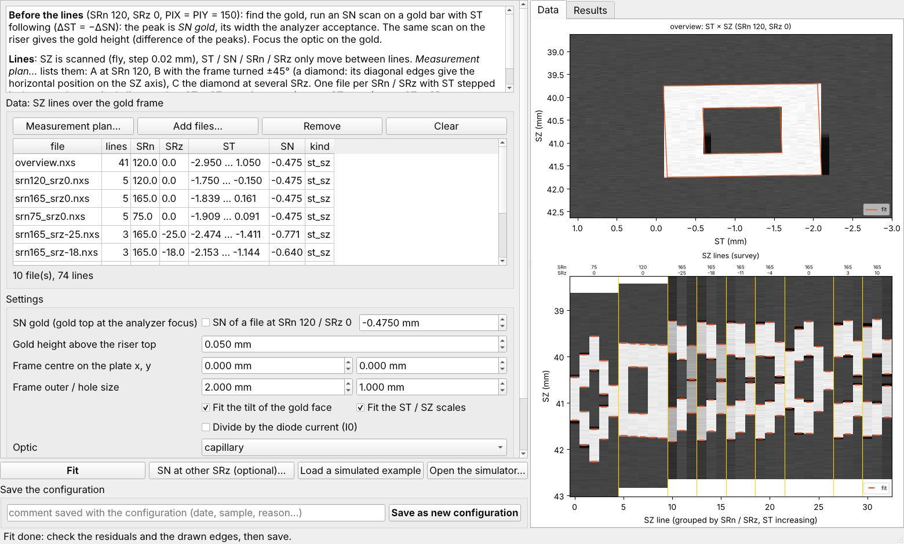

# GoldFrameCalibration — technical reference

Another way to make a configuration: total-intensity SPEM lines over the **gold reference frame** (2 × 2 mm, 1 × 1 mm
hole, at the riser centre of a standard plate). SZ is the only fast motor, so every measurement is an SZ fly line;
ST, SN, SRn, SRz only move between lines. With the frame turned by 45° (SRn 165 / 75) its edges are diagonal, so where
an SZ line crosses them also gives the horizontal position.

| document | |
|---|---|
| **Experiment plan** (for the beamtime) | [en](docs/pdf/GoldFrame_experiment_plan_en.pdf) (source `docs/EXPERIMENT_PLAN_en.md`) |
| Method, simulations, accuracy (report) | [en](docs/pdf/GoldFrame_calibration_report_en.pdf) · [中文](docs/pdf/GoldFrame_calibration_report_zh.pdf) · [fr](docs/pdf/GoldFrame_calibration_report_fr.pdf) |

Code: `src/quickalignment/goldframe/` (`model.py`: simulation, plan, global fit; `cli.py`: console commands;
`spem_nxs.py`: ANTARES `.nxs` reading; `plot.py`), window `src/quickalignment/ui/gold_frame_window.py`.
Agent / MCP access: tools `gfc_*` ([`../Agent/README.md`](../Agent/README.md)).

## Run

Double-click **`GoldFrameCalibration.py`** in this folder (Windows: `.pyw`): *Measurement plan…* (the lines, checked
against the motor ranges and the anti-collision model, CSV), *Add files…* (ANTARES `.nxs`, datasets found by their
`long_name`, intensity `heason/total_int` or `image32` summed; needs `h5py`), set SN gold and the gold height, *Fit*,
check the constants / residuals / fitted edges, *Save as new configuration*. *SN at other SRz (optional)…* opens the SN
points in their own dialog. *Load a simulated example* tries everything without beam.



`GoldFrameSimulator.py` (`.pyw`) is the interactive simulator (sliders for the frame, the stage axes, the analyzer
acceptance, the beam offset).

From a console (in this folder):

```bash
python GoldFrameCalibration.py plan --csv plan.csv
```

```bash
python GoldFrameCalibration.py fit FILES... --sn-gold SN --height 0.05 --optic capillary --plot fit.png --save
```

```bash
python GoldFrameCalibration.py simulate --frame-u 0.2 --srz-offset-n 3.0 --out sim
```

## The plan and the fit

The plan (33 lines in 9 settings): A at SRn 120 (5 lines), B at SRn 165 and 75 (5 lines each), C at SRn 165 and
SRz −25 … +10 (6 × 3 lines), placed with the newest configuration of the chosen optic; SN is set once per setting so
that the frame centre is at the analyzer focus. Every edge of every line is fitted at once (`fit_global`): ST0, SZ0,
SRn axis, SRz axis offsets, frame rotation, tilt of the gold face, ST / SZ scales; SN_f = SN_gold − gold height from an
SN scan on the gold. An ST × SZ overview map, an SZ × SRn sweep and, as an option, SN focus points at other SRz may be
added. Constants the data cannot fix are kept from the newest configuration and reported.

Regenerating the documents: `python devtools/gold_frame_report.py` (report figures and tables),
`python devtools/experiment_plan_tables.py` (plan tables), `python devtools/build_guides.py gold plan` (PDFs).
