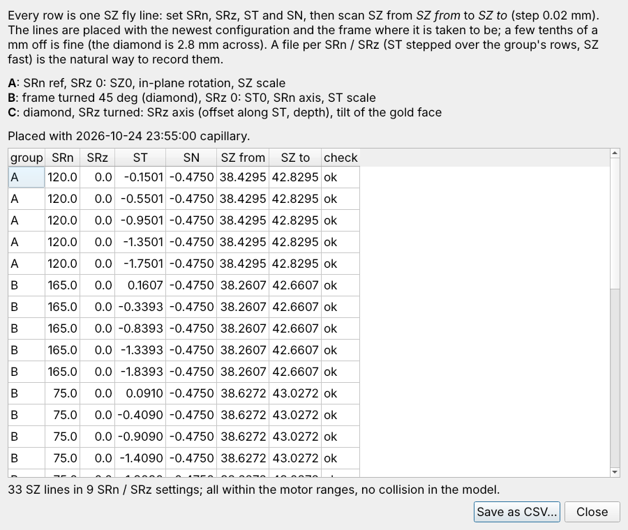
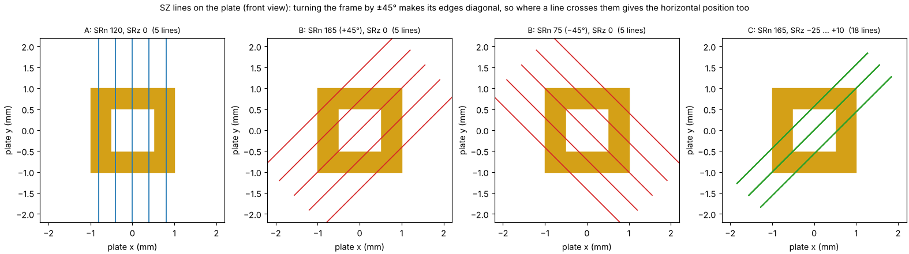
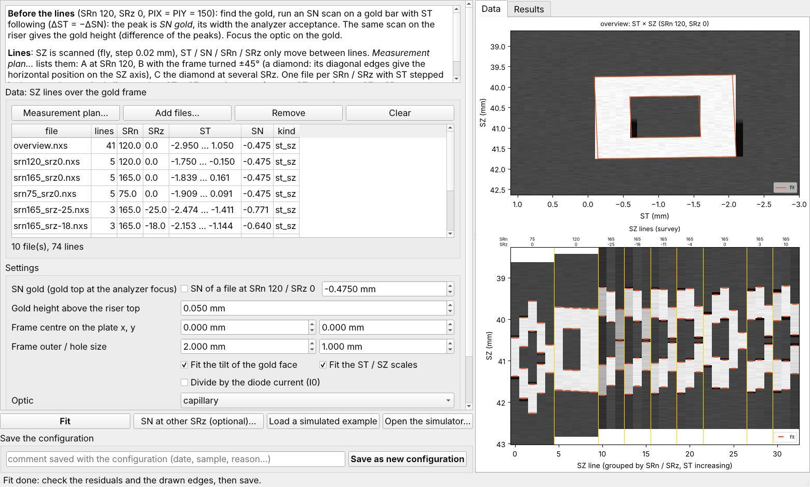
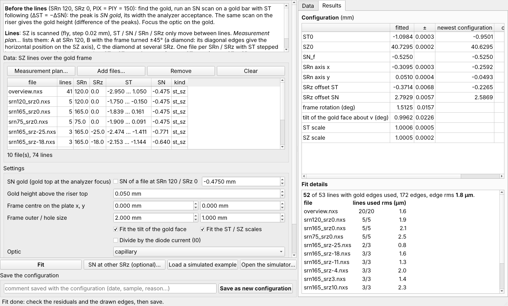
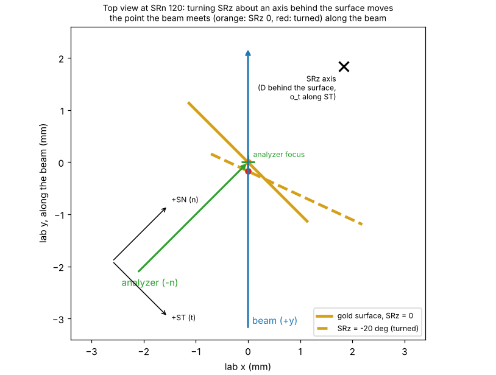

# Gold-frame calibration — Experiment plan

ANTARES beamline (SOLEIL) · calibration of the sample-stage model with SPEM lines over the gold reference frame ·
plan for the beamtime, November 2026

## Contents

1. [Goal](#goal)
2. [What is needed](#what-is-needed)
3. [The measurement at a glance](#the-measurement-at-a-glance)
4. [Before the beamtime](#before-the-beamtime)
5. [Procedure at the beamline](#procedure-at-the-beamline)
6. [The SZ lines](#the-sz-lines)
7. [Optional: SN points at other SRz](#optional-sn-points-at-other-srz)
8. [Analysis and acceptance](#analysis-and-acceptance)
9. [If something goes wrong](#if-something-goes-wrong)
10. [Logbook sheet](#logbook-sheet)
11. [Background: why SZ lines over a diamond](#background-why-sz-lines-over-a-diamond)

## Goal

Measure the constants of the stage model used by QuickAlignment, so that samples are found from their position on
the plate at any SRn / SRz:

| constant | meaning |
|---|---|
| ST0, SZ0 | ST, SZ that put the plate centre on the beam (SRn 120, SRz 0) |
| SN_f | SN that puts the riser top of the standard plate in the analyzer focal plane |
| SRn axis (x, y) | where the SRn rotation axis pierces the plate |
| SRz axis offsets (along ST, depth) | where the SRz rotation axis is, relative to the plate surface |

The fit also gives the in-plane rotation of the frame, the tilt of its gold face and the ST / SZ motor scales, for
the record. The result is a new configuration file in `configs/` that QuickAlignment loads at its next start.

**Expected accuracy** (simulations, see the report): about 1–2 µm for ST0, SZ0 and the SRn axis, about 5–20 µm for
the SRz axis.

**Method in one sentence:** only SZ is scanned (fly scans); with the frame turned by 45° (SRn 165 / 75) its edges
are diagonal, so where an SZ line crosses them also gives the horizontal position, and every edge of every line is
fitted at once.

## What is needed

**Sample.** The gold reference frame (2 × 2 mm outside, 1 × 1 mm hole) glued at the centre of the riser of a
**standard Ta plate**. If it is known to be off-centre, note its position (x, y in mm on the plate, front view, tab
up): it is entered in the program. The frame is taken as the plate reference: an error in where it is glued goes
into ST0, SZ0 and the axes.

**Beamline.**

- Focusing optic aligned and focused (capillary or zone plate + OSA). The configuration is saved for that optic.
- Total-intensity SPEM signal (`heason/total_int`, or the MBS `image32` summed): no angle or energy resolution needed.
- SZ fly scans with steps down to 0.02 mm; ST, SN, SRn, SRz moved between lines.
- Motor ranges used by the program: ST −9 … 9 mm, SN −30 … 65 mm, SZ 35 … 45 mm.

**Software.** `GoldFrameCalibration/GoldFrameCalibration.py` (double-click; Windows: `.pyw`) on a PC with the
repository and `pip install -r requirements.txt` (PyQt5, numpy, matplotlib, h5py). It reads the ANTARES `.nxs` files
directly.

**People.** One person at the beamline control, one checking the scans and keeping the logbook.

## The measurement at a glance

| step | what | gives | time (estimate) |
|---|---|---|---|
| 0 | mount the plate, SRn 120, SRz 0, PIX = PIY = 150 µm | | 15 min |
| 1 | overview map ST × SZ, ±2 mm around the frame | where the frame is; start of the fit | 15–20 min |
| 2 | SN scans (ST following) on a gold bar and on the riser; optic focused on the gold | SN_gold, gold height *h*, analyzer acceptance, optic reference | 15 min |
| 3 | make the plan in the program (33 SZ lines in 9 settings), check it | the positions of every line | 5 min |
| 4 | measure the 33 SZ lines (groups A, B, C) | the data of the fit | 30–40 min |
| 5 | optional: SN points at 6 SRz | cross-check of the SRz axis depth | 30 min |
| 6 | fit, check, save | the configuration | 10 min |
| 7 | try the configuration on a sample of known position at another rotation | verification | 15 min |

Times are rough planning figures, assuming about 0.1 s per point in the SZ fly scans and 1–2 min per SRn / SRz
change. Total: about 2 h, 2.5 h with the optional SN points.

## Before the beamtime

1. Check that the program starts and reads a file: *Load a simulated example* in the GoldFrameCalibration window
   simulates the whole measurement, loads it and fits it (no beam needed). Try *Fit* and *Save* on a copy of
   `configs/` if you want to rehearse.
2. Decide which optic is used and make sure the newest configuration of that optic is in `configs/`: the lines are
   placed with it. If the motors were re-homed since, the lines may be 0.5–1 mm off: plan for an extra first fit
   (see [If something goes wrong](#if-something-goes-wrong)).
3. Print the [logbook sheet](#logbook-sheet) and the [lines table](#the-sz-lines) (the numbers will be made again on
   the day).

## Procedure at the beamline

### Step 0 — Mount

- Mount the standard plate with the gold frame, tab up. SRn 120, SRz 0, PIX = PIY = 150 µm.
- Bring the frame onto the beam with ST / SZ (camera), SN so that the gold surface is on the "SN = 0" line of the camera.
- Note the optic in use and its position.

### Step 1 — Overview map

- 2-D map: **ST stepped** (±2 mm around the frame, steps 0.1 mm), **SZ fast** (fly, ±2 mm, step 0.02 mm).
- Check: the whole frame (both bars around the hole) is inside the map. If not, re-centre and repeat.
- Save the file; it is loaded in the fit with the others (it gives the fit its start).

### Step 2 — SN scans and optic focus

- On a **gold bar** (e.g. the right bar), an **SN scan with ST following** (ΔST = −ΔSN, so the point stays on the
  beam and only slides along it): the intensity peak is **SN_gold**, the SN with the gold top at the analyzer
  focus. Its width is the analyzer acceptance across its axis.
- The same scan on the bare **riser** next to the frame: the difference of the two peaks is the **gold height *h***
  (gold + glue above the riser top; nominal 0.05 mm).
- With the gold at SN_gold, **focus the optic** on the gold and note its position (it becomes the optic reference
  of the configuration; the program also reads it from a file recorded at SRn 120 / SRz 0).
- Write SN_gold, *h*, the peak width and the optic position in the logbook.

### Step 3 — Make the plan

- Open **GoldFrameCalibration**, choose the optic, set the gold height *h* (and the frame position if not at the
  centre), press **Measurement plan…**.
- Every line must show **ok** (within the motor ranges, no collision in the anti-collision model). **Save as CSV…**
  for the beamline.
- The lines only need to pass within a few tenths of a mm of where planned: the diamond is 2.8 mm across.

### Step 4 — Measure the SZ lines

For each setting S1 … S9 of the [settings table](#the-sz-lines), in this order (SRn moves only 120 → 75 → 165, then SRz steps):

1. Set **SRn**, **SRz** and **SN** of the setting (SN is set once per setting: the frame centre is then at the
   analyzer focus).
2. For each line of the setting, set **ST** and **fly-scan SZ** over the given range with step 0.02 mm. The natural
   way is one 2-D scan per setting with ST stepped over the setting's ST values; single-line files work as well.
3. Write the file name(s) in the [logbook](#logbook-sheet). Look at the data: each line should cross the gold (two or
   four edges).

| group | settings | what it mainly gives |
|---|---|---|
| A | SRn 120, SRz 0 (5 lines, ST ±0.8 mm around the centre) | SZ0, in-plane rotation, SZ scale |
| B | SRn 75 and 165, SRz 0 (5 lines each, ±1 mm across the diamond) | ST0, SRn axis, ST scale |
| C | SRn 165 at SRz −25, −18, −11, −4, +3, +10 (3 lines each, ±0.4 mm) | SRz axis (along ST, depth), tilt of the gold face |

**Watch the camera when SRz moves**: the program checks every line against its anti-collision model (analyzer and
optic solids), but the model is simple.

### Step 5 — Optional SN points

See [Optional: SN points at other SRz](#optional-sn-points-at-other-srz). They cross-check the SRz axis depth as the
analyzer sees it; they do not replace group C. They are at SRn 120: measure them right after setting S1 (before SRn
moves) or at the end.

### Step 6 — Fit and save

In the GoldFrameCalibration window (can be done right after the measurement, at the beamline):

1. **Add files…**: all files, the overview included.
2. **SN gold**: the value of step 2 (by default the SN of a file at SRn 120 / SRz 0). Gold height *h* as measured.
3. *SN at other SRz (optional)…*: enter the SN points if measured.
4. **Fit**, then check the [acceptance criteria](#analysis-and-acceptance).
5. **Save as new configuration** with a comment (date, optic, who, files). The file
   `configs/calibration_<date>_<time>_<optic>.json` is loaded by QuickAlignment at its next start with that optic.

From a console, the same: `python GoldFrameCalibration.py fit FILES… --sn-gold SN --height h --optic capillary --plot fit.png --save`.

### Step 7 — Verify

Mount (or use) a sample whose position on the plate is known. In QuickAlignment, go to its predicted position at a
rotation other than the calibration ones (for example SRn 100, SRz −15): it should be on the beam, in focus, within
about 0.05 mm. If it is not, use *Found here* and note the shift: if several samples show the same shift, the frame
is probably not where it was assumed (see [If something goes wrong](#if-something-goes-wrong)).

## The SZ lines

Every line: **SZ fly scan, step 0.02 mm**, over the range given; ST and SN as given; PIX = PIY = 150 µm. Make the plan
again in the program on the day (*Measurement plan…*): the numbers below are an example and change with the
configuration in use.

<!-- SETTINGS TABLE -->
Example placed with the configuration **2026-10-24 23:55:00 capillary** (`calibration_2026-10-24_235500_capillary.json`), frame at the riser centre, gold 0.05 mm above the riser top.

| setting | group | SRn (°) | SRz (°) | SN (mm) | lines | ST of the lines (mm) | SZ scan (mm) |
|---|---|---|---|---|---|---|---|
| S1 | A | 120 | 0 | -0.475 | 5 | -0.150, -0.550, -0.950, -1.350, -1.750 | 38.429 → 42.830 |
| S2 | B | 75 | 0 | -0.475 | 5 | 0.091, -0.409, -0.909, -1.409, -1.909 | 38.627 → 43.027 |
| S3 | B | 165 | 0 | -0.475 | 5 | 0.161, -0.339, -0.839, -1.339, -1.839 | 38.261 → 42.661 |
| S4 | C | 165 | -25 | -0.771 | 3 | -1.411, -1.943, -2.474 | 38.261 → 42.661 |
| S5 | C | 165 | -18 | -0.640 | 3 | -1.144, -1.649, -2.153 | 38.261 → 42.661 |
| S6 | C | 165 | -11 | -0.546 | 3 | -0.871, -1.340, -1.809 | 38.261 → 42.661 |
| S7 | C | 165 | -4 | -0.489 | 3 | -0.596, -1.023, -1.450 | 38.261 → 42.661 |
| S8 | C | 165 | +3 | -0.473 | 3 | -0.323, -0.701, -1.080 | 38.261 → 42.661 |
| S9 | C | 165 | +10 | -0.495 | 3 | -0.055, -0.380, -0.704 | 38.261 → 42.661 |
<!-- /SETTINGS TABLE -->

All 33 lines (with the check of the program; the last column is for the logbook):

<!-- LINES TABLE -->
| line | group | SRn | SRz | ST | SN | SZ from | SZ to | check | file / done |
|---|---|---|---|---|---|---|---|---|---|
| S1.1 | A | 120 | 0 | -0.1501 | -0.4750 | 38.4295 | 42.8295 | ok | |
| S1.2 | A | 120 | 0 | -0.5501 | -0.4750 | 38.4295 | 42.8295 | ok | |
| S1.3 | A | 120 | 0 | -0.9501 | -0.4750 | 38.4295 | 42.8295 | ok | |
| S1.4 | A | 120 | 0 | -1.3501 | -0.4750 | 38.4295 | 42.8295 | ok | |
| S1.5 | A | 120 | 0 | -1.7501 | -0.4750 | 38.4295 | 42.8295 | ok | |
| S2.1 | B | 75 | 0 | 0.0910 | -0.4750 | 38.6272 | 43.0272 | ok | |
| S2.2 | B | 75 | 0 | -0.4090 | -0.4750 | 38.6272 | 43.0272 | ok | |
| S2.3 | B | 75 | 0 | -0.9090 | -0.4750 | 38.6272 | 43.0272 | ok | |
| S2.4 | B | 75 | 0 | -1.4090 | -0.4750 | 38.6272 | 43.0272 | ok | |
| S2.5 | B | 75 | 0 | -1.9090 | -0.4750 | 38.6272 | 43.0272 | ok | |
| S3.1 | B | 165 | 0 | 0.1607 | -0.4750 | 38.2607 | 42.6607 | ok | |
| S3.2 | B | 165 | 0 | -0.3393 | -0.4750 | 38.2607 | 42.6607 | ok | |
| S3.3 | B | 165 | 0 | -0.8393 | -0.4750 | 38.2607 | 42.6607 | ok | |
| S3.4 | B | 165 | 0 | -1.3393 | -0.4750 | 38.2607 | 42.6607 | ok | |
| S3.5 | B | 165 | 0 | -1.8393 | -0.4750 | 38.2607 | 42.6607 | ok | |
| S4.1 | C | 165 | -25 | -1.4113 | -0.7710 | 38.2607 | 42.6607 | ok | |
| S4.2 | C | 165 | -25 | -1.9429 | -0.7710 | 38.2607 | 42.6607 | ok | |
| S4.3 | C | 165 | -25 | -2.4745 | -0.7710 | 38.2607 | 42.6607 | ok | |
| S5.1 | C | 165 | -18 | -1.1445 | -0.6398 | 38.2607 | 42.6607 | ok | |
| S5.2 | C | 165 | -18 | -1.6485 | -0.6398 | 38.2607 | 42.6607 | ok | |
| S5.3 | C | 165 | -18 | -2.1525 | -0.6398 | 38.2607 | 42.6607 | ok | |
| S6.1 | C | 165 | -11 | -0.8714 | -0.5455 | 38.2607 | 42.6607 | ok | |
| S6.2 | C | 165 | -11 | -1.3403 | -0.5455 | 38.2607 | 42.6607 | ok | |
| S6.3 | C | 165 | -11 | -1.8093 | -0.5455 | 38.2607 | 42.6607 | ok | |
| S7.1 | C | 165 | -4 | -0.5961 | -0.4895 | 38.2607 | 42.6607 | ok | |
| S7.2 | C | 165 | -4 | -1.0230 | -0.4895 | 38.2607 | 42.6607 | ok | |
| S7.3 | C | 165 | -4 | -1.4499 | -0.4895 | 38.2607 | 42.6607 | ok | |
| S8.1 | C | 165 | +3 | -0.3226 | -0.4726 | 38.2607 | 42.6607 | ok | |
| S8.2 | C | 165 | +3 | -0.7012 | -0.4726 | 38.2607 | 42.6607 | ok | |
| S8.3 | C | 165 | +3 | -1.0797 | -0.4726 | 38.2607 | 42.6607 | ok | |
| S9.1 | C | 165 | +10 | -0.0552 | -0.4950 | 38.2607 | 42.6607 | ok | |
| S9.2 | C | 165 | +10 | -0.3797 | -0.4950 | 38.2607 | 42.6607 | ok | |
| S9.3 | C | 165 | +10 | -0.7041 | -0.4950 | 38.2607 | 42.6607 | ok | |
<!-- /LINES TABLE -->

## Optional: SN points at other SRz

At each row: set SRn, SRz, ST and SZ, then an **SN scan with ST following** (ΔST = −ΔSN) on the frame's **right bar**;
note the **ST and SN at the intensity peak**. Enter them in *SN at other SRz (optional)…* (or a CSV with the columns
`srn, srz, st, sz, sn`). Rows without a measured SN are not used. The expected SN is where the newest configuration
puts the peak.

<!-- SN TABLE -->
| point | SRn | SRz | ST start | SZ | expected SN | measured ST | measured SN |
|---|---|---|---|---|---|---|---|
| P1 | 120 | -25 | -2.7230 | 40.6295 | -1.1347 | | |
| P2 | 120 | -18 | -2.4672 | 40.6295 | -0.9058 | | |
| P3 | 120 | -11 | -2.1853 | 40.6295 | -0.7098 | | |
| P4 | 120 | -4 | -1.8817 | 40.6295 | -0.5495 | | |
| P5 | 120 | +3 | -1.5608 | 40.6295 | -0.4275 | | |
| P6 | 120 | +10 | -1.2274 | 40.6295 | -0.3455 | | |
<!-- /SN TABLE -->

## Analysis and acceptance

After *Fit*, the *Results* tab lists the seven constants with their uncertainty, the newest configuration and the
change, the rotation, tilt and scales, and per file the lines used and the rms; the *Data* tab shows every line with
the fitted edges (orange).

**Accept the fit when:**

| check | expected |
|---|---|
| edge rms | a few µm (≤ ~10 µm) |
| lines left out | few, and only lines that do not cross the frame or do not see it |
| tilt of the gold face | ≲ 2° |
| ST / SZ scales | within 0.5 % of 1 |
| fitted edges (Data tab) | on the gold edges of every line |
| change from the newest configuration | plausible: same order as the known drifts; large changes explained (re-homing, optics) |
| verification (step 7) | the known sample found within about 0.05 mm |

## If something goes wrong

| symptom | likely cause | action |
|---|---|---|
| the overview does not show the whole frame | frame not where expected (re-homing, mounting) | re-centre on the camera, repeat step 1 |
| lines of group C miss the diamond | the newest configuration is more than ~1 mm off | fit groups A and B (with the overview) first, save it, make the plan again, measure group C with the new plan |
| a line flagged out of range / collision in the plan | frame far from the centre, or limits | check the frame position entered; change the line only if needed, the fit uses whatever lines are measured |
| many lines left out in the fit | wrong SN gold or gold height, files from another position | check SN gold, *h*, the file list |
| edge rms ≫ 10 µm | noisy data, sample drift, wrong motor read-back | look at the Data tab; repeat the worst setting |
| tilt > 2° | frame glued tilted | acceptable if the fit is good; the tilt is fitted |
| verification off by the same shift for several samples | frame not glued at the assumed place | measure a plate feature (riser edge) or a sample of known position and correct the frame position, then fit again |

**Limits of the method.** The frame is the plate reference: its mounting offset cannot be seen by the fit. SN_f
also takes up a beam passing beside the analyzer focus (by √2 × the offset); the found sample is then on the beam,
not exactly at the analyzer focus. The ST / SZ scales are reported, not used by QuickAlignment.

## Logbook sheet

Date: ____________ · Optic: capillary / zone plate · Plate: ____________ · People: ____________________

| quantity | value | file / note |
|---|---|---|
| frame position assumed (x, y mm) | | |
| SN_gold (step 2) | | |
| SN peak on the riser | | |
| gold height *h* = difference | | |
| SN peak width (analyzer acceptance) | | |
| optic position focused on the gold | | |
| overview map file | | |
| configuration used for the plan | | |

| setting | SRn | SRz | SN set | file(s) | start time | remarks |
|---|---|---|---|---|---|---|
| S1 | 120 | 0 | | | | |
| S2 | 75 | 0 | | | | |
| S3 | 165 | 0 | | | | |
| S4 | 165 | −25 | | | | |
| S5 | 165 | −18 | | | | |
| S6 | 165 | −11 | | | | |
| S7 | 165 | −4 | | | | |
| S8 | 165 | +3 | | | | |
| S9 | 165 | +10 | | | | |

| result | value |
|---|---|
| edge rms / lines used | |
| ST0, SZ0, SN_f | |
| SRn axis (x, y) | |
| SRz offsets (ST, depth) | |
| tilt, ST scale, SZ scale | |
| saved configuration file | |
| verification sample, rotation, deviation | |

## Background: why SZ lines over a diamond

SZ is the only fast motor, so every measurement is an SZ line. At SRn 120 the frame's edges are horizontal and
vertical, and an SZ line sees nothing of the horizontal position. Turned by 45° (SRn 165 or 75) the frame is a diamond:
where an SZ line crosses its diagonal edges moves 1:1 with where the line passes across it, so ST0, the SRn axis and
the SRz axis are read on the fast SZ axis with full sensitivity. An SZ line lies in the surface and along the SRz axis,
so the lit point does not slide along the beam and the analyzer acceptance does not move the edges.

Method, simulations of the perfect and imperfect cases and the accuracy: *Gold-frame calibration — Report*
(`GoldFrameCalibration/docs/pdf/GoldFrame_calibration_report_en.pdf`).
