# QuickAlignment — User Guide

ANTARES beamline (SOLEIL) · finding samples on the plate, keeping them on the beam when rotating, and choosing the
rotation for a Brillouin-zone point

## Contents

1. [What QuickAlignment does](#what-quickalignment-does)
2. [Starting the program](#starting-the-program)
3. [Coordinates and motors](#coordinates-and-motors)
4. [Samples tab: drawing the plate](#samples-tab-drawing-the-plate)
5. [Stage & Optics tab: going to a sample](#stage--optics-tab-going-to-a-sample)
6. [Rotate sample tab: turning without losing the sample](#rotate-sample-tab-turning-without-losing-the-sample)
7. [Correct SN: putting the point back on the analyzer focus](#correct-sn-putting-the-point-back-on-the-analyzer-focus)
8. [Quick sample rotation: a sample found without any preparation](#quick-sample-rotation-a-sample-found-without-any-preparation)
9. [How precise it is: tests at the beamline](#how-precise-it-is-tests-at-the-beamline)
10. [Finding the angles for a Brillouin-zone point](#finding-the-angles-for-a-brillouin-zone-point)
11. [Sessions, plate and configuration](#sessions-plate-and-configuration)
12. [A typical beamtime](#a-typical-beamtime)
13. [Messages and what to do](#messages-and-what-to-do)

---

## What QuickAlignment does

On ANTARES the beam spot is at the micrometre scale or below, while the
sample plate is 18 × 15.5 mm. QuickAlignment turns the plate and sample geometry into **motor positions**:

- where each sample or device is at the start orientation (ST, SZ, SN at SRn = 120°, SRz = 0°);
- the ST / SN / SZ and the optic position that put a sample on the beam, in the analyzer focus;
- after a rotation (SRn, SRz), the positions that bring the same point back onto the beam, with the optic position
  that keeps it in focus;
- for a sample found on the beam without any preparation (no photo), the same after a rotation, from the optic
  position alone (*Quick sample rotation* tab);
- for a 2-D hexagonal crystal (graphene, WSe2, …), the SRn / SRz that bring Γ, K or M to the slit centre, and what to
  do when the stage cannot reach them.

The program never moves a motor. It computes numbers; you enter them on the beamline control system.

**The example of this guide.** All pictures follow one real case: a **gating plate** with the substrate **SampleA**
(Si, H = 0.525 mm) and its device **D1**, measured with the **capillary** in October 2026 (with the configuration of
that beamtime, 2026-10-24 23:55). The substrate is marked on a phone photo of the plate, D1 on a microscope photo; D1
is brought onto the beam at the start orientation, its position is corrected once found, and the plate is then
turned to SRn = 92°, SRz = −24°, where D1 was found again on the beamline at the predicted position. The *Quick
sample rotation* tab is shown on the graphene sample **Cav** of the 2026-11-14 calibration report.

## Starting the program

Install once: `pip install PyQt5 numpy matplotlib`. Then double-click **`QuickAlignment.py`** (Windows:
`QuickAlignment.pyw`, no console window), or run `python QuickAlignment/QuickAlignment.py [session.json]`.

At every start the program asks which **sample plate** is mounted and which **focusing optic** is used:

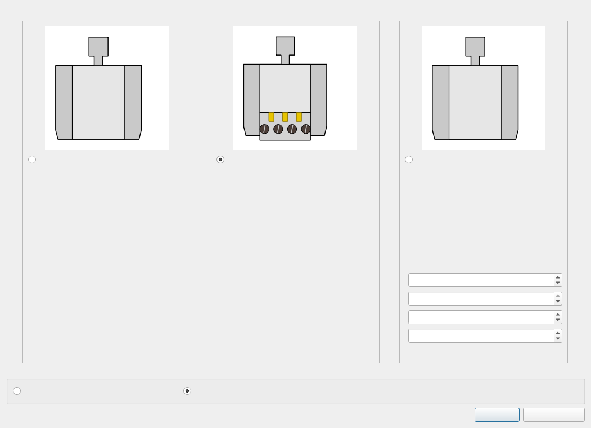

- **Standard Ta plate**: 18 × 15.5 mm back plate with an 11 mm wide raised part, 5.0 mm high.
- **Gating plate**: the same, with a contact block (3 gold pads, 4 screws); samples go only on the 11 × 10.5 mm above
  the block.
- **Custom plate**: the back plate with your own block (length, width, centre y and height from the back face; the height must be at least 4.5 mm: lower, the sample holder would touch the OSA).
- **Optic**: *zone plate + OSA* (95 eV only) or *capillary* (30–180 eV). The newest configuration made by the
  beamline staff for that optic is loaded (shown in the toolbar).

## Coordinates and motors

| name | meaning | range |
|---|---|---|
| x, y | position on the plate (mm), front view with the tab up, origin = centre of the back plate | – |
| H | sample height above the plate surface (mm) | – |
| ST | along the analyzer focal plane; ST < 0 moves the sample upper-left (top view) | −9 … 9 mm |
| SN | perpendicular to the analyzer focal plane; SN = 65 is the transfer position | −12 … 65 mm; below SN_f a collision can come first (see *Anti-collision*) |
| SZ | vertical | 35 … 45 mm |
| SRn | azimuth about the sample normal; SRn = 120°: plate vertical, tab up | usable 60 … 180° |
| SRz | rotation about the vertical; SRz = 0: plate parallel to the analyzer focal plane | usable −25 … +10° |
| PIX, PIY | piezo stage, 0 … 300 µm, centre 150 µm | – |

At the start orientation a plate point (x, y) comes onto the beam at **ST = ST0 − x, SZ = SZ0 − y**, and a sample of
height H is in the analyzer focus at **SN = SN_f + H** (ST0, SZ0, SN_f come from the configuration). The motor fields
refuse values outside the travel ranges.

## Samples tab: drawing the plate

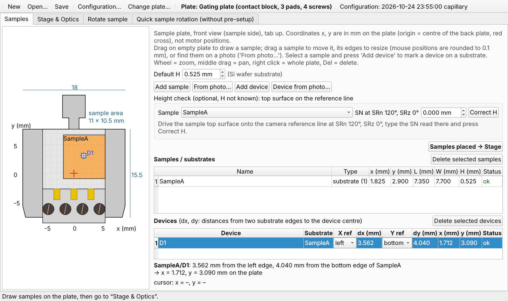

The picture shows the plate of the example after *From photo…* (next section): the substrate SampleA with its device
D1 (selected, blue marker). The red cross is the plate centre (x = y = 0); the grey frame is the
sample area (gating plate: 11 × 10.5 mm above the contact block).

- **Draw a sample**: drag on an empty part of the plate. **Move** it by dragging it, **resize** it by dragging an edge
  or corner (mouse positions are rounded to 0.1 mm). Or press *Add sample* and type the values.
- **Table**: name, x, y, length L, width W and height H can be typed exactly (typed values are not rounded).
  *Default H* is the height of new samples (0.525 mm: a standard Si wafer). *Type* says *sample*, or *substrate (n)*
  with the number of its devices.
- **Devices on a substrate**: select the substrate, press *Add device*, choose the two reference edges (*X ref*
  left/right, *Y ref* bottom/top) and the distances dx, dy to the device centre, or drag the blue marker. The table
  and the line under it also give the device position x, y on the plate. Devices move with their substrate. A
  substrate with devices is listed by its devices only in the target lists (e.g. *SampleA/D1*).
- **Device from photo…**: adds devices to the selected substrate from a microscope photo, without finding the samples
  again. The photo is matched on the corners of the substrate as drawn and the devices already on it (or on a plate
  photo used earlier while the program runs); the devices clicked are added, those already there are not changed.
- **Status**: `ok`, or what is wrong (outside the sample area, overlapping, device outside its substrate). Red items
  on the drawing have a problem.
- Wheel = zoom, middle drag = pan, right click = whole plate, Del = delete the selection (*Delete selected*). The
  line at the bottom gives the plate coordinates under the mouse.

### Samples from a photo

Instead of drawing, the samples can be found on a photo of the plate taken from straight above (sample side; a phone
photo is fine). Press **From photo…**:

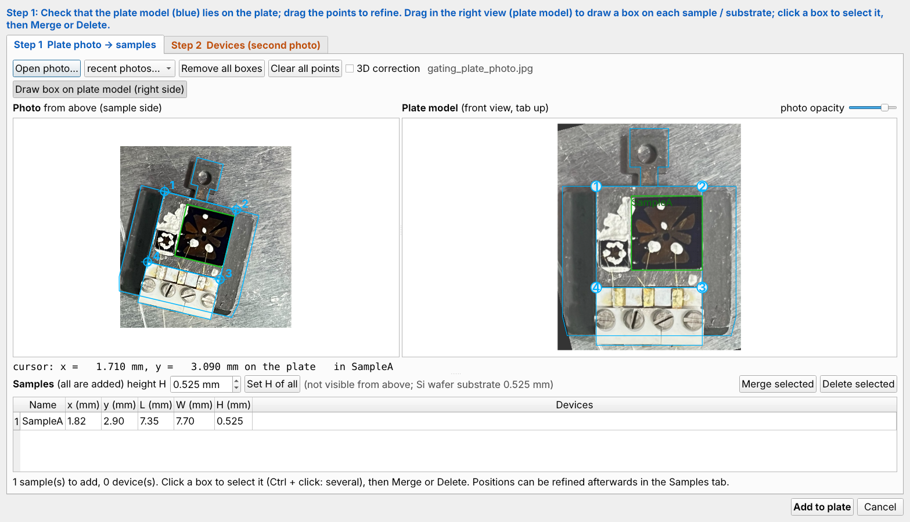

1. *Open photo…* (or a photo used earlier while the program runs, with its points, from *recent photos…*). The right
   view shows the plate model with the four corners of the sample area numbered **1–4**; the one to click next is
   **red**. Click that point on the photo, then the next red one (1 top left, 2 top right on the tab side, 3 bottom
   right, 4 bottom left; gating plate: 3 and 4 are where the sample area meets the contact block). Wheel = zoom (zoom
   in as far as needed to place the point), middle drag = pan, right click = whole photo; drag the markers afterwards
   to refine. *Undo last point* (Ctrl+Z) removes the last one, *Clear all points* starts again.
2. The photo is mapped onto the plate model (right view, blue outlines). Check that the outlines lie on the plate.
   The cursor shows plate coordinates (x, y in mm) in the right view and on the photo.
   **3D correction (optional, off by default).** Four corners map the plane of the sample area exactly, from any
   angle. On a photo that is clearly not taken from straight above, things at other heights (a thick sample, the back
   plate) appear shifted. Tick **3D correction** before clicking: the program then asks for eight points at two
   heights (the four sample-area corners on the riser, then the two top corners of the back plate and the two top
   corners of the tab, 1.1 mm above the back face), fits a camera model to them and corrects the perspective at every
   height; the back plate outline is then drawn at its own height, and the instruction line gives how well the points
   fit (rms in pixels). For a photo from about straight above leave it off.
3. **Draw a box on each sample** in the right view (*Draw box on plate model*, on by default): drag from one corner of
   the sample to the opposite one, on the photo now lying under the plate model (*photo opacity* fades it). Boxes are
   rounded to 0.05 mm. A click selects a box (Ctrl + click: several); **Delete selected** (or Del) removes it,
   **Merge selected** joins boxes drawn on the pieces of one sample, *Remove all boxes* starts again. In the example
   one box is drawn on the substrate (green); its name is typed in the table (S1 → SampleA); the *Devices* column
   counts the devices marked in tab 2.
4. Check the boxes against the photo once more: every box in the list is added.
5. Enter the **height H** (it cannot be seen from above; default: *Default H*), per sample in the table or with *Set H
   of all*.
6. Optionally locate the devices on a second photo (tab 2, below), then press **Add to plate**. *Remove the samples
   already on the plate* replaces the present ones.

The boxes are in plate coordinates; they can then be moved, resized and given devices like drawn samples. The accuracy is set by the corner clicks (about 0.1–0.3 mm); *Found here* in the
Stage & Optics tab corrects the rest. Everything runs on the computer, nothing is sent anywhere.

**Placing the corners well.** The corners are those of the **raised part** (riser top = sample area), not of the
wider back plate below it. A worn or rounded corner is placed where the two straight edges, extended, meet. Check in
the right view that the blue outline follows the riser edges and the back plate all round: if one corner is off, the
whole plate is distorted.

#### Tab 2: devices from a second photo

The plate photo shows where a substrate is, but usually not its devices; a closer photo (microscope, camera) shows the
devices but often not the substrate edges. The two photos are matched by points you mark on both:

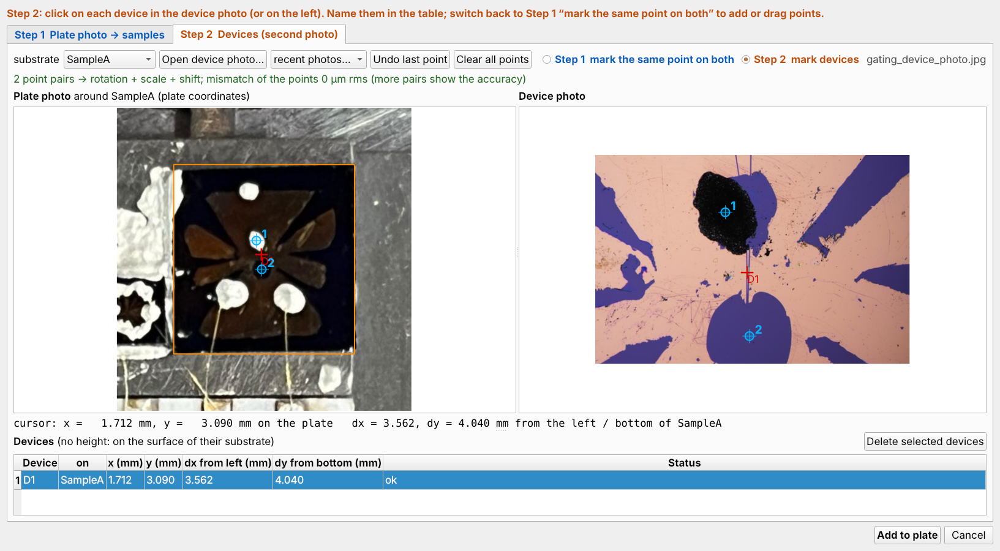

1. Choose the **substrate** (or select its box in tab 1). The left view shows the plate photo around it, already in
   plate coordinates. **Open device photo…** (right view).
2. *mark the same point on both*: click a feature on the left that you also see on the device photo (a paint dot, a
   pattern corner, a scratch), then the same feature on the right; numbered markers, draggable. With 2 pairs the device
   photo is placed by rotation + scale + shift, with 3 by an affine map, with 4 or more by a perspective map. The line
   above the views gives the mismatch of the points (µm): with more pairs than needed it shows a wrong point. The
   substrate outline (orange) is drawn on the device photo as a check.
3. *mark devices*: click on each device in the device photo (or on the left). The table gives its plate position, its
   substrate and dx, dy from the left / bottom substrate edges; rename the devices there, delete wrong ones. Devices have
   no height: they are on the surface of their substrate.
4. Another device photo (for another substrate, or another part) can be opened: the devices already marked keep their
   positions. *Add to plate* adds each device to the sample it lies on (devices on no sample are left out).

In the example the device photo is a microscope picture of the centre of SampleA. Two features are seen on both
photos: point **1**, the silver paint dot above the centre (a black blob under the microscope), and point **2**, the
round hole of the electrode pattern (the purple disc). D1 is then clicked on the flake of the channel between them:
x = 1.712, y = 3.090 mm. With only two pairs the mismatch is always 0 µm; a third pair, when one is visible, checks
the match.

The accuracy is that of the plate photo (corner clicks, 0.1–0.3 mm) plus the point matching.

#### Height check (H not known)

The height H of a sample is often not known or not measured. Below the table, *Height check*: drive the sample top
surface onto the **camera reference line** (the analyzer focal plane) at SRn = 120°, SRz = 0°, choose the sample, type
the **SN read there** and press **Correct H**. H is computed from this SN and SN_f of the configuration (by eye: about
±0.05 mm); the line below lists the samples checked. *Bring target onto the beam* then keeps this SN for the targets of
that sample (exact at SRn = 120°, SRz = 0°), and the start positions mark it *(H checked)*. Typing H by hand in the
table drops the check.

When all samples are drawn, press **Samples placed → Stage**.

## Stage & Optics tab: going to a sample

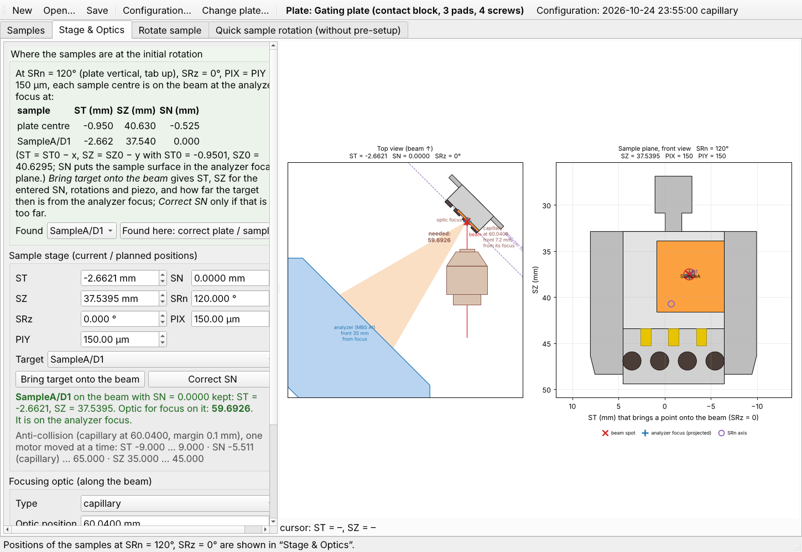

The green box lists, for every sample and device, the **ST / SZ / SN at the start orientation** (SRn = 120°,
SRz = 0°, PIX = PIY = 150 µm) that put its centre on the beam in the analyzer focus. In the example D1 is listed at
ST = −2.662, SZ = 37.540, SN = 0.000 (*plate centre* is the centre of the back plate, for reference).

1. Enter the current motor positions (absolute values, as on the control system). PIX, PIY are the piezo stage: the
   computations use them as entered (the start positions above are for the piezo centred).
2. Choose a **Target** and press **Bring target onto the beam**: ST and SZ are computed for the entered SN, SRn,
   SRz, PIX, PIY (**SN kept**, as the stage is usually run). The text below says how far the target then is from the
   analyzer focus along the beam (red above 50 µm: the spectra would be distorted) and the ΔSN that would remove it.
   Only if you judge it too far, press **Correct SN**: SN, ST, SZ that put the target on the analyzer focus (see
   [Correct SN](#correct-sn-putting-the-point-back-on-the-analyzer-focus)). If a motor would leave its range, or
   the plate would touch the optic or the analyzer, nothing is changed and you are told why. In the picture, D1 is
   brought onto the beam at SRn = 120°, SRz = 0°: with SN = 0 kept it is on the analyzer focus.
3. **Focusing optic**: *Type* is the optic in use (zone plate + OSA, or capillary); enter the optic position; press
   **Update schematic & optics**. The schematic shows the beam, the analyzer focus, the optic and the position
   **needed** for focus on the illuminated surface (in the picture the capillary is at 60.04, 59.6926 is needed).
4. **Move found sample to analyzer focal plane**: once a sample is found on the beam and focused by hand, enter the
   stage positions and the optic position (ZPS / CPS) where it is in focus and press it. With the configuration's
   optics reference, the optic position tells where along the beam the sample surface is; SN (ST compensating, so
   the point stays on the beam) brings it onto the analyzer focal plane and the optic is moved to keep it in focus.
   The line under the motors gives the new ST, SZ, SN, ΔSN and optic position, and where the point is on the plate.
   Refused, with nothing changed, if a motor would leave its range or the plate would touch something.

**The schematic** (redrawn only with *Update schematic & optics*):

- *Top view* (beam going up): the plate with its samples (orange) seen from above, the beam (red line, × = beam spot
  on the surface), the analyzer nose (blue) with its acceptance cone (light orange) and its focus (blue +), the
  analyzer focal plane (dashed purple), the optic with its focus (○) and its position. Parts the plate would touch
  are red.
- *Sample plane, front view*: the plate as seen along the beam, turned by SRn; the axes give the ST, SZ that bring
  a point onto the beam at SRz = 0. × = beam spot, blue + = analyzer focus projected on the surface, purple ○ = SRn
  axis. Moving the mouse over it shows (under the views) those ST, SZ, the plate position x, y and the sample there.

### Found here: correcting the drawing

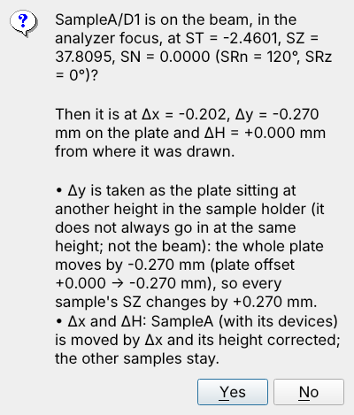

The photo (or the drawing) is good to 0.1–0.3 mm, so a device is usually found a little away from its listed
position. Once it is really **on the beam and in the analyzer focus**, enter the positions, choose the device under
*Found* and press **Found here: correct plate / sample**. The window asks for confirmation and gives the error of the
drawing (Δx, Δy on the plate, ΔH in height), then *Yes* applies it in two parts:

- **Δy (SZ)** is taken as the **plate** sitting at another height in the sample holder (it does not always go in at the
  same height): the whole plate moves, so the SZ of **every** sample changes by the same amount. The start positions
  show the *plate offset*; above 2.5 mm you are warned to check that the right sample was found. Choosing another
  plate resets it.
- **Δx and ΔH** correct only this sample (with all its devices); the other samples stay.

All predictions then use the corrected positions (saved with the session); the list of start positions is updated.

In the example D1 is found at ST = −2.4601, SZ = 37.8095, SN = 0 (SRn = 120°, SRz = 0°): it was drawn 0.20 mm too
far right, and the plate is 0.27 mm off in y (it was drawn 0.27 mm too high). A Δx or ΔH above 0.3 mm, or the same ST shift for every sample, suggests that the
configuration is outdated: tell the beamline staff. Use *Found here* at SRz = 0° when you can: there SN kept means
"in the analyzer focus"; after an SRz turn with SN kept the point is usually not in the analyzer focus, and ΔH would
be wrong.

### Anti-collision

After *Update*, the line under the motors gives the **collision-free range** of ST, SN and SZ at the entered positions
(one motor moved, the others and the optic kept) and what sets each limit, e.g. *SN −4.1 (OSA) … 65*. The top view
draws the analyzer nose (MBS A1, 35 mm from the focus), the zone plate and OSA (thin plates; the OSA stays where it is
when the zone plate refocuses) or the capillary at scale, in red when the plate touches them. *Bring target onto the
beam*, *Correct SN* and the Rotate tab refuse a position where the plate would touch something. Lowering SN brings the
surface towards the optic and the analyzer: SN is limited from below only. ST and SZ are free for a plate parallel to
the focal plane, and limited when SRz tilts it or when something stands out (gating plate screws). The dimensions are
estimates kept in the configuration: if you know better, type the **working distances** (OSA, zone plate or
capillary front from the focus) in the fields under the optic position (for this session). Keep a safe distance and
watch the camera.

## Rotate sample tab: turning without losing the sample

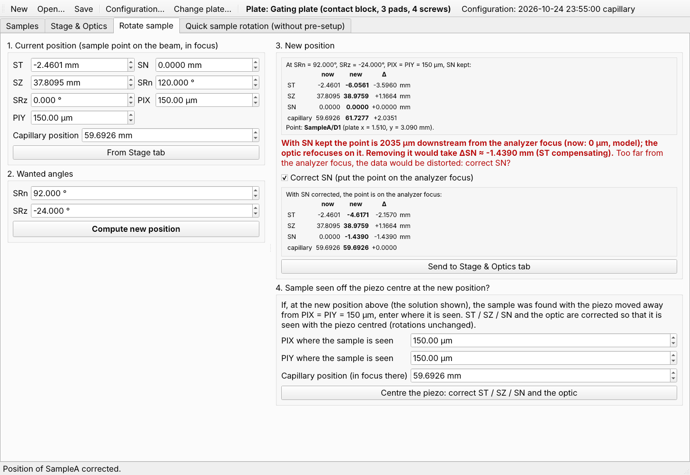

1. **Current position**: the positions with the point of interest on the beam and in focus, and the optic position
   (*From Stage tab* copies them).
2. **Wanted angles**: the new SRn and SRz (for a Brillouin-zone point, ask the agent: see
   [below](#finding-the-angles-for-a-brillouin-zone-point)).
3. **Compute new position**: ST and SZ with the piezo centred and **SN kept**, and the optic position that refocuses
   (the table gives *now*, *new* and the change Δ). The point followed is the plate point under the beam at the
   current position (*Point:* line: what lies there and its plate x, y). The text says how far the point then is from the analyzer focus, *downstream* (further along the
   beam) or *upstream*, and how far it is now according to the model (red above 50 µm: the spectra would be
   distorted). SRn alone keeps the surface plane; SRz does not.
4. Only if the point is too far from the focus, tick **Correct SN** to see SN, ST, SZ and the optic position that
   put the point **on the analyzer focus** (every new computation starts unticked; see the next section). If a
   motor range does not allow it, the closest reachable position is given with its distance from the focus.
5. **Send to Stage & Optics tab** takes the shown solution (ticked: the corrected one), refused if it is out of range
   or the plate would touch something.
6. **Sample seen off the piezo centre at the new position?** If, at the new position, the sample is found on a
   PIX / PIY map but not at the piezo centre (150 µm), enter the **PIX and PIY where it is seen** and the optic
   position in focus there, and press **Centre the piezo: correct ST / SZ / SN and the optic**. The table gives the
   ST / SZ (SN kept) and the optic position that show it with the piezo centred (the rotations do not change), and
   how far the sample moves along the beam; *Send corrected position to Stage & Optics tab* takes them.

**Example.** D1 is on the beam at SRn = 120°, SRz = 0° (ST = −2.4601, SZ = 37.8095, SN = 0, capillary 59.6926);
wanted: SRn = 92°, SRz = −24°. With SN kept, ST = −6.0561, SZ = 38.9759 and the capillary at 61.7277 put D1 back on
the beam, but 2035 µm downstream of the analyzer focus (red: the spectra would be distorted). With *Correct SN*:
ST = −4.6171, SZ = 38.9759, SN = −1.4390, the capillary unchanged: D1 on the analyzer focus. Ticked, *Send to Stage
& Optics tab*:

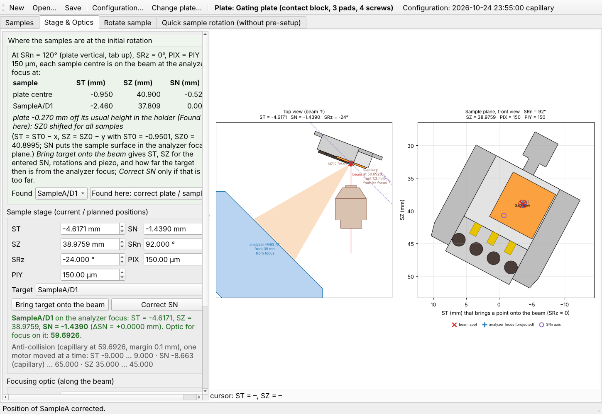

The Stage tab now shows D1 **found again** at the new angles: in the sample plane view the plate is turned by
SRn = 92° (28° from the start orientation) and the beam spot (×) is on D1, on the analyzer focus (+); the top view
shows the plate turned by SRz = −24°. *Bring target onto the beam* / *Correct SN* there give the same positions.

**Checked on the beamline**: at SRn = 92°, SRz = −24° with SN kept at 0, D1 was found at ST = −6.0479,
SZ = 38.9880, capillary 61.74, within 8 µm, 12 µm and 0.01 of the SN-kept prediction above: the sample is not lost
by the rotation, and the optic position for focus is given with it.

## Correct SN: putting the point back on the analyzer focus

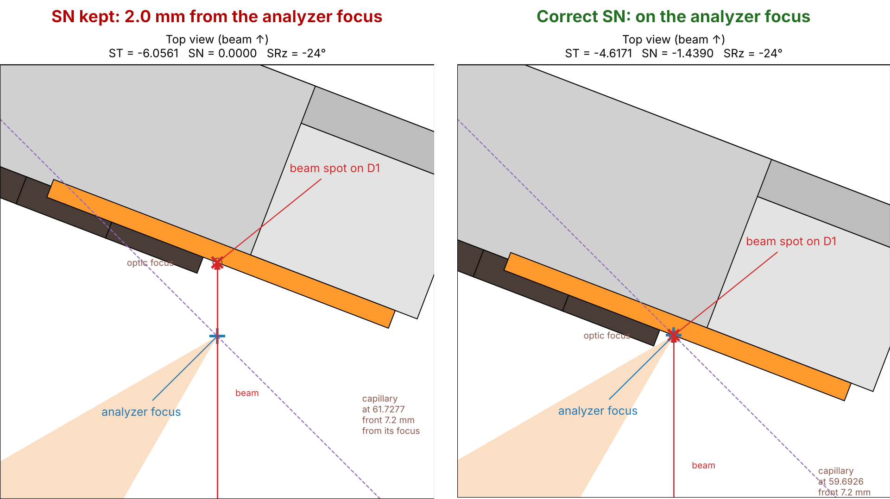

The analyzer collects electrons from one fixed point in space, the **analyzer focus** (blue +; the analyzer focal
plane is the "SN = 0" line of the camera). The measured point has to be on the beam **and** at that point.

- **ST and SZ** move the plate across the beam: they bring the point onto the beam line. Where along the beam the
  point then is depends on **SN**, which moves the plate along its normal (at 45° to the beam).
- **SRn** turns the plate about its own normal: the surface stays in its plane, the point stays on the analyzer
  focus once ST, SZ follow it.
- **SRz** turns the plate about a vertical axis that does not pass through the surface (in the present configuration
  it lies about 2.6 mm behind the riser top). With ST, SZ following and **SN kept**, the point stays on the beam but
  slides **along** it, away from the analyzer focus. The optic is refocused onto the point, so the beam spot stays
  small; but the electrons now come from a point off the analyzer focus: energy and angle scales are distorted and
  the intensity drops. Above 50 µm the program writes it in red.
- **Correct SN** moves SN, with ST compensating (SN is not along the beam), so that the point is back **on** the
  analyzer focus. The optic then goes back to where it focuses on the analyzer focus.

In the example (left: SN kept, right: Correct SN, both at SRn = 92°, SRz = −24°) the beam spot on D1 is 2.0 mm
downstream of the analyzer focus with SN kept; SN = −1.439 with ST = −4.617 puts it back, the capillary at 59.6926
as before the turn.

SN is kept by default because the stage is run that way (the surface stays on the camera line, the optic is
refocused), and because *Correct SN* is absolute: it relies on the configuration's SN_f and rotation axes. Use it
when the distance is red, and check the anti-collision line: a lower SN brings the surface towards the optic and the
analyzer. In the Stage tab, *Correct SN* is a button (for the chosen target at the entered angles); in the Rotate
tab, a tick box.

## Quick sample rotation: a sample found without any preparation

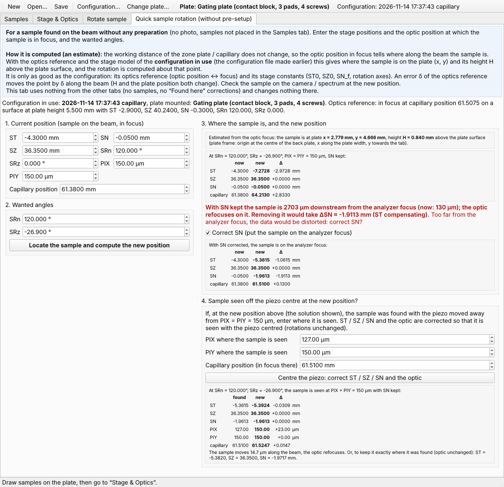

For a sample found on the beam **without any preparation**: no photo, no samples drawn in the Samples tab. Only the
stage positions and the optic position (ZPS / CPS) at which the sample is in focus are entered.

**How it works.** The working distance of the zone plate / capillary does not change, so the optic position in focus
tells where along the beam the sample surface is. With the optics reference and the stage model of the
**configuration in use** this gives where the sample is on the plate (x, y) and its height H, and the rotation is
computed about that point. The tab uses nothing from the other tabs (no samples, no *Found here* correction) and
changes nothing there. The line under the explanation gives the configuration and plate in use and the optics
reference.

1. **Current position**: ST, SZ, SN, SRn, SRz, PIX, PIY with the sample on the beam and in focus, and the optic
   position.
2. **Wanted angles**, then **Locate the sample and compute the new position**.
3. The result: where the sample is on the plate (x, y, H, estimated from the optic focus); the new ST / SZ with
   **SN kept** and the optic position that refocuses; how far the sample is then from the analyzer focus (red above
   50 µm); and, with **Correct SN** ticked, SN, ST, SZ and the optic that put it on the analyzer focus. A position
   out of range or where the plate would touch something is written in red.
4. **Sample seen off the piezo centre**, as in the Rotate sample tab (no *Send* button: the tab stays on its own).

**Example: Cav, 2026-11-14** (configuration 2026-11-14 17:37:43 capillary, gating plate). The graphene sample Cav was
found at SRn = 120°, SRz = 0° at ST = −4.30, SZ = 36.35, SN = −0.05, capillary CPS 61.38; it had to be turned to
SRz = −26.9° to bring the K point to the slit centre. From the CPS alone the tab places Cav at plate x = 2.779,
y = 4.666 mm, H = 0.840 mm. With SN kept the sample would be 2.7 mm downstream of the analyzer focus (red), with the
capillary refocused at 64.21; with *Correct SN*: ST = −5.3615, SZ = 36.35, SN = −1.9613, capillary 61.51 (back at the
analyzer focus). In step 4, a sample seen at PIX = 127 µm (23 µm off) gives ST −5.3924 with the piezo centred.

**How good it is.** It is an estimate: an error δ of the optics reference moves the point by δ along the beam. For
Cav, whose height was known better from its SN on the camera line (H = 0.748), the full prediction (Stage & Optics /
Rotate tabs) was ST = −5.238, SN = −2.002, and Cav was found there within 27 µm (next section); the quick estimate
is 0.12 mm from it, still well inside one 300 × 300 µm SPEM map. Check the sample on the camera / spectrum at the
new position, and use step 4 to centre it.

## How precise it is: tests at the beamline

Measured with the configurations of the calibrations of November 2026 (reports in
`RealSampleCalibration/docs/reports/`). Positions are read to ±0.02 mm; deviations were measured on SPEM maps
(300 × 300 µm, 10 µm steps).

| test | rotation | stage moved by | prediction error | focus |
|---|---|---|---|---|
| device D1 (gating plate), 2026-11-14 | SRn 120 → 150, SRz 0 → −10, SN corrected | 0.15 mm ST, 0.09 mm SZ, 0.15 mm SN | **22 µm** | capillary unchanged (61.51), same spectra |
| sample Cav (graphene), 2026-11-14 | SRz 0 → −26.9, SN corrected | 0.94 mm ST, 1.95 mm SN | **27 µm** | capillary unchanged (61.38), same spectra |
| calibration check points, 2026-11-14 | SRn 100, SRn 100 / SRz −5 (predicted before measuring) | – | ≤ **34 µm** | CPS 61.764 predicted, 61.76 found |
| Cav with the zone plate, 2026-11-15 | SRn 140 / SRz −15, SN kept | – | – | ZPS 54.30 predicted, **54.33** found |
| SampleA / D1 (this guide), 2026-10-24 | SRn 120 → 92, SRz 0 → −24, SN kept | 3.6 mm ST, 1.2 mm SZ | **8 µm / 12 µm** (ST / SZ) | capillary 61.73 predicted, 61.74 found |

So, once the first sample is found and corrected (*Found here*), a rotation keeps it **within 50 µm** — on the same
SPEM map — and the optic position (or the SN correction) keeps it **in focus**, even for SRz turns of 25° where the
point would otherwise slide 2–3 mm along the beam. On the photo alone the first sample is found within 0.1–0.3 mm
(D1 on 2026-11-14: 0.10 mm in x and y on a blurred photo). The predictions are only as good as the configuration:
if *Found here* moves a sample by more than 0.3 mm, or several samples by the same amount, tell the beamline staff.

## Finding the angles for a Brillouin-zone point

For 2-D hexagonal crystals, the question *"how much do I turn SRn and SRz so that K is at the centre of the slit,
the slit runs along Γ–K and the deflector stays near 0?"* is answered by the **agent** (tools `align_bz_angles` and
`align_bz_point_to`; there is no window for it in the program). Give it, read on the contour of a map in ARPES viewer
(θ = deflector angle, contour x; φ = angle along the slit, contour y): the SRn / SRz and photon energy of the map,
the angles of **Γ** and of **one K or M point**, the in-plane lattice constant a, the wanted point and slit direction,
and the photon energy of the new measurement. Then enter the SRn / SRz it gives under *Wanted angles*.

The point is *reachable* when, with the deflector at 0, it is within |θ| ≤ 5° and |φ| ≤ 5° of the slit centre, the
slit within 2° of the wanted line, with SRn 60 … 180° and SRz −25 … +10° (SRz ≤ 0 preferred: the beam is then closer
to the surface normal and the spot smaller).

### When it cannot be reached

The manipulator has **no tilt axis**. A consequence: with a point at the slit centre and the deflector at 0, the
slit always runs along the line from Γ to that point (Γ–K for K). A slit *across* it (K–M, M–K) needs the deflector
at the emission angle of the point (15–20° at 95 eV), which the analyzer cannot do well. The **radial alternative**:
K at the centre with the slit along Γ–K; the deflector direction then runs along K–M, so a short **deflector map**
(|θ| ≤ 5°) gives the K–M cut through K with little distortion.

When the emission angle is too large for the SRz range, a higher photon energy may make the point reachable:

- ANTARES: 30–180 eV with the **capillary**; the **zone plate works at 95 eV only**. Changing the photon energy with
  the zone plate means changing to the capillary (realignment, capillary configuration).
- If SRn is the limit, the sample has to be **turned on the plate** when remounting it.
- If nothing works, the sample has to be remounted, or another, equivalent point chosen.

| example (E_F, work function 4.5 eV) | emission angle of K at 30 / 95 / 180 eV | K, slit along Γ–K |
|---|---|---|
| WSe2, a = 3.282 Å, Γ–K = 1.28 Å⁻¹ | 29.6° / 15.2° / 10.8° | reachable at 95 eV with SRz ≈ −15° |
| graphene, a = 2.46 Å, Γ–K = 1.70 Å⁻¹ | 41.2° / 20.4° / 14.5° | 95 eV: SRz ≈ −20°; 30 eV: not reachable (needs ≥ ~61 eV) |

The signs between the stage and the ARPES viewer contour have been checked once (deflector sign, 2026-09); on the
first use of a new kind of measurement, check that the point appears where the agent says it will.

## Sessions, plate and configuration

- **New / Open… / Save** (toolbar): a session holds the plate, the samples and devices (with their corrections) and
  the motor positions, in one JSON file. The first *Save* asks for the file name. Files are written safely: if
  saving fails (disk full, no permission), the previous file stays intact and a message tells you why.
- **Change plate…**: another plate; the samples are kept and misplaced ones are flagged.
- **Configuration…**: read-only view of the configuration in use (stage constants and optics reference), made by
  the beamline staff. An older configuration can be chosen for this session. Under *Motor limits* the min / max of
  ST, SZ, SN, SRn and SRz can be changed by hand (*Defaults* restores the built-in ones); *Apply limits* uses them for
  the input fields, the out-of-range and the anti-collision checks, and saves them in `configs/motor_limits.json`
  for the next starts.

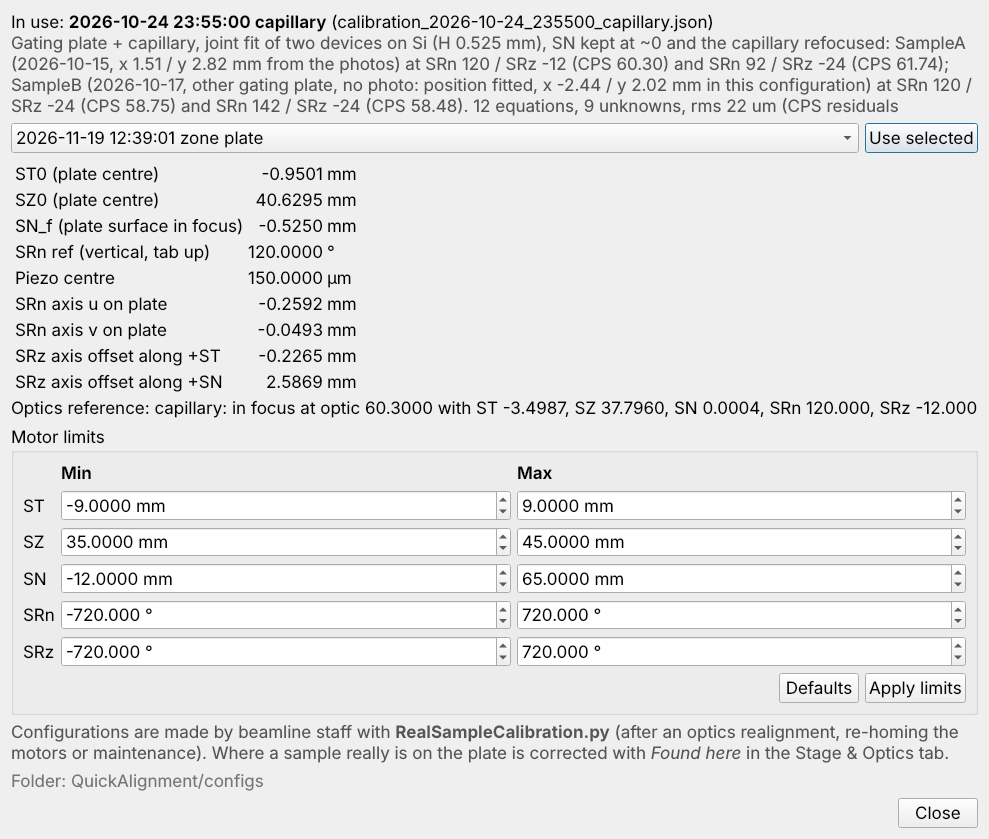

## A typical beamtime

1. Start QuickAlignment, confirm plate and optic.
2. Mark the samples on your mounting photo (*From photo…*), locate the devices on a microscope photo (tab 2), or draw
   them; or open the session prepared before the beamtime. Press *Samples placed → Stage*. (No time for this? Find
   the sample on the beam and use the *Quick sample rotation* tab.)
3. Go to the first sample or device with the listed ST / SZ / SN (SRn = 120°, SRz = 0°); find it with the beam
   (camera, photoemission map).
4. *Found here*: correct its position. The others now come out right too.
5. Measure a map at SRn = 120°, SRz = 0°; read Γ and one K / M point in ARPES viewer.
6. Ask the agent for the BZ point angles → *Wanted angles* → *Compute new position* (tick *Correct SN* if the point is
   more than 50 µm from the analyzer focus) → *Send to Stage & Optics tab*. If the sample is then seen off the
   piezo centre on a map, step 6 of the Rotate tab centres it.
7. Save the session.

## Messages and what to do

| message | meaning / what to do |
|---|---|
| *Out of range: ST = … (range …)* | the point cannot be reached at these angles; choose other angles or use the corrected solution; if the stage really travels further, set the limits in *Configuration… → Motor limits* |
| *Collision: the plate would touch …* | at that position the plate (or a sample, a screw) would hit the optic or the analyzer; nothing is changed: choose another position, or move the optic back |
| *… in the analyzer acceptance cone: it would shadow the electrons* | the optic stands in the path of the electrons to the analyzer; move it out |
| *… µm from the analyzer focus* (red) | after an SRz turn the point left the focal plane: tick *Correct SN* |
| *Correct the plate / sample position?* | *Found here*: check the positions and the device; *Yes* moves the plate by Δy (all samples) and the sample by Δx, ΔH |
| *Found here* moves a sample by > 0.3 mm | the drawing was off, or the configuration is outdated (motors re-homed): ask the staff |
| *The beam misses the plate* | ST / SZ do not put the beam on the plate |
| *Check the input: Γ–K on the map is …* | lattice constant, point or photon energy does not match the map |
| *An unexpected error occurred* | the program keeps running; check the last result, save the session and send the details to the staff |
