# QuickAlignment — Guide de l'utilisateur

Ligne ANTARES (SOLEIL) · retrouver les échantillons sur la plaquette, les garder sous le faisceau en tournant, et
choisir la rotation pour un point de la zone de Brillouin

## Sommaire

1. [Ce que fait QuickAlignment](#ce-que-fait-quickalignment)
2. [Démarrer le programme](#démarrer-le-programme)
3. [Coordonnées et moteurs](#coordonnées-et-moteurs)
4. [Onglet Samples : dessiner la plaquette](#onglet-samples--dessiner-la-plaquette)
5. [Onglet Stage & Optics : aller sur un échantillon](#onglet-stage--optics--aller-sur-un-échantillon)
6. [Onglet Rotate sample : tourner sans perdre l'échantillon](#onglet-rotate-sample--tourner-sans-perdre-léchantillon)
7. [Correct SN : remettre le point au foyer de l'analyseur](#correct-sn--remettre-le-point-au-foyer-de-lanalyseur)
8. [Quick sample rotation : un échantillon trouvé sans préparation](#quick-sample-rotation--un-échantillon-trouvé-sans-préparation)
9. [Quelle précision : tests sur la ligne](#quelle-précision--tests-sur-la-ligne)
10. [Trouver les angles pour un point de la zone de Brillouin](#trouver-les-angles-pour-un-point-de-la-zone-de-brillouin)
11. [Sessions, plaquette et configuration](#sessions-plaquette-et-configuration)
12. [Un temps de faisceau type](#un-temps-de-faisceau-type)
13. [Messages et que faire](#messages-et-que-faire)

---

## Ce que fait QuickAlignment

Sur ANTARES le faisceau est micrométrique ou plus petit, alors que la plaquette fait 18 × 15,5 mm. QuickAlignment
traduit la géométrie de la plaquette et des échantillons en **positions moteurs** :

- où se trouve chaque échantillon ou dispositif à l'orientation de départ (ST, SZ, SN à SRn = 120°, SRz = 0°) ;
- les ST / SN / SZ et la position de l'optique qui mettent un échantillon sous le faisceau, au foyer de l'analyseur ;
- après une rotation (SRn, SRz), les positions qui ramènent le même point sous le faisceau, avec la position de
  l'optique qui le garde au point ;
- pour un échantillon trouvé sous le faisceau sans aucune préparation (sans photo), la même chose après une
  rotation, à partir de la seule position de l'optique (onglet *Quick sample rotation*) ;
- pour un cristal hexagonal 2D (graphène, WSe2, …), les SRn / SRz qui amènent Γ, K ou M au centre de la fente, et
  que faire quand la platine ne peut pas les atteindre.

Le programme ne déplace jamais de moteur : il calcule des nombres, que vous entrez dans le contrôle-commande de la ligne.

**L'exemple de ce guide.** Toutes les images suivent un cas réel : une **plaquette gating** portant le substrat
**SampleA** (Si, H = 0,525 mm) et son dispositif **D1**, mesurés avec le **capillaire** en octobre 2026 (avec la
configuration de ce temps de faisceau, 2026-10-24 23:55). Le substrat est marqué sur une photo de téléphone de la
plaquette, D1 sur une photo au microscope ; D1 est amené sous le faisceau à l'orientation de départ, sa position est
corrigée une fois trouvé, puis la plaquette est tournée à SRn = 92°, SRz = −24°, où D1 a été retrouvé sur la ligne à
la position prédite. L'onglet *Quick sample rotation* est montré sur l'échantillon de graphène **Cav** du rapport de
calibration du 2026-11-14.

## Démarrer le programme

Installation (une fois) : `pip install PyQt5 numpy matplotlib`. Puis double-cliquer sur **`QuickAlignment.py`**
(Windows : `QuickAlignment.pyw`, sans console), ou lancer `python QuickAlignment/QuickAlignment.py [session.json]`.

À chaque démarrage le programme demande quelle **plaquette** est montée et quelle **optique de focalisation** est
utilisée :

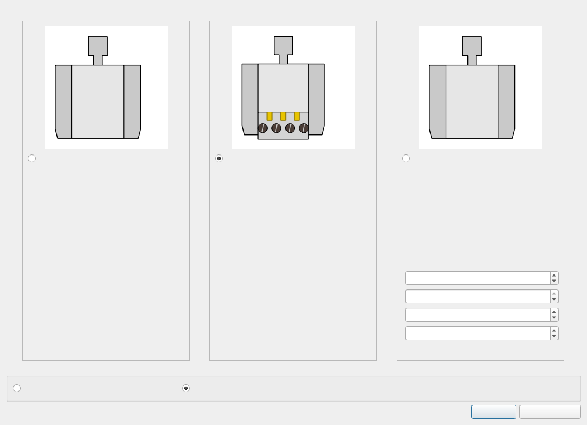

- **Standard Ta plate** : plaquette de 18 × 15,5 mm avec une rehausse de 11 mm de large, hauteur 5,0 mm.
- **Gating plate** : la même, avec un bloc de contact (3 plots en or, 4 vis) ; les échantillons vont seulement sur
  les 11 × 10,5 mm au-dessus du bloc.
- **Custom plate** : la plaquette de base avec votre propre bloc (longueur, largeur, centre y, hauteur depuis la face
  arrière ; au moins 4.5 mm : plus bas, le porte-échantillon toucherait l'OSA).
- **Optique** : *zone plate + OSA* (95 eV uniquement) ou *capillary* (30–180 eV). La configuration la plus récente
  faite par le personnel de la ligne pour cette optique est chargée (affichée dans la barre d'outils).

## Coordonnées et moteurs

| nom | signification | plage |
|---|---|---|
| x, y | position sur la plaquette (mm), vue de face, languette en haut, origine = centre de la plaquette | – |
| H | hauteur de l'échantillon au-dessus de la surface de la plaquette (mm) | – |
| ST | le long du plan focal de l'analyseur ; ST < 0 déplace l'échantillon vers le haut à gauche (vue de dessus) | −9 … 9 mm |
| SN | perpendiculaire au plan focal de l'analyseur ; SN = 65 est la position de transfert | −12 … 65 mm ; sous SN_f une collision peut venir avant (voir *Anticollision*) |
| SZ | vertical | 35 … 45 mm |
| SRn | azimut autour de la normale ; SRn = 120° : plaquette verticale, languette en haut | utilisable 60 … 180° |
| SRz | rotation autour de la verticale ; SRz = 0 : plaquette parallèle au plan focal | utilisable −25 … +10° |
| PIX, PIY | platine piézo, 0 … 300 µm, centre 150 µm | – |

À l'orientation de départ, un point (x, y) de la plaquette est sous le faisceau à **ST = ST0 − x, SZ = SZ0 − y**, et
un échantillon de hauteur H est au foyer de l'analyseur à **SN = SN_f + H** (ST0, SZ0, SN_f viennent de la
configuration). Les champs moteurs refusent les valeurs hors course.

## Onglet Samples : dessiner la plaquette

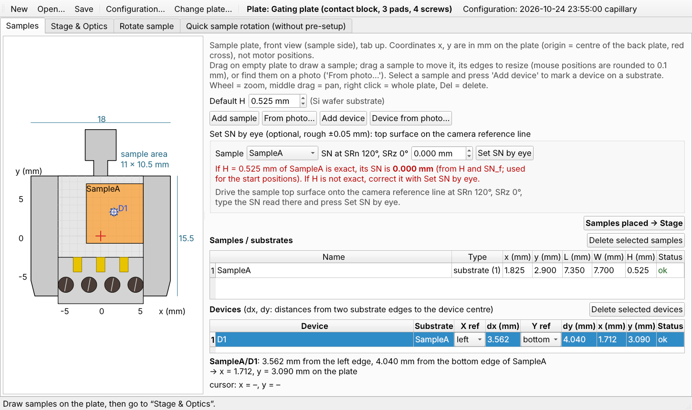

L'image montre la plaquette de l'exemple après *From photo…* (section suivante) : le substrat SampleA avec son
dispositif D1 (sélectionné, repère bleu). La croix rouge est le centre de la plaquette
(x = y = 0) ; le cadre gris est la zone d'échantillons (plaquette gating : 11 × 10,5 mm au-dessus du bloc de contact).

- **Dessiner un échantillon** : glisser sur une partie vide de la plaquette. Le **déplacer** en le faisant glisser,
  le **redimensionner** par un bord ou un coin (positions arrondies à 0,1 mm). Ou *Add sample* puis taper les valeurs.
- **Tableau** : nom, x, y, longueur L, largeur W et hauteur H se tapent exactement (non arrondis). *Default H* est la
  hauteur des nouveaux échantillons (0,525 mm : un wafer Si standard). *Type* indique *sample*, ou *substrate (n)*
  avec le nombre de ses dispositifs.
- **Dispositifs sur un substrat** : sélectionner le substrat, *Add device*, choisir les deux bords de référence
  (*X ref* left/right, *Y ref* bottom/top) et les distances dx, dy au centre du dispositif, ou faire glisser le repère
  bleu. Le tableau et la ligne en dessous donnent aussi la position x, y du dispositif sur la plaquette. Les
  dispositifs suivent leur substrat ; un substrat avec dispositifs n'apparaît que par ses dispositifs dans les listes
  de cibles (par ex. *SampleA/D1*).
- **Device from photo…** : ajoute des dispositifs au substrat sélectionné depuis une photo au microscope, sans
  retrouver les échantillons. Comme dans l'onglet 2, la même direction tracée sur les deux (par ex. le long d'un bord
  du substrat) fixe l'orientation, puis des paires de points sur les coins du substrat tel qu'il est dessiné et sur
  les dispositifs déjà placés (les clics s'y accrochent) fixent l'échelle et la position par moindres carrés, sans
  déformer la photo (ou appariement sur une photo de plaquette utilisée plus tôt pendant que le programme tourne) ;
  les dispositifs cliqués sont ajoutés, ceux déjà présents ne changent pas.
- **Status** : `ok`, ou le problème (hors de la zone, chevauchement, dispositif hors du substrat). Les éléments rouges
  du dessin ont un problème.
- Molette = zoom, bouton du milieu = déplacer, clic droit = plaquette entière, Suppr = effacer la sélection (*Delete
  selected*). La ligne du bas donne les coordonnées plaquette sous la souris.

### Échantillons depuis une photo

Au lieu de les dessiner, les échantillons peuvent être trouvés sur une photo de la plaquette prise d'en haut (côté
échantillons ; une photo de téléphone suffit). Appuyer sur **From photo…** :

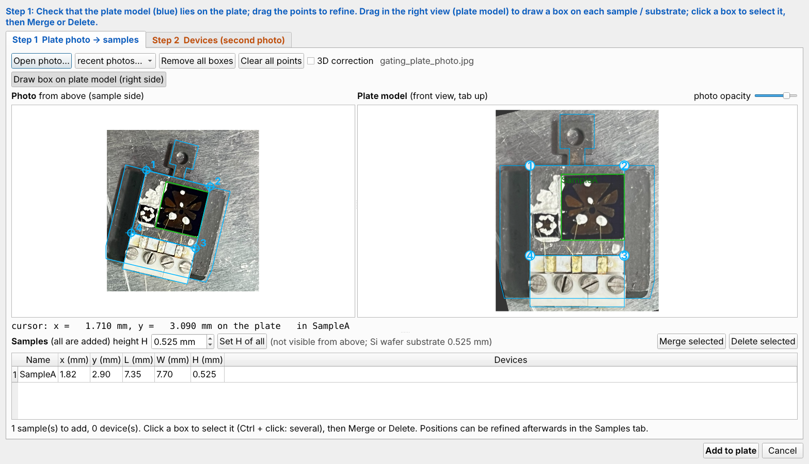

1. *Open photo…* (ou une photo déjà utilisée pendant que le programme tourne, avec ses points, dans *recent
   photos…*). La vue de droite montre le modèle de la plaquette avec les quatre coins de la zone d'échantillons
   numérotés **1–4** ; celui à cliquer ensuite est en **rouge**. Cliquer ce point sur la photo, puis le rouge suivant
   (1 haut gauche, 2 haut droit côté languette, 3 bas droit, 4 bas gauche ; plaquette gating : 3 et 4 sont où la zone
   rencontre le bloc de contacts). Molette = zoom (zoomer autant que nécessaire pour placer le point), bouton du milieu
   = déplacer, clic droit = photo entière ; faire glisser les repères ensuite pour affiner. *Undo last point* (Ctrl+Z)
   retire le dernier point, *Clear all points* recommence.
2. La photo est projetée sur le modèle de la plaquette (vue de droite, contours bleus). Vérifier que les contours sont
   sur la plaquette. Le curseur donne les coordonnées plaquette (x, y en mm) dans la vue de droite et sur la photo.
   **Correction 3D (optionnelle, désactivée par défaut).** Quatre coins projettent exactement le plan de la zone
   d'échantillons, quel que soit l'angle. Sur une photo nettement prise de biais, ce qui est à une autre hauteur (un
   échantillon épais, la plaque de base) apparaît décalé. Cocher **3D correction** avant de cliquer : le programme
   demande alors huit points à deux hauteurs (les quatre coins de la zone sur la rehausse, puis les deux coins hauts de
   la plaque de base et les deux coins hauts de la languette, à 1,1 mm de la face arrière), ajuste un modèle de caméra
   et corrige la perspective à toutes les hauteurs ; le contour de la plaque de base est alors dessiné à sa hauteur et
   la ligne d'instructions indique l'accord des points (rms en pixels). Pour une photo prise à peu près à la verticale,
   la laisser désactivée.
3. **Dessiner un cadre sur chaque échantillon** dans la vue de droite (*Draw box on plate model*, actif par défaut) :
   glisser d'un coin de l'échantillon au coin opposé, sur la photo placée sous le modèle (*photo opacity* règle sa
   transparence). Les cadres sont arrondis à 0,05 mm. Un clic sélectionne un cadre (Ctrl + clic : plusieurs) ;
   **Delete selected** (ou Suppr) le retire, **Merge selected** réunit les cadres dessinés sur les morceaux d'un même
   échantillon, *Remove all boxes* recommence. Dans l'exemple un cadre est dessiné sur le substrat (vert) ; son nom se
   tape dans le tableau (S1 → SampleA) ; la colonne *Devices* compte les dispositifs marqués dans l'onglet 2.
4. Comparer encore une fois les cadres à la photo : tous les cadres de la liste sont ajoutés.
5. Entrer la **hauteur H** (invisible d'en haut ; par défaut *Default H*), par échantillon dans le tableau ou avec
   *Set H of all*.
6. Si besoin, placer les dispositifs sur une deuxième photo (onglet 2, ci-dessous), puis **Add to plate**. *Remove the
   samples already on the plate* remplace les échantillons présents.

Les cadres sont en coordonnées plaquette ; ils se déplacent, se redimensionnent et reçoivent des dispositifs comme les échantillons dessinés. La précision dépend des clics sur les
coins (environ 0,1–0,3 mm) ; *Fine tunings by ZPS/CPS* dans l'onglet Stage & Optics corrige le reste. Tout est calculé sur
l'ordinateur, rien n'est envoyé.

**Bien placer les coins.** Ce sont les coins de la **partie surélevée** (dessus de la rehausse = zone d'échantillons),
pas ceux de la plaque de fond, plus large, en dessous. Un coin usé ou arrondi se place à l'intersection des deux bords
droits prolongés. Vérifier dans la vue de droite que le contour bleu suit les bords de la rehausse et la plaque de
fond tout autour : si un coin est faux, toute la plaquette est déformée.

#### Onglet 2 : dispositifs sur une deuxième photo

La photo de la plaquette montre où est un substrat, mais rarement ses dispositifs ; une photo plus proche (microscope,
appareil) montre les dispositifs mais souvent pas les bords du substrat, et elle n'est souvent pas tournée comme la
photo de la plaquette. Les deux photos sont mises en correspondance en deux temps : la même direction tracée sur les deux
fixe l'orientation, puis des points marqués sur les deux fixent l'échelle et la position :

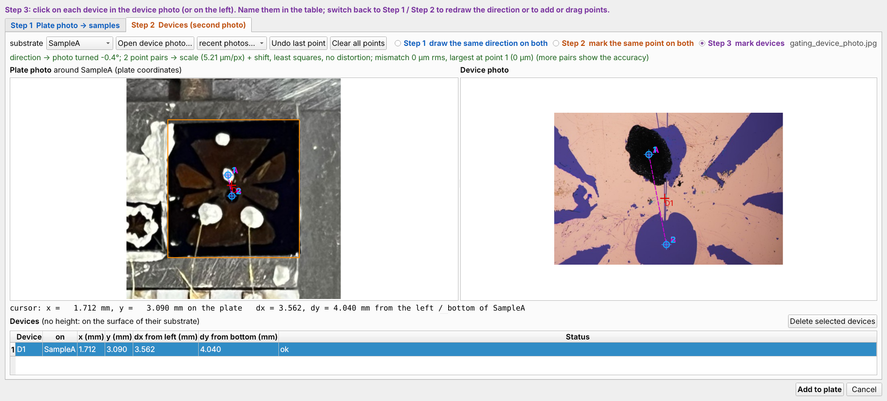

1. Choisir le **substrat** (ou sélectionner son cadre dans l'onglet 1). La vue de gauche montre la photo de la
   plaquette autour de lui, déjà en coordonnées plaquette. **Open device photo…** (vue de droite).
2. *Step 1 draw the same direction on both* : sur chaque photo, cliquer deux points **A**, **B** le long d'un élément
   droit visible sur les deux (un bord du substrat, une longue ligne du motif, ou l'axe passant par deux détails),
   d'abord à gauche, puis sur la photo des dispositifs. **Seule la direction compte** : A et B n'ont pas besoin d'être
   les mêmes endroits sur les deux photos (un bord plus long que la photo des dispositifs convient), mais A → B doit
   pointer dans le même sens sur les deux (en sens inverse cela marche aussi : la photo est alors tournée de 180° de
   plus). Prendre les points éloignés : plus ils le sont, plus l'angle est précis. Les lignes de direction (tirets
   magenta) donnent l'angle de la photo des dispositifs sur la plaquette ; faire glisser leurs points pour ajuster, un
   troisième clic d'un côté retrace la ligne de ce côté. Quand les deux sont tracées, Step 2 est sélectionné.
3. *Step 2 mark the same point on both* : cliquer à gauche un détail visible aussi sur la photo des dispositifs (point
   de laque, coin d'un motif, rayure), puis le même détail à droite ; repères numérotés, déplaçables. Il faut au moins
   2 paires. La photo des dispositifs est seulement **tournée (par la direction), mise à l'échelle et déplacée**, jamais
   déformée : l'échelle et la translation sont celles pour lesquelles l'écart total de toutes les paires est le plus
   petit (moindres carrés). La photo de la plaquette a une faible résolution, chaque clic y est donc un peu décalé :
   plus de paires moyennent ces erreurs, au lieu de tordre la photo comme le ferait un ajustement passant par chaque
   point. La ligne au-dessus des vues donne l'angle, l'échelle (µm par pixel), l'écart des points (µm rms) et le point
   le plus décalé : un grand écart révèle un point faux. Avec 3 paires ou plus, elle avertit aussi quand les points
   seuls tourneraient la photo de plus de 2° par rapport à la direction (les lignes de direction ne suivent sans doute pas le
   même élément sur les deux). Le contour du substrat (orange) est tracé sur la photo des dispositifs pour vérifier.
4. *Step 3 mark devices* : cliquer chaque dispositif sur la photo des dispositifs (ou à gauche). Le tableau donne sa
   position sur la plaquette, son substrat et dx, dy aux bords gauche / bas du substrat ; y renommer les dispositifs,
   effacer les faux. Les dispositifs n'ont pas de hauteur : ils sont à la surface de leur substrat.
5. Une autre photo de dispositifs (autre substrat, autre partie) peut être ouverte : les dispositifs déjà marqués
   gardent leur position, la direction et les points recommencent. *Undo last point* (Ctrl+Z) enlève le dernier point
   cliqué (un point d'une ligne de direction s'il n'y a pas de paire) ; *Clear all points* enlève les lignes de
   direction et les paires.
   *Add to plate* ajoute chaque dispositif à l'échantillon sur lequel il se trouve (ceux hors de tout échantillon sont
   écartés).

Dans l'exemple, la photo des dispositifs est une image au microscope du centre de SampleA. Deux détails se voient
sur les deux photos : la goutte de laque d'argent au-dessus du centre (une tache noire au microscope) et le trou rond du motif d'électrodes (le disque violet). La direction est tracée le
long de l'axe du canal, de la goutte (A) au trou (B), et ces deux mêmes détails sont les paires **1** et **2**. D1 est
ensuite cliqué sur le flocon du canal entre les deux : x = 1,712, y = 3,090 mm. Avec deux paires seulement l'écart vaut
toujours 0 µm ; une troisième paire, quand un détail s'y prête, vérifie la correspondance et moyenne les erreurs de
clic.

La précision est celle de la photo de la plaquette (clics des coins, 0,1–0,3 mm) plus celle de la mise en
correspondance.

#### Set SN by eye (H inconnue, estimation)

La hauteur H d'un échantillon est souvent inconnue ou non mesurée. Sous le tableau, *Set SN by eye* : amener la
surface de l'échantillon sur la **ligne de référence de la caméra** (plan focal de l'analyseur) à SRn = 120°,
SRz = 0°, choisir l'échantillon, entrer le **SN lu à cet endroit** et appuyer sur **Set SN by eye**. H est calculée à
partir de ce SN et du SN_f de la configuration (à l'œil : environ ±0,05 mm) ; la ligne en dessous liste les
échantillons réglés. *Bring target onto the beam* garde ensuite ce SN pour les cibles de cet échantillon (exact à
SRn = 120°, SRz = 0°), et les positions de départ le marquent *(by eye)*. Entrer H à la main dans le tableau
l'annule. C'est une estimation : une fois l'échantillon trouvé et focalisé, *Fine tunings by ZPS/CPS* (onglet Stage &
Optics) corrige H précisément.

**Quel SN est utilisé.** Quand H est connue exactement (par ex. une plaquette d'épaisseur connue), le SN en découle et
n'a pas besoin d'être réglé à l'œil : pour l'échantillon choisi, la ligne sous le champ SN indique en rouge *If H = …
mm of S1 is exact, its SN is … mm (from H and SN_f; used for the start positions). If H is not exact, correct it with
Set SN by eye.* (SN = SN_f + dessus de la plaquette − 5,0 + H.) Les positions de départ utilisent **le SN tiré de H**
(marqué *(from H)*, ou *(exact H)* une fois H confirmée exacte dans Stage & Optics : la ligne passe au vert) **sauf si
un SN a été réglé à l'œil** : ce SN est alors utilisé (marqué *(by eye)*, ligne verte : *the SN set by eye … is used*).

Une fois les échantillons dessinés, appuyer sur **Samples placed → Stage**. Si un échantillon a un SN réglé à l'œil, ou
si un SN est entré dans le champ sans être réglé, le programme demande d'abord si c'est bien le SN pour lequel la
surface est sur la ligne de référence ; *No* (valeurs réglées) ou *Cancel* (valeur entrée) permet de rester sur
l'onglet pour corriger.

## Onglet Stage & Optics : aller sur un échantillon

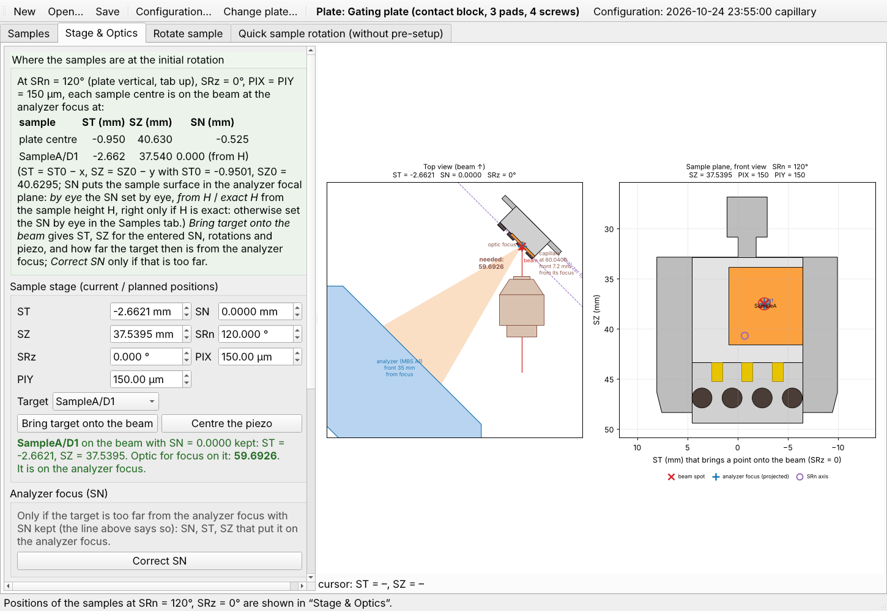

Le cadre vert donne, pour chaque échantillon et dispositif, les **ST / SZ / SN à l'orientation de départ**
(SRn = 120°, SRz = 0°, PIX = PIY = 150 µm) qui mettent son centre sous le faisceau, au foyer de l'analyseur. Dans
l'exemple D1 est listé à ST = −2.662, SZ = 37.540, SN = 0.000 (*plate centre* est le centre de la plaque de fond,
pour repère).

1. Entrer les positions moteurs actuelles (valeurs absolues, comme dans le contrôle-commande). PIX, PIY sont la
   platine piézo (les positions de départ ci-dessus sont pour le piézo centré).
2. Choisir une **Target** et appuyer sur **Bring target onto the beam** : ST et SZ sont calculés pour les SN, SRn,
   SRz entrés, avec le **piézo centré** (PIX = PIY = 150 µm, même si les champs gardent une position de scan de
   l'échantillon précédent) et **SN gardé**, comme d'habitude. Le texte indique la distance de la cible au foyer de
   l'analyseur le long du faisceau (en rouge au-delà de 50 µm : les spectres seraient déformés) et le ΔSN qui
   l'annulerait. Seulement si elle est jugée trop grande, **Correct SN** (cadre *Analyzer focus (SN)* sous la platine) donne SN, ST, SZ qui mettent la cible au
   foyer de l'analyseur (voir [Correct SN](#correct-sn--remettre-le-point-au-foyer-de-lanalyseur)). Si un moteur sortait de sa course, ou si la plaquette touchait
   l'optique ou l'analyseur, rien n'est changé et la raison est donnée. **Centre the piezo** (à côté de *Bring
   target onto the beam*) : quand l'échantillon apparaît dans un scan PIX / PIY loin de 150 / 150 µm, entrer ces PIX,
   PIY (et la position de l'optique au point) puis appuyer : les ST / SZ qui le montrent piézo centré aux mêmes SRn,
   SRz (SN gardé) et l'optique refocalisée sont mis dans les champs, comme la dernière étape de Rotate sample. Sur
   l'image, D1 est amené sous le faisceau à
   SRn = 120°, SRz = 0° : avec SN = 0 gardé, il est au foyer de l'analyseur.
3. **Optique** : *Type* est l'optique utilisée (zone plate + OSA, ou capillaire) ; entrer sa position et appuyer sur
   **Update schematic & optics**. Le schéma montre le faisceau, le foyer de l'analyseur, l'optique et la position
   **nécessaire** pour focaliser sur la surface éclairée (sur l'image le capillaire est à 60.04, il faut 59.6926).
4. **Fine tunings by ZPS/CPS** (principe : la distance focale de l'optique est fixe, donc le ZPS / CPS du foyer corrige
   la hauteur de l'échantillon et le ramène au foyer de l'analyseur) : une fois un échantillon trouvé sous le faisceau
   et focalisé à la main, choisir la *Target* sous le faisceau, entrer les positions de la platine et la position de
   l'optique (ZPS / CPS) où il est au foyer, puis appuyer. Avec la référence optique de la configuration, la position
   de l'optique indique où se trouve la surface le long du faisceau. Ensuite :
   - **Position et H corrigées.** À SRz 0 le foyer donne où est vraiment la *Target*, indépendamment des axes de
     rotation : Δx et ΔH de son échantillon et Δy de la plaquette (voir
     [plus bas](#fine-tunings-by-zpscps-à-srz-0--corriger-le-dessin) ; ΔH à environ ±0,014 mm avec la zone plate,
     ±0,07 mm avec le capillaire) ; le programme demande d'abord, et ne propose rien si c'est déjà juste (moins de
     0,001 mm en x, y et 0,002 mm en H). Après une rotation SRz, H seulement :
     si l'optique s'écarte de plus de 0,05 mm de la prédiction, le programme cherche un ΔH qui explique ensemble les
     écarts de ST, SZ et de l'optique ; s'il en trouve un (écarts restants ≤ 0,03 mm) il propose de corriger H, sinon H
     reste et la ligne de résultat indique les causes probables (position sur la plaquette → ce bouton à SRz 0 ;
     axe SRz ou SN_f → le personnel de la ligne).
   - **Retour au foyer de l'analyseur.** SN (ST compensant, le point reste sous le faisceau ; SZ gardé) amène la
     surface dans le plan focal de l'analyseur, et l'optique revient à la position exacte de la configuration pour le
     foyer de l'analyseur. La ligne sous les moteurs donne les nouveaux ST, SZ, SN, ΔSN, ΔST et la position de
     l'optique, et où est le point sur la plaquette. Pas de déplacement si un moteur sortait de sa course ou si la
     plaquette touchait quelque chose (rien n'est alors corrigé non plus).
   - **Target's sample H** (au-dessus du bouton) affiche et règle la hauteur de l'échantillon de la *Target* (le même
     H que dans l'onglet Samples ; la taper annule un SN réglé à l'œil). La ligne en dessous dit d'où vient H : *du SN
     réglé à l'œil* (orange), *la hauteur par défaut des nouveaux échantillons* (rouge : sans doute jamais entrée, ce
     qu'on remarque souvent au moment du réglage fin) ou *exact* (vert). **H is exact: do not correct it** (décoché
     par défaut) : à cocher quand la hauteur est connue précisément, par ex. une plaquette de Si d'épaisseur connue
     montée à 0,02 mm près. Le réglage fin garde alors H et ne corrige que l'erreur de la photo : la *Target* est prise
     là où le faisceau rencontre sa surface à cette hauteur (Δx de son échantillon, Δy de la plaquette), et SN amène
     cette surface au foyer de l'analyseur. Le foyer de l'optique est seulement comparé à H (affiché dans la fenêtre,
     signalé au-delà de 3 σ) ; après une rotation SRz, pas de contrôle de hauteur.
   - **Quelle hauteur l'emporte.** Confiance : une H exacte connue > le foyer ZPS / CPS > le SN réglé à l'œil. Une H
     n'est prise comme exacte qu'après confirmation : cocher *H is exact* (ou appuyer sur le bouton case cochée) pour
     une H venant du SN réglé à l'œil, par défaut ou pas encore confirmée demande *Is the sample height exact?* —
     *Yes, H = … is exact*, *Enter the known H…*, ou *Cancel* (la case est alors décochée, rien ne change). Une
     hauteur tapée dans le champ H case cochée est la hauteur connue. L'H exacte remplace le SN réglé à l'œil, qui ne
     sert plus que de contrôle : la ligne de résultat le compare au SN qui met l'H exacte au foyer de l'analyseur
     (écart de plus de 0,1 mm : vérifier SN_f de la configuration ou le montage). Sans *H is exact*, le foyer corrige
     H comme avant ; si H est encore la valeur par défaut ou vient du SN réglé à l'œil, la fenêtre de confirmation
     rappelle qu'on peut répondre *No*, entrer l'H connue, cocher *H is exact* et appuyer à nouveau.
   - **Undo fine tuning** annule le dernier réglage fin (ou le passage du SN réglé à l'œil à une H exacte) : position et hauteur de l'échantillon, plate offset, SN
     réglé à l'œil et champs de la platine et de l'optique reviennent à leur état d'avant. Appuyé à nouveau, il annule
     le précédent, jusqu'à l'état d'avant le premier réglage fin (par ex. le résultat de *Set SN by eye*).

   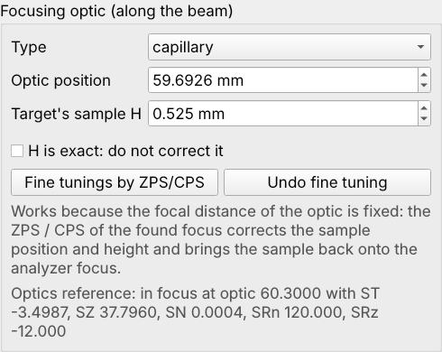

**Le schéma** (redessiné seulement avec *Update schematic & optics*) :

- *Top view* (vue de dessus, faisceau vers le haut) : la plaquette et ses échantillons (orange) vus d'en haut, le
  faisceau (ligne rouge, × = tache du faisceau sur la surface), le nez de l'analyseur (bleu) avec son cône
  d'acceptance (orange clair) et son foyer (+ bleu), le plan focal de l'analyseur (tirets violets), l'optique avec
  son foyer (○) et sa position. Les pièces que la plaquette toucherait sont en rouge.
- *Sample plane, front view* : la plaquette vue le long du faisceau, tournée de SRn ; les axes donnent les ST, SZ qui
  amènent un point sous le faisceau à SRz = 0. × = tache du faisceau, + bleu = foyer de l'analyseur projeté sur la
  surface, ○ violet = axe SRn. La souris sur cette vue donne (sous les vues) ces ST, SZ, la position x, y sur la
  plaquette et l'échantillon qui s'y trouve.

### Fine tunings by ZPS/CPS à SRz 0 : corriger le dessin

La photo (ou le dessin) est juste à 0,1–0,3 mm près : un dispositif se trouve donc en général un peu à côté de sa
position listée. Une fois qu'il est vraiment **sous le faisceau et focalisé** à SRz = 0°, le choisir comme *Target*,
entrer les positions de la platine et la position de l'optique (ZPS / CPS) et appuyer sur **Fine tunings by ZPS/CPS**.
La distance focale de l'optique est fixe : sa position indique où est la surface le long du faisceau. La fenêtre
demande confirmation et donne l'erreur du dessin (Δx, Δy sur la plaquette, ΔH en hauteur) ; *Yes* l'applique en deux
parties (puis la platine revient au foyer de l'analyseur, voir l'étape 4 ci-dessus) :

- **Δy (SZ)** est attribué à la **plaquette**, entrée à une autre hauteur dans le porte-échantillon (elle n'entre pas
  toujours à la même hauteur) : toute la plaquette se déplace, le SZ de **tous** les échantillons change d'autant. Les
  positions de départ affichent le *plate offset* ; au-delà de 2,5 mm, un avertissement demande de vérifier que c'est
  le bon échantillon. Choisir une autre plaquette le remet à zéro.
- **Δx et ΔH** ne corrigent que cet échantillon (avec tous ses dispositifs) ; les autres restent. Avec *H is
  exact* coché, ΔH n'est pas appliqué (la fenêtre indique *H … kept*) : seulement Δx et Δy, d'après le point où le
  faisceau rencontre la surface à la hauteur connue.

Toutes les prédictions utilisent ensuite les positions corrigées (enregistrées avec la session) ; la liste des
positions de départ est mise à jour.

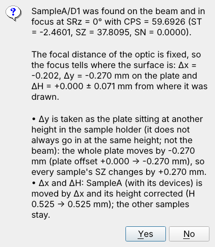

Dans l'exemple D1 est trouvé à ST = −2.4601, SZ = 37.8095, SN = 0 (SRn = 120°, SRz = 0°) : il était dessiné
0,20 mm trop à droite, et décalé de 0,27 mm en y (dessiné trop haut), pris comme décalage de la plaquette. H de SampleA est encore la valeur
par défaut 0,525 mm : la fenêtre se termine donc par le rappel d'entrer l'épaisseur connue s'il y en a une. Un Δx ou ΔH de plus de 0,3 mm, ou le même
décalage en ST pour tous les échantillons, suggère une configuration périmée : prévenir le personnel de la ligne. Le
faire à SRz = 0° : là, le foyer donne x, y et H sans les axes de rotation ; après une rotation SRz le bouton ne corrige
que H (quand un ΔH explique les écarts), car les erreurs de x, y ne s'y distinguent pas des erreurs d'axe. (Ceci
remplace l'ancien bouton *Found here*, qui supposait l'échantillon exactement au foyer de l'analyseur au lieu de lire
le foyer sur l'optique.)

### Anticollision

La vue de dessus montre à l'échelle le nez de l'analyseur (MBS A1, à 35 mm du foyer), la zone plate et l'OSA (plaques minces ;
l'OSA ne bouge pas quand la zone plate refocalise) ou le capillaire, en rouge quand la plaquette les touche. *Bring
target onto the beam*, *Correct SN* et l'onglet Rotate refusent une position où la plaquette toucherait quelque
chose. Baisser SN rapproche la surface de l'optique et de l'analyseur : SN n'est limité que vers le bas. ST et SZ sont
libres pour une plaquette parallèle au plan focal, et limités quand SRz l'incline ou quand quelque chose dépasse (vis
de la plaquette gating). Les dimensions sont des estimations gardées dans la configuration (les **distances de
travail** de la face avant de l'OSA, de la zone plate ou du capillaire au foyer) ; seul le personnel de la ligne les
change, dans le fichier de configuration (RealSampleCalibration).
Garder une distance de sécurité et surveiller la caméra.

## Onglet Rotate sample : tourner sans perdre l'échantillon

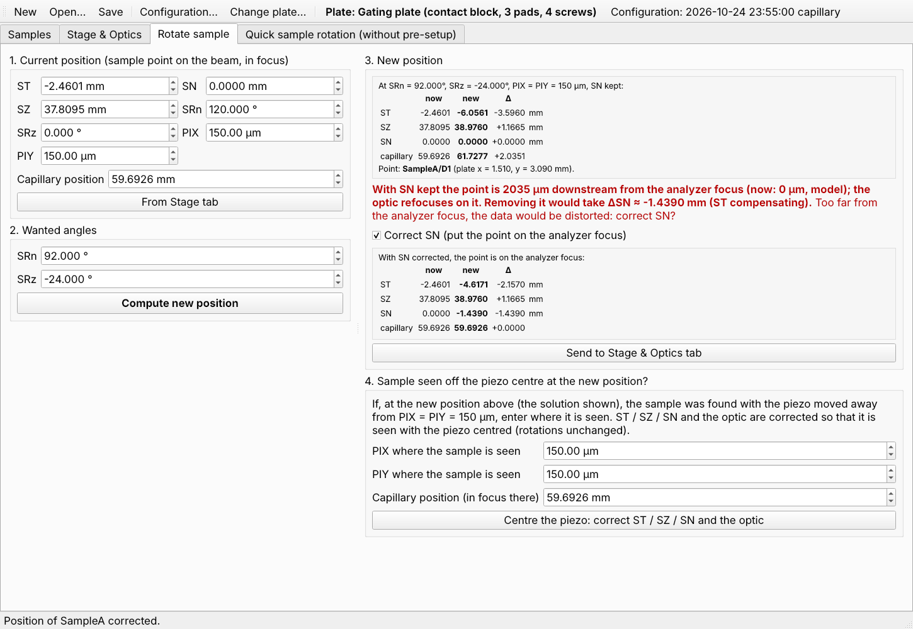

1. **Current position** : les positions avec le point d'intérêt sous le faisceau et au foyer, et la position de
   l'optique (*From Stage tab* les copie).
2. **Wanted angles** : les nouveaux SRn et SRz (pour un point de la zone de Brillouin, demander à l'agent : voir
   [plus bas](#trouver-les-angles-pour-un-point-de-la-zone-de-brillouin)).
3. **Compute new position** : ST et SZ avec le piézo centré et **SN gardé**, et la position de l'optique qui
   refocalise (le tableau donne *now*, *new* et l'écart Δ). Le point suivi est le point de la plaquette sous le
   faisceau à la position actuelle (ligne *Point:* : ce qui s'y trouve et ses x, y). Le texte indique la distance du
   point au foyer de l'analyseur, *downstream* (plus loin le long du faisceau) ou *upstream*, et sa distance actuelle
   selon le modèle (en rouge au-delà de 50 µm : les spectres seraient déformés). SRn seul garde le plan de la
   surface ; SRz non.
4. Seulement si le point est trop loin du foyer, cocher **Correct SN** (décoché à chaque nouveau calcul ; voir la
   section suivante) pour voir SN, ST, SZ et l'optique qui mettent le point **au foyer de l'analyseur**. Si une
   course moteur ne le permet pas, la position atteignable la plus proche est donnée avec sa distance au foyer.
5. **Send to Stage & Optics tab** reprend la solution affichée (cochée : la solution corrigée), refusé si hors course
   ou si la plaquette touchait quelque chose.
6. **Sample seen off the piezo centre at the new position?** Si, à la nouvelle position, l'échantillon est trouvé sur
   une carte PIX / PIY mais pas au centre du piezo (150 µm), entrer les **PIX et PIY où il est vu** et la position de
   l'optique au point à cet endroit, puis **Centre the piezo: correct ST / SZ / SN and the optic**. Le tableau donne
   les ST / SZ (SN gardé) et la position de l'optique qui le montrent avec le piezo centré (les rotations ne changent
   pas), et de combien l'échantillon se déplace le long du faisceau ; *Send corrected position to Stage & Optics
   tab* les reprend.

**Exemple.** D1 est sous le faisceau à SRn = 120°, SRz = 0° (ST = −2.4601, SZ = 37.8095, SN = 0, capillaire
59.6926) ; voulu : SRn = 92°, SRz = −24°. Avec SN gardé, ST = −6.0561, SZ = 38.9760 et le capillaire à 61.7277
remettent D1 sous le faisceau, mais à 2035 µm en aval du foyer de l'analyseur (rouge : les spectres seraient
déformés). Avec *Correct SN* : ST = −4.6171, SZ = 38.9760, SN = −1.4390, capillaire inchangé : D1 au foyer de
l'analyseur. Case cochée, *Send to Stage & Optics tab* :

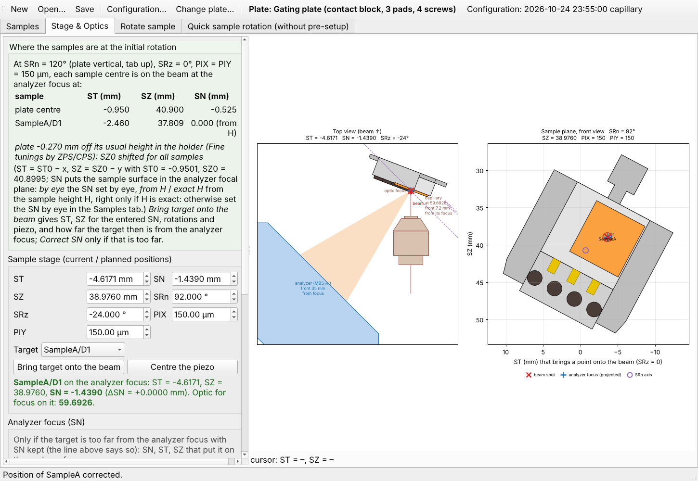

L'onglet Stage montre maintenant D1 **retrouvé** aux nouveaux angles : dans la vue du plan de l'échantillon la
plaquette est tournée à SRn = 92° (28° depuis l'orientation de départ) et la tache du faisceau (×) est sur D1, au
foyer de l'analyseur (+) ; la vue de dessus montre la plaquette tournée de SRz = −24°. *Bring target onto the beam* /
*Correct SN* y donnent les mêmes positions.

**Vérifié sur la ligne** : à SRn = 92°, SRz = −24° avec SN gardé à 0, D1 a été trouvé à ST = −6.0479,
SZ = 38.9880, capillaire 61.74, à 8 µm, 12 µm et 0.01 de la prédiction avec SN gardé ci-dessus : la rotation ne
fait pas perdre l'échantillon, et la position de l'optique pour la mise au point est donnée avec elle.

## Correct SN : remettre le point au foyer de l'analyseur

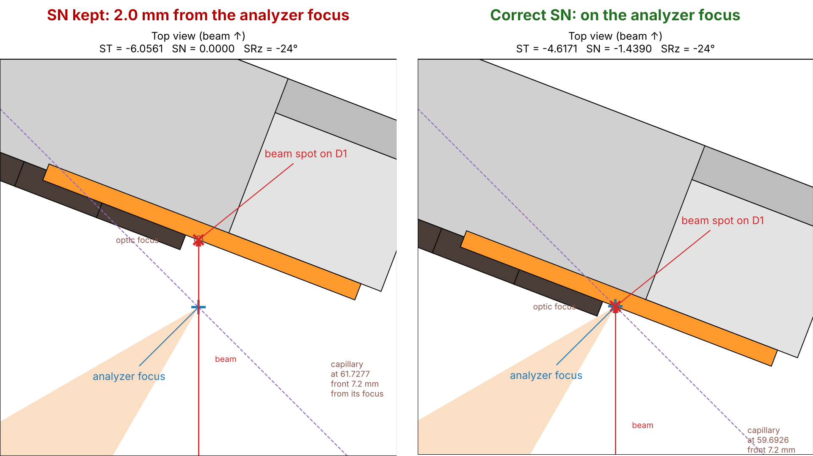

L'analyseur recueille les électrons d'un seul point fixe de l'espace, le **foyer de l'analyseur** (+ bleu ; le plan
focal de l'analyseur est la ligne « SN = 0 » de la caméra). Le point mesuré doit être sous le faisceau **et** en ce
point.

- **ST et SZ** déplacent la plaquette en travers du faisceau : ils amènent le point sur la ligne du faisceau. L'endroit
  où il se trouve alors le long du faisceau dépend de **SN**, qui déplace la plaquette selon sa normale (à 45° du
  faisceau).
- **SRn** tourne la plaquette autour de sa propre normale : la surface reste dans son plan, le point reste au foyer de
  l'analyseur dès que ST, SZ le suivent.
- **SRz** tourne la plaquette autour d'un axe vertical qui ne passe pas par la surface (dans la configuration
  actuelle, à environ 2,6 mm derrière le dessus de la rehausse). Avec ST, SZ qui suivent et **SN gardé**, le point
  reste sous le faisceau mais glisse **le long** de celui-ci, loin du foyer de l'analyseur. L'optique refocalise sur le
  point, la tache reste petite ; mais les électrons viennent d'un point hors du foyer de l'analyseur : les échelles
  d'énergie et d'angle sont déformées et l'intensité baisse. Au-delà de 50 µm le programme l'écrit en rouge.
- **Correct SN** déplace SN, avec ST qui compense (SN n'est pas le long du faisceau), pour remettre le point **au**
  foyer de l'analyseur. L'optique revient alors là où elle focalise sur le foyer de l'analyseur.

Dans l'exemple (à gauche : SN gardé, à droite : Correct SN, tous deux à SRn = 92°, SRz = −24°), la tache sur D1 est à
2,0 mm en aval du foyer de l'analyseur avec SN gardé ; SN = −1.439 avec ST = −4.617 l'y remet, le capillaire à 59.6926
comme avant la rotation.

SN est gardé par défaut parce que la platine se conduit ainsi (la surface reste sur la ligne de la caméra, l'optique
refocalise) et parce que *Correct SN* est absolu : il repose sur le SN_f et les axes de rotation de la configuration.
L'utiliser quand la distance est en rouge, et surveiller la caméra : un SN plus bas rapproche la surface de l'optique
et de l'analyseur (un déplacement vers une collision est refusé). Dans l'onglet Stage, *Correct SN* est un bouton dans
son propre cadre (pour la cible choisie aux angles
entrés) ; dans l'onglet Rotate, une case à cocher.

## Quick sample rotation : un échantillon trouvé sans préparation

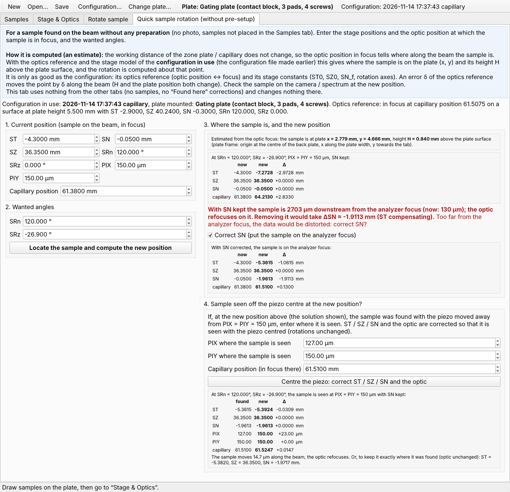

Pour un échantillon trouvé sous le faisceau **sans aucune préparation** : pas de photo, pas d'échantillons dessinés
dans l'onglet Samples. On entre seulement les positions de la platine et la position de l'optique (ZPS / CPS) où
l'échantillon est au point.

**Principe.** La distance de travail de la zone plate / du capillaire ne change pas : la position de l'optique au
point indique où se trouve la surface le long du faisceau. Avec la référence optique et le modèle de platine de la
**configuration utilisée**, on en déduit où est l'échantillon sur la plaquette (x, y) et sa hauteur H, et la rotation
est calculée autour de ce point. L'onglet n'utilise rien des autres onglets (ni échantillons, ni correction *Found
here*) et n'y change rien. La ligne sous l'explication donne la configuration, la plaquette et la référence optique
utilisées.

1. **Current position** : ST, SZ, SN, SRn, SRz, PIX, PIY avec l'échantillon sous le faisceau et au point, et la
   position de l'optique.
2. **Wanted angles**, puis **Locate the sample and compute the new position**.
3. Le résultat : où est l'échantillon sur la plaquette (x, y, H, estimés depuis le foyer de l'optique) ; les nouveaux
   ST / SZ avec **SN gardé** et la position de l'optique qui refait le point ; la distance au foyer de l'analyseur
   (en rouge au-delà de 50 µm) ; et, avec **Correct SN** coché, SN, ST, SZ et l'optique qui le mettent au foyer de
   l'analyseur. Une position hors course ou où la plaquette toucherait quelque chose est écrite en rouge.
4. **Sample seen off the piezo centre**, comme dans l'onglet Rotate sample (sans bouton *Send* : l'onglet reste
   indépendant).

**Exemple : Cav, 2026-11-14** (configuration 2026-11-14 17:37:43 capillary, plaquette gating). L'échantillon de
graphène Cav a été trouvé à SRn = 120°, SRz = 0° à ST = −4.30, SZ = 36.35, SN = −0.05, capillaire CPS 61.38 ; il
fallait le tourner à SRz = −26.9° pour amener le point K au centre de la fente. À partir du seul CPS, l'onglet place
Cav à x = 2.779, y = 4.666 mm sur la plaquette, H = 0.840 mm. Avec SN gardé l'échantillon serait à 2,7 mm en aval du
foyer de l'analyseur (rouge), capillaire refocalisé à 64.21 ; avec *Correct SN* : ST = −5.3615, SZ = 36.35,
SN = −1.9613, capillaire 61.51 (de retour au foyer de l'analyseur). À l'étape 4, un échantillon vu à PIX = 127 µm
(23 µm à côté) donne ST −5.3924 avec le piezo centré.

**Ce que vaut l'estimation.** Une erreur δ de la référence optique déplace le point de δ le long du faisceau. Pour
Cav, dont la hauteur était mieux connue par son SN sur la ligne de la caméra (H = 0.748), la prédiction complète
(onglets Stage & Optics / Rotate) était ST = −5.238, SN = −2.002, et Cav y a été retrouvé à 27 µm près (section
suivante) ; l'estimation rapide en est à 0,12 mm, bien à l'intérieur d'une seule carte SPEM de 300 × 300 µm. Vérifier
l'échantillon sur la caméra / le spectre à la nouvelle position, et le centrer avec l'étape 4.

## Quelle précision : tests sur la ligne

Mesuré avec les configurations des calibrations de novembre 2026 (rapports dans
`RealSampleCalibration/docs/reports/`). Positions lues à ±0,02 mm ; écarts mesurés sur des cartes SPEM
(300 × 300 µm, pas de 10 µm).

| test | rotation | déplacement de la platine | erreur de prédiction | mise au point |
|---|---|---|---|---|
| dispositif D1 (plaquette gating), 2026-11-14 | SRn 120 → 150, SRz 0 → −10, SN corrigé | ST 0,15 mm, SZ 0,09 mm, SN 0,15 mm | **22 µm** | capillaire inchangé (61.51), mêmes spectres |
| échantillon Cav (graphène), 2026-11-14 | SRz 0 → −26.9, SN corrigé | ST 0,94 mm, SN 1,95 mm | **27 µm** | capillaire inchangé (61.38), mêmes spectres |
| points de contrôle de la calibration, 2026-11-14 | SRn 100, SRn 100 / SRz −5 (prédits avant la mesure) | – | ≤ **34 µm** | CPS 61.764 prédit, 61.76 trouvé |
| Cav avec la zone plate, 2026-11-15 | SRn 140 / SRz −15, SN gardé | – | – | ZPS 54.30 prédit, **54.33** trouvé |
| SampleA / D1 (ce guide), 2026-10-24 | SRn 120 → 92, SRz 0 → −24, SN gardé | ST 3,6 mm, SZ 1,2 mm | **8 µm / 12 µm** (ST / SZ) | capillaire 61.73 prédit, 61.74 trouvé |

Ainsi, une fois le premier échantillon trouvé et corrigé (*Fine tunings by ZPS/CPS*), une rotation le garde **à moins de 50 µm**
— sur la même carte SPEM — et la position de l'optique (ou la correction de SN) le garde **au point**, même pour des
rotations SRz de 25° où le point glisserait sinon de 2–3 mm le long du faisceau. Sur la photo seule, le premier
échantillon est trouvé à 0,1–0,3 mm (D1 le 2026-11-14 : 0,10 mm en x et en y sur une photo floue). Les prédictions
valent ce que vaut la configuration : si *Fine tunings by ZPS/CPS* déplace un échantillon de plus de 0,3 mm, ou plusieurs
échantillons de la même quantité, prévenir le personnel de la ligne.

## Trouver les angles pour un point de la zone de Brillouin

Pour les cristaux hexagonaux 2D, la question *« de combien tourner SRn et SRz pour que K soit au centre de la fente,
la fente selon Γ–K et le déflecteur proche de 0 ? »* est traitée par l'**agent** (outils `align_bz_angles` et
`align_bz_point_to` ; le programme n'a pas de fenêtre pour cela). Lui donner, lus sur le contour d'une carte dans
ARPES viewer (θ = angle du déflecteur, x du contour ; φ = angle le long de la fente, y du contour) : SRn / SRz et
énergie de photon de la carte, les angles de **Γ** et d'**un point K ou M**, la constante de réseau dans le plan a,
le point et la direction de fente voulus, et l'énergie de photon de la nouvelle mesure. Entrer ensuite les SRn / SRz
obtenus dans *Wanted angles*.

Le point est *atteignable* quand, déflecteur à 0, il est à |θ| ≤ 5° et |φ| ≤ 5° du centre de la fente, la fente à
moins de 2° de la ligne voulue, avec SRn 60 … 180° et SRz −25 … +10° (SRz ≤ 0 de préférence : faisceau plus proche de
la normale, spot plus petit).

### Quand ce n'est pas atteignable

Le manipulateur n'a **pas d'axe de tilt**. Conséquence : avec un point au centre de la fente et le déflecteur à 0, la
fente est toujours selon la ligne de Γ à ce point (Γ–K pour K). Une fente *perpendiculaire* (K–M, M–K) demande le
déflecteur à l'angle d'émission du point (15–20° à 95 eV), ce que l'analyseur fait mal. L'**alternative radiale** :
K au centre, fente selon Γ–K ; la direction du déflecteur est alors selon K–M, et une courte **carte en déflecteur**
(|θ| ≤ 5°) donne la coupe K–M passant par K avec peu de distorsion.

Quand l'angle d'émission est trop grand pour la plage de SRz, une énergie de photon plus élevée peut rendre le point
atteignable :

- ANTARES : 30–180 eV avec le **capillaire** ; la **zone plate ne fonctionne qu'à 95 eV**. Changer d'énergie avec la
  zone plate signifie passer au capillaire (réalignement, configuration capillaire).
- Si SRn est la limite, il faut **tourner l'échantillon sur la plaquette** au remontage.
- Si rien ne marche, il faut remonter l'échantillon ou choisir un autre point équivalent.

| exemple (E_F, travail de sortie 4,5 eV) | angle d'émission de K à 30 / 95 / 180 eV | K, fente selon Γ–K |
|---|---|---|
| WSe2, a = 3,282 Å, Γ–K = 1,28 Å⁻¹ | 29,6° / 15,2° / 10,8° | atteignable à 95 eV avec SRz ≈ −15° |
| graphène, a = 2,46 Å, Γ–K = 1,70 Å⁻¹ | 41,2° / 20,4° / 14,5° | 95 eV : SRz ≈ −20° ; 30 eV : non (il faut ≳ 61 eV) |

Les signes entre la platine et le contour d'ARPES viewer ont été vérifiés une fois (signe du déflecteur, 2026-09) ;
lors d'un nouveau type de mesure, vérifier que le point apparaît là où l'agent l'annonce.

## Sessions, plaquette et configuration

- **New / Open… / Save** (barre d'outils) : une session contient la plaquette, les échantillons et dispositifs (avec
  leurs corrections) et les positions moteurs, dans un fichier JSON. Le premier *Save* demande le nom du fichier.
  L'écriture est sûre : si elle échoue (disque plein, droits), l'ancien fichier reste intact et un message en donne
  la raison.
- **Change plate…** : une autre plaquette ; les échantillons sont gardés et ceux mal placés sont signalés.
- **Configuration…** : vue en lecture seule de la configuration utilisée (constantes de la platine et référence
  optique), faite par le personnel de la ligne. Une configuration plus ancienne peut être choisie pour la session.
  Sous *Motor limits*, les limites min / max de ST, SZ, SN, SRn et SRz peuvent être modifiées à la main (*Defaults*
  remet celles par défaut) ; *Apply limits* les utilise pour les champs de saisie, les contrôles de course et
  anticollision, et les enregistre dans `configs/motor_limits.json` pour les démarrages suivants.

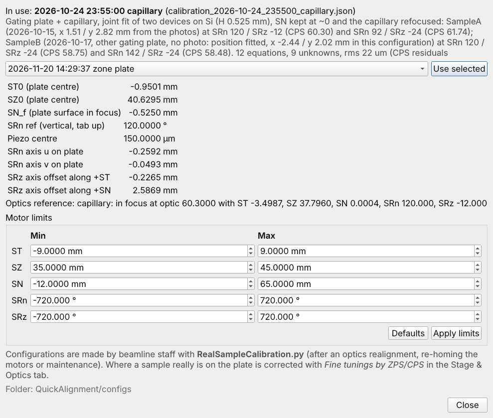

## Un temps de faisceau type

1. Lancer QuickAlignment, confirmer plaquette et optique.
2. Marquer les échantillons sur la photo de montage (*From photo…*), placer les dispositifs sur une photo au
   microscope (onglet 2), ou les dessiner ; ou ouvrir la session préparée avant. *Samples placed → Stage*. (Pas le
   temps ? Trouver l'échantillon sous le faisceau et utiliser l'onglet *Quick sample rotation*.)
3. Aller au premier échantillon ou dispositif avec les ST / SZ / SN listés (SRn = 120°, SRz = 0°) ; le trouver avec le
   faisceau (caméra, carte de photoémission).
4. *Fine tunings by ZPS/CPS* : corriger sa position. Les autres tombent alors juste aussi.
5. Mesurer une carte à SRn = 120°, SRz = 0° ; lire Γ et un point K / M dans ARPES viewer.
6. Demander à l'agent les angles du point de zone → *Wanted angles* → *Compute new position* (cocher *Correct SN* si le point est à
   plus de 50 µm du foyer) → *Send to Stage & Optics tab*. Si l'échantillon est ensuite vu hors du centre du piezo
   sur une carte, l'étape 6 de l'onglet Rotate le recentre.
7. Enregistrer la session.

## Messages et que faire

| message | signification / que faire |
|---|---|
| *Out of range: ST = … (range …)* | le point n'est pas atteignable à ces angles ; choisir d'autres angles ou la solution corrigée ; si la platine va réellement plus loin, régler les limites dans *Configuration… → Motor limits* |
| *Collision: the plate would touch …* | à cette position la plaquette (ou un échantillon, une vis) heurterait l'optique ou l'analyseur ; rien n'est changé : choisir une autre position, ou reculer l'optique |
| *… in the analyzer acceptance cone: it would shadow the electrons* | l'optique est sur le trajet des électrons vers l'analyseur ; la retirer |
| *… µm from the analyzer focus* (rouge) | après une rotation SRz le point a quitté le plan focal : cocher *Correct SN* |
| *Correct the plate / sample position and height?* | *Fine tunings by ZPS/CPS* : vérifier les positions et le dispositif ; *Yes* déplace la plaquette de Δy (tous les échantillons) et l'échantillon de Δx, ΔH |
| *Fine tunings by ZPS/CPS* déplace un échantillon de plus de 0,3 mm | dessin faux, ou configuration périmée (moteurs réinitialisés) : demander au personnel |
| *The beam misses the plate* | ST / SZ ne mettent pas le faisceau sur la plaquette |
| *Check the input: Γ–K on the map is …* | constante de réseau, point ou énergie ne correspondent pas à la carte |
| *An unexpected error occurred* | le programme continue ; vérifier le dernier résultat, enregistrer la session et envoyer les détails au personnel |
