# QuickAlignment 用户指南

ANTARES 线站（SOLEIL）· 在样品托上找到样品、转动时保持样品在光斑上、为布里渊区高对称点选择转角

## 目录

1. [QuickAlignment 的用途](#quickalignment-的用途)
2. [启动程序](#启动程序)
3. [坐标与电机](#坐标与电机)
4. [Samples 页：绘制样品托](#samples-页绘制样品托)
5. [Stage & Optics 页：移动到样品](#stage--optics-页移动到样品)
6. [Rotate sample 页：转动而不丢失样品](#rotate-sample-页转动而不丢失样品)
7. [Correct SN：把该点放回分析器焦点](#correct-sn把该点放回分析器焦点)
8. [Quick sample rotation：无需准备直接转动样品](#quick-sample-rotation无需准备直接转动样品)
9. [精度：线站上的实测](#精度线站上的实测)
10. [为布里渊区高对称点寻找转角](#为布里渊区高对称点寻找转角)
11. [Session、样品托与配置](#session样品托与配置)
12. [一次典型的机时流程](#一次典型的机时流程)
13. [提示信息与处理方法](#提示信息与处理方法)

---

## QuickAlignment 的用途

ANTARES 的光斑在微米量级或更小，而样品托有 18 × 15.5 mm。QuickAlignment 把样品托和样品的几何信息换算成
**电机位置**：

- 每个样品或 device 在初始取向（SRn = 120°，SRz = 0°）下的 ST、SZ、SN；
- 把样品放到光斑上、并位于分析器焦点处所需的 ST / SN / SZ 和聚焦元件位置；
- 转动（SRn、SRz）之后，让同一点回到光斑上的位置，以及保持其聚焦的聚焦元件位置；
- 对没有做任何准备（没有照片）就在光斑上找到的样品，仅凭聚焦元件位置给出转动后的位置（*Quick sample rotation* 页）；
- 对二维六角晶体（graphene、WSe2 等），把 Γ、K 或 M 点移到狭缝中心所需的 SRn / SRz，以及达不到时的解决办法。

程序不会移动任何电机，它只给出数值，由你在线站控制系统里输入。

**本指南的例子。** 所有截图都来自同一个真实例子：一块 **gating plate**，上面是衬底 **SampleA**（Si，H = 0.525 mm）和它上面的 device **D1**，2026 年 10 月用 **capillary** 测量（使用该次机时的配置 2026-10-24 23:55）。衬底在手机拍的托照片上标出，D1 在显微镜照片上定位；在初始取向下把 D1 移到光斑上，找到后修正其位置，然后把托转到 SRn = 92°、SRz = −24°，在线站上于预测位置再次找到了 D1。*Quick sample rotation* 页用 2026-11-14 标定报告中的 graphene 样品 **Cav** 作例子。

## 启动程序

首次安装：`pip install PyQt5 numpy matplotlib`。然后双击 **`QuickAlignment.py`**（Windows 下可用
`QuickAlignment.pyw`，不弹出控制台），或运行 `python QuickAlignment/QuickAlignment.py [session.json]`。

每次启动时程序会询问装的是哪种 **样品托**、用的是哪种 **聚焦元件**：

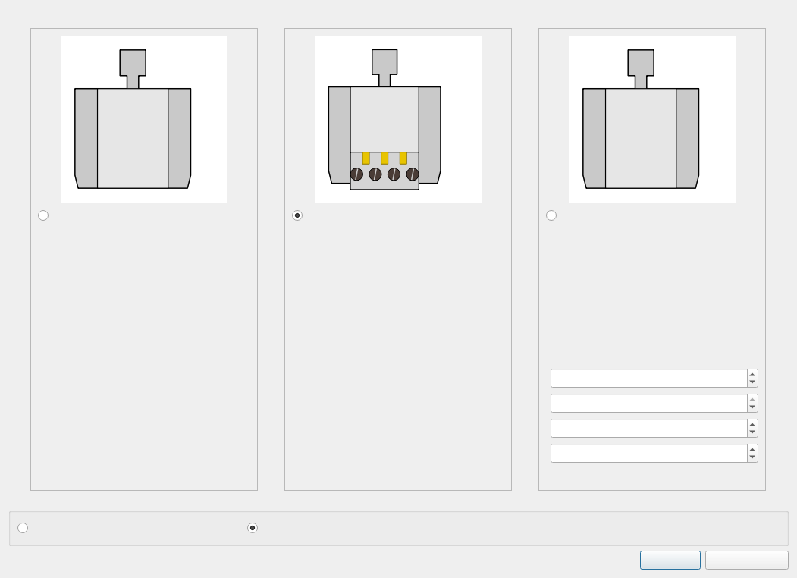

- **Standard Ta plate（标准 Ta 托）**：18 × 15.5 mm 底板，中间 11 mm 宽的凸台，高 5.0 mm。
- **Gating plate（门电压托）**：同上，下方有接触块（3 个金电极、4 颗螺丝）；样品只能放在接触块上方 11 × 10.5 mm 的区域。
- **Custom plate（自定义托）**：底板加自定义的块（长、宽、中心 y、从底板背面量起的高度；高度至少 4.5 mm，更低时样品架会碰到 OSA）。
- **聚焦元件**：*zone plate + OSA*（只能用 95 eV）或 *capillary*（30–180 eV）。程序会载入线站人员为该元件做的最新配置（显示在工具栏中）。

## 坐标与电机

| 名称 | 含义 | 范围 |
|---|---|---|
| x, y | 样品托上的位置（mm），正视图、tab 朝上，原点 = 底板中心 | – |
| H | 样品高出托面的高度（mm） | – |
| ST | 沿分析器焦平面；ST < 0 时样品向左上移动（俯视） | −9 … 9 mm |
| SN | 垂直于分析器焦平面；SN = 65 为传样位置 | −12 … 65 mm；低于 SN_f 时可能先发生碰撞（见 *防碰撞*） |
| SZ | 竖直方向 | 35 … 45 mm |
| SRn | 绕样品法线的方位角；SRn = 120°：托竖直、tab 朝上 | 可用 60 … 180° |
| SRz | 绕竖直轴转动；SRz = 0：托平行于分析器焦平面 | 可用 −25 … +10° |
| PIX, PIY | 压电台，0 … 300 µm，中心 150 µm | – |

在初始取向下，托上一点 (x, y) 在 **ST = ST0 − x，SZ = SZ0 − y** 时位于光斑上；高度为 H 的样品在
**SN = SN_f + H** 时位于分析器焦点（ST0、SZ0、SN_f 来自配置文件）。电机输入框不接受超出行程的数值。

## Samples 页：绘制样品托

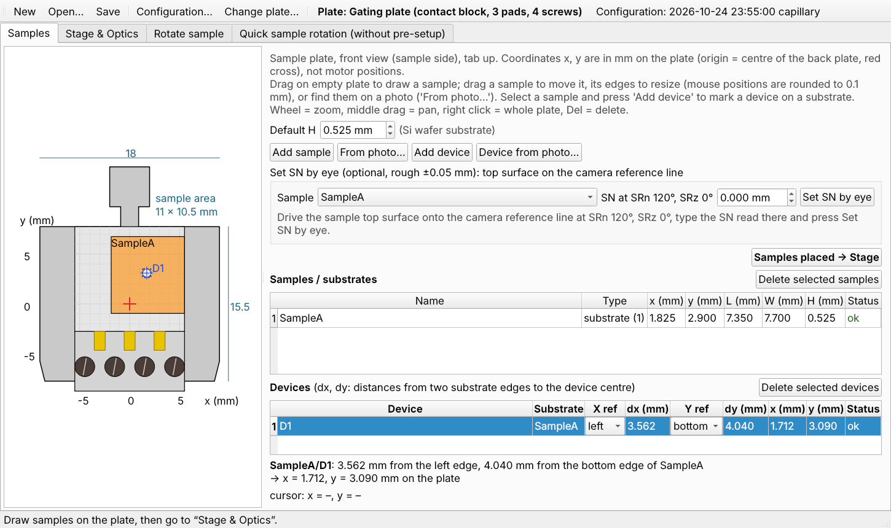

图中是例子用 *From photo…*（下一节）识别后的样品托：衬底 SampleA 及其 device D1（已选中，蓝色标记）。红色十字是托中心（x = y = 0），灰色框是样品区（gating plate：接触块上方 11 × 10.5 mm）。

- **画样品**：在托的空白处拖动鼠标。拖动样品可 **移动**，拖动边或角可 **改变大小**（鼠标位置取整到 0.1 mm）。也可以按 *Add sample* 后直接输入数值。
- **表格**：名称、x、y、长 L、宽 W、高 H 都可以精确输入（输入值不取整）。*Default H* 是新样品的默认高度（0.525 mm：标准 Si 片）。*Type* 显示 *sample*，或 *substrate (n)*（n 为其 device 数）。
- **衬底上的 device**：选中衬底，按 *Add device*，选择两条参考边（*X ref* left/right、*Y ref* bottom/top）以及到 device 中心的距离 dx、dy，也可以拖动蓝色标记。表格及其下方一行还给出 device 在托上的位置 x、y。device 随衬底一起移动。带 device 的衬底在目标列表里只列出它的 device（例如 *SampleA/D1*）。
- **Device from photo…**：从一张显微镜照片给选中的衬底添加 device，不必重新识别样品。照片通过已画衬底的四个角和衬底上已有的 device（或本次运行中用过的托照片）来匹配；点出的 device 被添加，已有的不变。
- **Status**：`ok`，或问题说明（超出样品区、重叠、device 不在衬底上）。图上红色的项目有问题。
- 滚轮 = 缩放，中键拖动 = 平移，右键 = 显示整个托，Del = 删除选中项（*Delete selected*）。最下面一行显示鼠标处的托坐标。

### 从照片识别样品

除了手画，也可以从正上方（样品面）拍一张样品托照片（手机照片即可），让程序找出样品。按 **From photo…**：

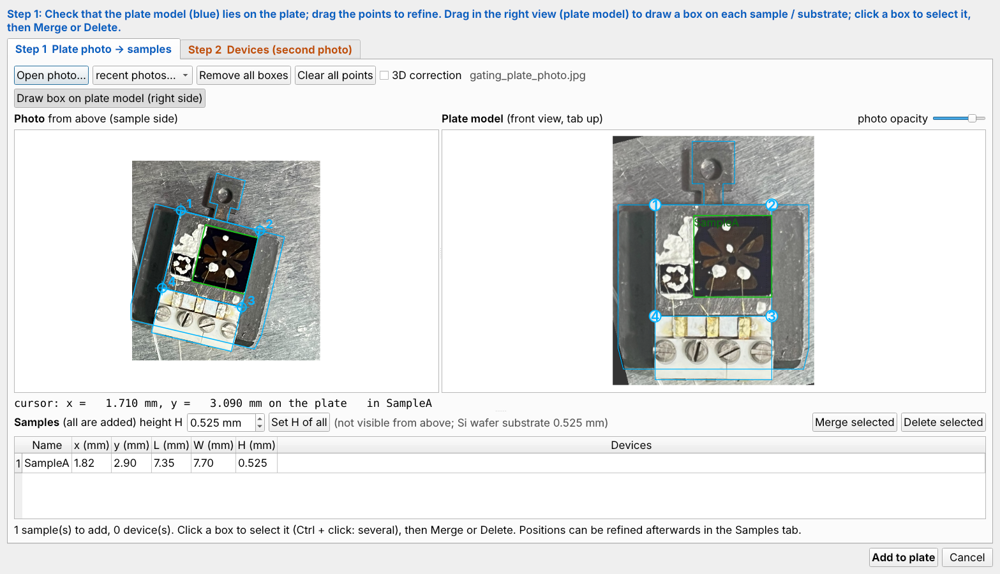

1. *Open photo…*（或在 *recent photos…* 中选择本次运行中用过的照片，连同已点的点）。右图的托模型上标出了样品区的四个角 **1–4**，下一个要点的点显示为 **红色**。在照片上点击这个点，然后点下一个红色的点（1 左上、2 右上（tab 一侧）、3 右下、4 左下；gating plate：3 和 4 是样品区与接触块相交处）。滚轮 = 缩放（可以放大到足够精确地选点），中键拖动 = 平移，右键 = 显示整张照片；之后可以拖动标记微调。*Undo last point*（Ctrl+Z）撤销最后一个点，*Clear all points* 重新开始。
2. 照片被映射到托模型上（右图，蓝色轮廓）。检查轮廓是否和照片中的托重合。光标在右图和照片上都会显示托坐标（x、y，mm）。
   **3D 校正（可选，默认关闭）。** 四个角点能把样品区所在的平面准确映射，无论拍摄角度如何。如果照片明显不是从正上方拍的，其他高度上的东西（较厚的样品、底板）会出现偏移。点击之前勾选 **3D correction**：程序会要求在两个高度上点 8 个点（先是 riser 上样品区的 4 个角，然后是底板顶部的 2 个角和 tab（耳朵）顶部的 2 个角，它们高出底面 1.1 mm），拟合一个相机模型，在每个高度上校正透视；之后底板轮廓会画在它自己的高度上，提示行会给出这些点与模型的吻合程度（像素 rms）。照片基本是正上方拍的就不要打开。
3. **在右图中给每个样品画框**（*Draw box on plate model*，默认打开）：从样品的一个角拖到对角，照片就叠在托模型下面（*photo opacity* 调节透明度）。框按 0.05 mm 取整。点击选中框（Ctrl + 点击：多选）；**Delete selected**（或 Del）删除，**Merge selected** 合并画在同一样品不同部分上的框，*Remove all boxes* 重新开始。例子中在衬底上画了一个框（绿色）；名称直接在表格里输入（S1 → SampleA）；*Devices* 列是在第 2 页标出的 device 数。
4. 再对照照片检查一遍：列表中的框都会被添加。
5. 输入 **高度 H**（从上方看不出来；默认为 *Default H*），可以在表格中逐个修改，或用 *Set H of all*。
6. 需要的话在第二张照片上定位 device（见下面的第 2 页），然后按 **Add to plate**。勾选 *Remove the samples already on the plate* 会替换托上已有的样品。

框使用托坐标；之后可以像手画的样品一样移动、改大小、添加 device。精度取决于四个角点得准不准（约 0.1–0.3 mm），剩下的误差由 Stage & Optics 页的 *Found here* 修正。全部在本机计算，不联网。

**怎样点准角点。** 角点是 **凸台**（riser 顶面 = 样品区）的角，不是下面更宽的底板的角。角磨损或变圆时，点在两条直边延长线的交点上。在右图中检查蓝色轮廓是否一圈都沿着凸台边缘和底板：只要有一个角点偏了，整个托都会变形。

#### 第 2 页：在第二张照片上定位 device

样品托照片能看出衬底在哪里，但通常看不清 device；近距离照片（显微镜、相机）能看到 device，却往往拍不到衬底边缘。两张照片通过你在两边标出的相同点来对应：

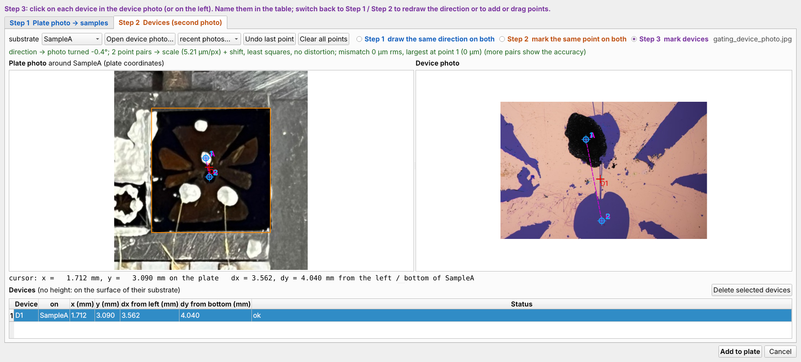

1. 选择 **substrate**（或在第 1 页选中它的框）。左图是它周围的托照片，已经是托坐标。按 **Open device photo…** 打开 device 照片（右图）。
2. *mark the same point on both*：先在左图点一个在 device 照片上也能看到的特征（银胶点、图形的角、划痕），再在右图点同一个特征；标记带编号，可拖动。2 对点时按旋转 + 缩放 + 平移对应，3 对时为仿射，4 对及以上为透视。视图上方显示这些点的偏差（µm）：点对多于所需时，可以发现点错的点。device 照片上会画出衬底轮廓（橙色）供检查。
3. *mark devices*：在 device 照片（或左图）上点击每个 device。表格给出它在托上的位置、所在衬底，以及到衬底左边、下边的 dx、dy；可以在表格中改名、删除错误的点。device 没有高度：它在衬底表面上。
4. 可以再打开另一张 device 照片（另一个衬底或另一部分），已经标出的 device 位置保持不变。*Add to plate* 把每个 device 加到它所在的样品上（不在任何样品上的 device 不会被添加）。

例子中的 device 照片是 SampleA 中心的显微镜照片。两张照片上都能看到两个特征：点 **1** 是中心上方的银胶点（显微镜下是一块黑斑），点 **2** 是电极图形中心的圆孔（紫色圆盘）。然后在两者之间沟道上的 flake 处点出 D1：x = 1.712，y = 3.090 mm。只有两对点时偏差总是 0 µm；若能看到第三个特征，再加一对点可以检验对应是否正确。

精度为托照片的精度（角点，0.1–0.3 mm）加上点对应的误差。

#### 高度检查（H 未知时）

样品高度 H 常常未知或没有测量。表格下方的 *Height check*：在 SRn = 120°、SRz = 0° 时把样品上表面移到 **相机参考线**（分析器焦平面）上，选择该样品，输入 **此时读到的 SN**，按 **Correct H**。程序由该 SN 和配置中的 SN_f 算出 H（目测，约 ±0.05 mm）；下方一行列出已检查的样品。之后 *Bring target onto the beam* 对该样品的目标保持这个 SN（在 SRn = 120°、SRz = 0° 时准确），初始位置列表中标为 *(H checked)*。在表格中手动输入 H 会取消该检查。

样品画完后，按 **Samples placed → Stage**。

## Stage & Optics 页：移动到样品

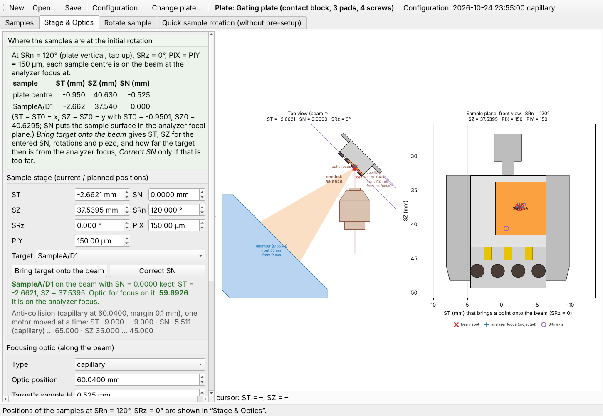

绿色框列出每个样品和 device 在 **初始取向**（SRn = 120°，SRz = 0°，PIX = PIY = 150 µm）下，使其中心位于光斑上且在分析器焦点处的 **ST / SZ / SN**。例子中 D1 列为 ST = −2.662、SZ = 37.540、SN = 0.000（*plate centre* 是底板中心，作参考）。

1. 输入当前电机位置（绝对值，与控制系统一致）。PIX、PIY 是压电台：计算按输入值使用（上面的初始位置对应压电台居中）。
2. 选择 **Target**，按 **Bring target onto the beam**：按输入的 SN、SRn、SRz、PIX、PIY 计算 ST、SZ（**SN 不变**，即日常实验的做法）。下方文字说明此时目标沿光束距分析器焦点多远（超过 50 µm 显示为红色：谱会畸变），以及消除该偏离所需的 ΔSN。只有当你判断偏离过大时，才按 **Correct SN**：计算把目标放到分析器焦点上的 SN、ST、SZ（见 [Correct SN](#correct-sn把该点放回分析器焦点)）。若某个电机会超出行程，或样品托会碰到聚焦元件或分析器，数值不会改变，并说明原因。图中在 SRn = 120°、SRz = 0° 下把 D1 移到光斑上：SN = 0 不变时它就在分析器焦点上。
3. **聚焦元件**：*Type* 是所用元件（zone plate + OSA 或 capillary）；输入元件位置，按 **Update schematic & optics**。示意图显示光束、分析器焦点、聚焦元件，以及在被照表面上聚焦 **所需的** 位置（图中 capillary 在 60.04，需要 59.6926）。
4. **Move found sample to analyzer focal plane**：找到样品并手动聚焦后，输入此时的样品台位置和聚焦元件位置（ZPS / CPS），按此按钮。程序根据配置文件中的光学参考，由元件位置算出样品表面沿光束的位置；移动 SN（ST 随之补偿，该点始终留在光束上）把它拉到分析器焦平面上，并移动聚焦元件使其保持聚焦。电机下方一行给出新的 ST、SZ、SN、ΔSN 和元件位置，以及该点在托上的位置。若某个电机会超出行程或样品托会碰到东西，则拒绝且不改变任何数值。
   **SRz 转动后的高度检查。** 若 SRz 不为 0，且聚焦元件位置与所选 *Target* 的预测相差超过 0.05 mm，程序会寻找一个样品高度变化 ΔH，看它能否同时解释 ST、SZ 和聚焦元件的误差（SRz 转动后，H 错误会让 ST 和焦点一起偏）。如果能（剩余误差都 ≤ 0.03 mm），就询问是否修正该样品的 H（之后的位置和转动都会使用）；如果不能，H 不变，结果中给出可能原因（托上位置 → 在 SRz 0 用 *Found here*；SRz 轴或 SN_f → 找线站人员）。用 capillary 时 ΔH 只能精确到约 ±0.07 mm。SRz 为 0 时不做检查：请用 *Correct H* 或 *Found here*。

**示意图**（只在按 *Update schematic & optics* 时重画）：

- *Top view*（俯视，光束向上）：从上方看到的样品托及样品（橙色）、光束（红线，× = 表面上的光斑）、分析器前端（蓝色）及其接收锥（浅橙色）和焦点（蓝色 +）、分析器焦平面（紫色虚线）、聚焦元件及其焦点（○）和位置。样品托会碰到的部件显示为红色。
- *Sample plane, front view*（样品平面正视图）：沿光束方向看到的样品托，按 SRn 转动；坐标轴给出在 SRz = 0 时把某点移到光斑上的 ST、SZ。× = 光斑，蓝色 + = 分析器焦点在表面上的投影，紫色 ○ = SRn 轴。鼠标移到图上时，视图下方显示该点对应的 ST、SZ、托上位置 x、y 以及该处的样品。

### Found here：修正绘图误差

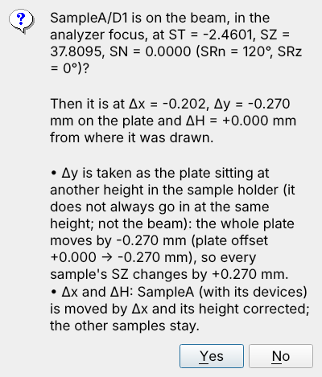

照片（或手画）的精度为 0.1–0.3 mm，所以 device 通常是在离列出位置稍远处找到的。当它确实 **位于光斑上且在分析器焦点处** 时，输入当前位置，在 *Found* 中选择该 device，按 **Found here: correct plate / sample**。窗口要求确认，并给出绘图误差（托上的 Δx、Δy，高度 ΔH）；按 *Yes* 后分两部分修正：

- **Δy（SZ）** 视为 **样品托** 在样品架中插入的高度不同（每次插入高度不一定相同）：整个托一起移动，**所有** 样品的 SZ 改变相同的量。初始位置列表显示 *plate offset*；超过 2.5 mm 时会提醒检查找到的是否是正确的样品。更换样品托时归零。
- **Δx 和 ΔH** 只修正该样品（连同所有 device），其他样品不动。

之后所有预测都使用修正后的位置（随 session 保存），初始位置列表也随之更新。

例子中 D1 在 ST = −2.4601、SZ = 37.8095、SN = 0（SRn = 120°，SRz = 0°）处找到：它在图上画得偏右 0.20 mm，y 方向偏 0.27 mm（画得偏上 0.27 mm），作为样品托的偏移。Δx 或 ΔH 超过 0.3 mm，或所有样品的 ST 偏移相同，可能说明配置已过时：请告知线站人员。尽量在 SRz = 0° 时使用 *Found here*：此时 SN 不变就意味着"在分析器焦点处"；转过 SRz 且 SN 不变时，该点通常不在分析器焦点处，ΔH 会算错。

### 防碰撞

按 *Update* 后，电机下方一行给出当前位置下 ST、SN、SZ 的 **无碰撞范围**（每次只动一个电机，其余电机和聚焦元件不动），以及限制来自哪里，例如 *SN −4.1 (OSA) … 65*。俯视图按比例画出分析器前端（MBS A1，距焦点 35 mm）、zone plate 和 OSA（薄板；zone plate 重新聚焦时 OSA 不动）或 capillary，样品托碰到时显示为红色。*Bring target onto the beam*、*Correct SN* 和 Rotate 页会拒绝会发生碰撞的位置。降低 SN 会使表面靠近聚焦元件和分析器：SN 只有下限。样品托平行于焦平面时 ST、SZ 不受限制；SRz 使其倾斜或有突出物（gating plate 的螺丝）时才受限。尺寸为配置中的估计值：若知道更准确的值，可在元件位置下方的输入框中填写 **工作距离**（OSA、zone plate 或 capillary 前端到焦点的距离，仅对本次 session 有效）。请保持安全距离并观察相机。

## Rotate sample 页：转动而不丢失样品

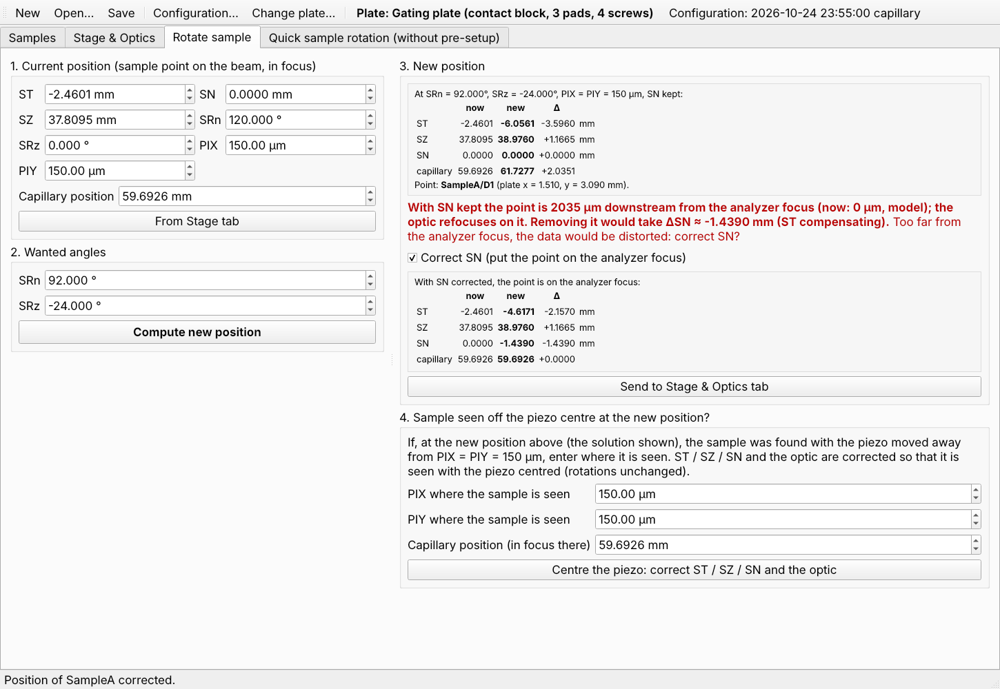

1. **Current position**：感兴趣的点位于光斑上且已聚焦时的位置及聚焦元件位置（*From Stage tab* 可直接复制）。
2. **Wanted angles**：新的 SRn 和 SRz（布里渊区高对称点的转角请问 agent，见[后文](#为布里渊区高对称点寻找转角)）。
3. **Compute new position**：在压电台居中、**SN 不变** 的情况下给出 ST、SZ，以及重新聚焦所需的元件位置（表格列出 *now*、*new* 和变化量 Δ）。所跟踪的是当前位置下光斑所在的托上那一点（*Point:* 一行：该处是什么及其托坐标 x、y）。文字说明该点距离分析器焦点有多远、在 *downstream*（沿光束更远处）还是 *upstream*，以及按模型计算的当前距离（超过 50 µm 显示为红色：谱会畸变）。只转 SRn 时表面平面不变，转 SRz 时会改变。
4. 只有当该点离焦点过远时，才勾选 **Correct SN**（每次重新计算都会恢复为不勾选；见下一节），可看到把该点放到 **分析器焦点上** 所需的 SN、ST、SZ 和元件位置。若电机行程不允许，则给出最接近的可达位置及其与焦点的距离。
5. **Send to Stage & Optics tab** 采用所显示的结果（勾选时为修正后的结果）；超出行程或样品托会碰到东西时拒绝。
6. **Sample seen off the piezo centre at the new position?** 如果在新位置上，样品在 PIX / PIY 扫描图上找到了，但不在 piezo 中心（150 µm），输入 **看到它时的 PIX 和 PIY** 以及在那里聚焦的聚焦元件位置，按 **Centre the piezo: correct ST / SZ / SN and the optic**。表格给出 piezo 居中时能看到它的 ST / SZ（SN 不变）和聚焦元件位置（转角不变），以及样品沿光束移动了多少；*Send corrected position to Stage & Optics tab* 把它们送到 Stage 页。

**例子。** D1 在 SRn = 120°、SRz = 0° 时位于光斑上（ST = −2.4601，SZ = 37.8095，SN = 0，capillary 59.6926）；目标：SRn = 92°，SRz = −24°。SN 不变时，ST = −6.0561、SZ = 38.9759、capillary 61.7277 能把 D1 放回光斑上，但它在分析器焦点下游 2035 µm（红色：谱会畸变）。勾选 *Correct SN*：ST = −4.6171，SZ = 38.9759，SN = −1.4390，capillary 不变：D1 位于分析器焦点上。在勾选状态下按 *Send to Stage & Optics tab*：

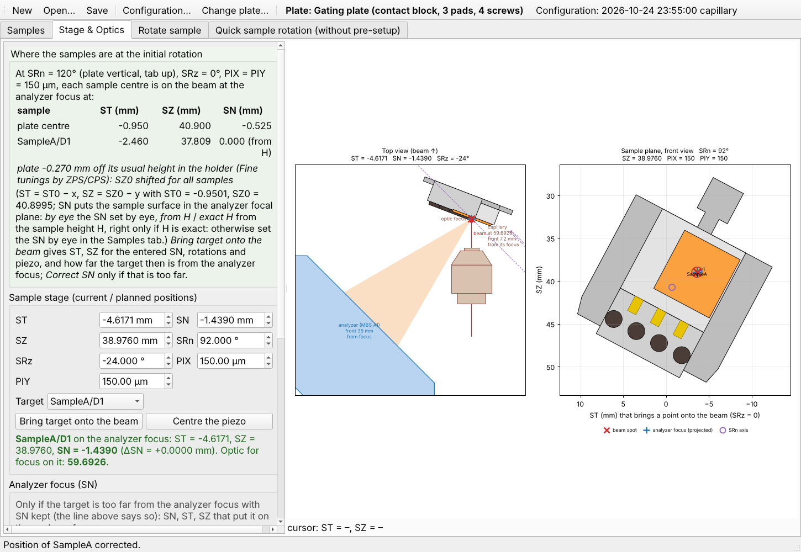

此时 Stage 页显示在新角度下 **再次找到** 了 D1：样品平面视图中托转到了 SRn = 92°（相对初始取向转了 28°），光斑（×）落在 D1 上，并与分析器焦点（+）重合；俯视图中托转过了 SRz = −24°。在该页按 *Bring target onto the beam* / *Correct SN* 会得到同样的位置。

**线站上的验证**：在 SRn = 92°、SRz = −24°、SN 保持 0 时，D1 实际在 ST = −6.0479、SZ = 38.9880、capillary 61.74 处找到，与上面 SN 不变的预测相差 8 µm、12 µm 和 0.01：转动不会丢失样品，同时给出聚焦所需的聚焦元件位置。

## Correct SN：把该点放回分析器焦点

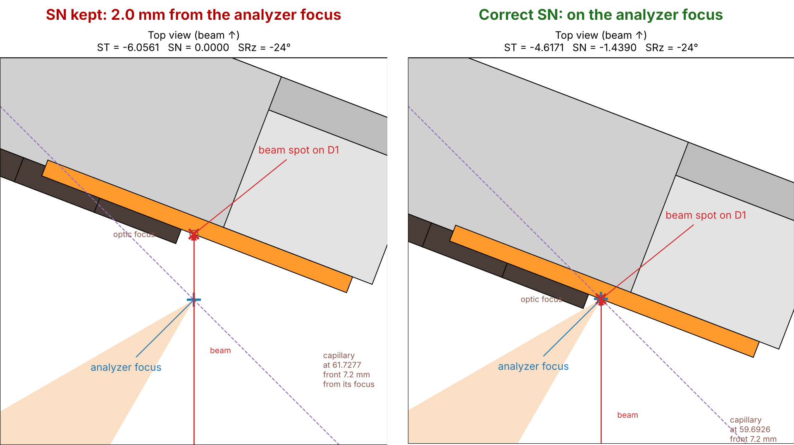

分析器只收集空间中一个固定点发出的电子，即 **分析器焦点**（蓝色 +；分析器焦平面就是相机上的 "SN = 0" 线）。被测的点必须既在光束上，**又** 在这个点上。

- **ST 和 SZ** 让样品托在垂直于光束的方向上移动：把该点移到光束线上。该点此时在光束上的哪个位置，取决于 **SN**；SN 沿托的法线方向移动样品托（与光束成 45°）。
- **SRn** 绕托自身的法线转动：表面留在原平面内，只要 ST、SZ 跟着修正，该点就仍在分析器焦点上。
- **SRz** 绕一根竖直轴转动，而这根轴不经过样品表面（按当前配置，它位于凸台顶面后方约 2.6 mm）。ST、SZ 跟着修正而 **SN 不变** 时，该点仍在光束上，但会 **沿着** 光束滑离分析器焦点。聚焦元件会重新聚焦到该点上，所以光斑仍然很小；但电子来自分析器焦点以外的点：能量和角度标尺会畸变，强度也会下降。超过 50 µm 时程序以红色显示。
- **Correct SN** 移动 SN（ST 随之补偿，因为 SN 不沿光束方向），把该点放回分析器焦点 **上**。聚焦元件随之回到聚焦于分析器焦点的位置。

例子中（左：SN 不变，右：Correct SN，均为 SRn = 92°、SRz = −24°），SN 不变时 D1 上的光斑在分析器焦点下游 2.0 mm；SN = −1.439、ST = −4.617 把它放回焦点，capillary 与转动前一样为 59.6926。

默认保持 SN 不变，一是因为样品台平时就这样操作（表面留在相机的线上，聚焦元件重新聚焦），二是因为 *Correct SN* 是绝对计算：它依赖配置中的 SN_f 和转轴参数。距离显示为红色时再使用它，并检查防碰撞一行：SN 降低会使表面靠近聚焦元件和分析器。在 Stage 页中 *Correct SN* 是一个按钮（针对所选目标和输入的角度），在 Rotate 页中是一个勾选框。

## Quick sample rotation：无需准备直接转动样品

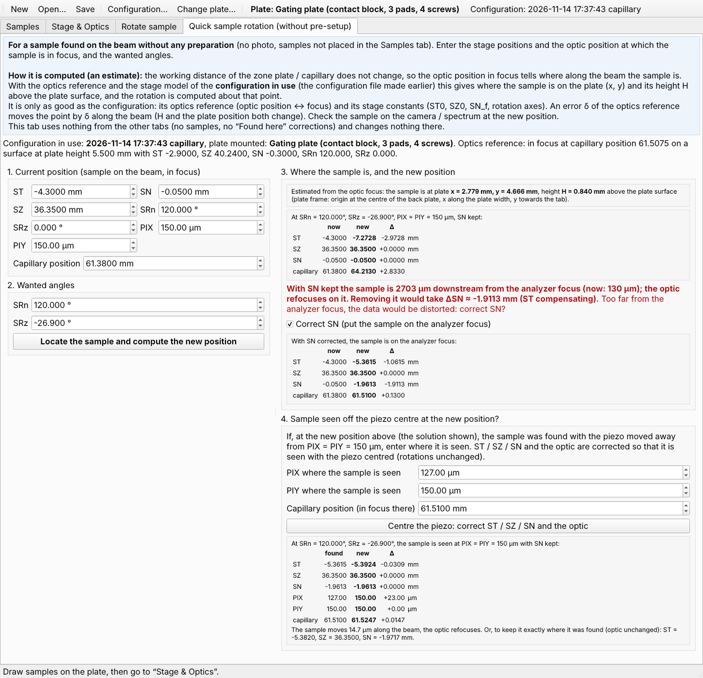

用于 **没有做任何准备** 就在光斑上找到的样品：没有照片，Samples 页里也没有画样品。只需输入样品台位置和样品聚焦时的聚焦元件位置（ZPS / CPS）。

**原理。** zone plate / capillary 的工作距离不变，所以聚焦时的聚焦元件位置说明了样品表面沿光束在哪里。利用 **当前配置** 的光学参考和样品台模型，就能求出样品在托上的位置（x、y）和高度 H，再绕这一点计算转动。本页不使用其他页的任何内容（没有样品，没有 *Found here* 修正），也不会改变其他页。说明文字下方一行给出所用的配置、样品托和光学参考。

1. **Current position**：样品在光斑上且聚焦时的 ST、SZ、SN、SRn、SRz、PIX、PIY，以及聚焦元件位置。
2. **Wanted angles**，然后按 **Locate the sample and compute the new position**。
3. 结果：样品在托上的位置（x、y、H，由聚焦位置估算）；**SN 不变** 时新的 ST / SZ 和重新聚焦的聚焦元件位置；此时样品距分析器焦点多远（超过 50 µm 为红色）；勾选 **Correct SN** 时，把它放到分析器焦点上的 SN、ST、SZ 和聚焦元件位置。超出行程或样品托会碰到东西时用红色标出。
4. **Sample seen off the piezo centre**，与 Rotate sample 页相同（没有 *Send* 按钮：本页独立）。

**例子：Cav，2026-11-14**（配置 2026-11-14 17:37:43 capillary，gating plate）。graphene 样品 Cav 在 SRn = 120°、SRz = 0° 时于 ST = −4.30、SZ = 36.35、SN = −0.05、capillary CPS 61.38 处找到；需要转到 SRz = −26.9°，把 K 点移到狭缝中心。仅凭 CPS，本页给出 Cav 在托上 x = 2.779、y = 4.666 mm，H = 0.840 mm。SN 不变时样品会在分析器焦点下游 2.7 mm（红色），capillary 重新聚焦到 64.21；勾选 *Correct SN*：ST = −5.3615，SZ = 36.35，SN = −1.9613，capillary 61.51（回到分析器焦点）。第 4 步中，若样品在 PIX = 127 µm（偏 23 µm）处看到，piezo 居中时 ST 为 −5.3924。

**估算的精度。** 光学参考的误差 δ 会使该点沿光束移动 δ。对于 Cav，其高度由相机参考线上的 SN 得到更准确的值（H = 0.748），完整预测（Stage & Optics / Rotate 页）为 ST = −5.238、SN = −2.002，实际在 27 µm 以内找到了 Cav（见下一节）；快速估算与之相差 0.12 mm，仍在一张 300 × 300 µm 的 SPEM 扫描图之内。到新位置后在相机 / 谱上确认样品，并用第 4 步把它居中。

## 精度：线站上的实测

使用 2026 年 11 月标定得到的配置测量（报告见 `RealSampleCalibration/docs/reports/`）。位置读数精度 ±0.02 mm；偏差在 SPEM 扫描图（300 × 300 µm，步长 10 µm）上测得。

| 测试 | 转动 | 样品台移动 | 预测误差 | 聚焦 |
|---|---|---|---|---|
| device D1（gating plate），2026-11-14 | SRn 120 → 150，SRz 0 → −10，SN 修正 | ST 0.15 mm，SZ 0.09 mm，SN 0.15 mm | **22 µm** | capillary 不变（61.51），谱相同 |
| 样品 Cav（graphene），2026-11-14 | SRz 0 → −26.9，SN 修正 | ST 0.94 mm，SN 1.95 mm | **27 µm** | capillary 不变（61.38），谱相同 |
| 标定检验点，2026-11-14 | SRn 100、SRn 100 / SRz −5（测量前预测） | – | ≤ **34 µm** | CPS 预测 61.764，实测 61.76 |
| Cav 用 zone plate，2026-11-15 | SRn 140 / SRz −15，SN 不变 | – | – | ZPS 预测 54.30，实测 **54.33** |
| SampleA / D1（本指南），2026-10-24 | SRn 120 → 92，SRz 0 → −24，SN 不变 | ST 3.6 mm，SZ 1.2 mm | **8 µm / 12 µm**（ST / SZ） | capillary 预测 61.73，实测 61.74 |

也就是说，找到并修正（*Found here*）第一个样品后，转动后样品仍在 **50 µm 以内**——在同一张 SPEM 扫描图上——而聚焦元件位置（或 SN 修正）让它保持 **聚焦**，即使是 25° 的 SRz 转动（否则该点会沿光束滑动 2–3 mm）。仅凭照片，第一个样品可在 0.1–0.3 mm 内找到（2026-11-14 的 D1：在一张模糊照片上 x、y 各偏 0.10 mm）。预测的好坏取决于配置：如果 *Found here* 使某个样品移动超过 0.3 mm，或几个样品移动相同的量，请告知线站人员。

## 为布里渊区高对称点寻找转角

对二维六角晶体，*"SRn 和 SRz 要转多少，才能让 K 点位于狭缝中心、狭缝沿 Γ–K、且 deflector 接近 0？"* 这个问题由 **agent** 回答（工具 `align_bz_angles` 和 `align_bz_point_to`；程序界面中没有对应窗口）。告诉它在 ARPES viewer 中 map 的 contour 上读到的内容（θ = deflector 角，contour 的 x；φ = 沿狭缝的角度，contour 的 y）：这张 map 的 SRn / SRz 和光子能量、**Γ** 和 **一个 K 或 M 点** 的角度、面内晶格常数 a、目标点和狭缝方向，以及新测量的光子能量。然后把得到的 SRn / SRz 填入 *Wanted angles*。

当 deflector 为 0 时该点距狭缝中心 |θ| ≤ 5°、|φ| ≤ 5°，狭缝与目标方向偏差在 2° 以内，且 SRn 在 60 … 180°、SRz 在 −25 … +10° 之内，即为 *可达*（优先 SRz ≤ 0：光更接近样品法线、光斑更小）。

### 达不到时

样品台 **没有 tilt 轴**。因此当某点位于狭缝中心且 deflector 为 0 时，狭缝总是沿 Γ 到该点的方向（对 K 点即 Γ–K）。要让狭缝 *垂直* 于这一方向（K–M、M–K），deflector 需要转到该点的出射角（95 eV 时为 15–20°），分析器难以做好。**径向替代方案**：K 点在中心、狭缝沿 Γ–K；此时 deflector 方向正好沿 K–M，做一个小范围的 **deflector map**（|θ| ≤ 5°）即可得到穿过 K 点的 K–M 切面，畸变很小。

当出射角超出 SRz 范围时，提高光子能量可能使该点可达：

- ANTARES：**capillary** 可用 30–180 eV；**zone plate 只能用 95 eV**。用 zone plate 时改变光子能量意味着换成 capillary（重新对光、使用 capillary 的配置）。
- 若受 SRn 限制，重新 mount 时需要 **把样品在托上转一个角度**。
- 若都不行，需要重新 mount 样品，或选择另一个等价点。

| 例子（E_F，功函数 4.5 eV） | K 点在 30 / 95 / 180 eV 的出射角 | K 点、狭缝沿 Γ–K |
|---|---|---|
| WSe2，a = 3.282 Å，Γ–K = 1.28 Å⁻¹ | 29.6° / 15.2° / 10.8° | 95 eV 可达，SRz ≈ −15° |
| graphene，a = 2.46 Å，Γ–K = 1.70 Å⁻¹ | 41.2° / 20.4° / 14.5° | 95 eV：SRz ≈ −20°；30 eV 不可达（需约 61 eV 以上） |

样品台与 ARPES viewer contour 之间的符号已经验证过一次（deflector 符号，2026-09）；第一次做新类型的测量时，请确认该点出现在 agent 给出的位置。

## Session、样品托与配置

- **New / Open… / Save**（工具栏）：一个 session 保存样品托、样品和 device（包括修正）以及电机位置，存为一个 JSON 文件。第一次 *Save* 时会询问文件名。文件以安全方式写入：如果保存失败（磁盘满、无权限），原文件保持不变，并提示原因。
- **Change plate…**：更换样品托；样品保留，位置不合适的会被标出。
- **Configuration…**：只读查看当前使用的配置（样品台常数和光学参考），由线站人员制作。可以为本次 session 选择较早的配置。在 *Motor limits* 中可以手动修改 ST、SZ、SN、SRn、SRz 的运动极限（最小 / 最大值，*Defaults* 恢复默认值）；*Apply limits* 将其用于输入框、超出行程和防碰撞检查，并保存到 `configs/motor_limits.json`，以后启动时继续使用。

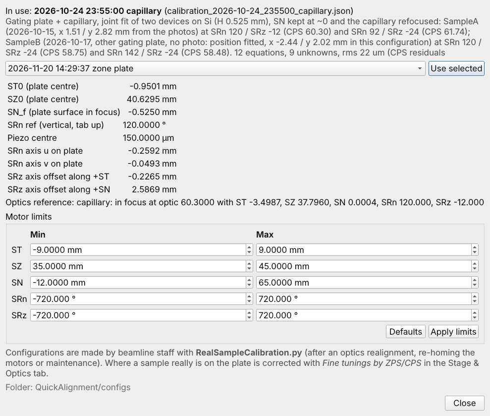

## 一次典型的机时流程

1. 启动 QuickAlignment，确认样品托和聚焦元件。
2. 在 mount 照片上标出样品（*From photo…*），在显微镜照片上定位 device（第 2 页），或者手画；也可以打开机时前准备好的 session。按 *Samples placed → Stage*。（没时间？先在光斑上找到样品，再用 *Quick sample rotation* 页。）
3. 用列出的 ST / SZ / SN（SRn = 120°，SRz = 0°）移到第一个样品或 device，用光斑找到它（相机、光电子 map）。
4. *Found here*：修正它的位置，其他样品随之也会更准。
5. 在 SRn = 120°、SRz = 0° 测一张 map；在 ARPES viewer 中读出 Γ 和一个 K / M 点。
6. 请 agent 给出布里渊区点的转角 → 填入 *Wanted angles* → *Compute new position*（若该点距分析器焦点超过 50 µm，勾选 *Correct SN*）→ *Send to Stage & Optics tab*。如果之后在扫描图上看到样品不在 piezo 中心，用 Rotate 页的第 6 步把它居中。
7. 保存 session。

## 提示信息与处理方法

| 提示 | 含义 / 处理 |
|---|---|
| *Out of range: ST = … (range …)* | 在这些角度下达不到该点；换角度或使用修正后的方案；若样品台实际行程更大，在 *Configuration… → Motor limits* 中设置 |
| *Collision: the plate would touch …* | 在该位置样品托（或样品、螺丝）会撞到聚焦元件或分析器；数值不变：换一个位置，或把聚焦元件退后 |
| *… in the analyzer acceptance cone: it would shadow the electrons* | 聚焦元件挡在电子飞向分析器的路径上；把它移开 |
| *… µm from the analyzer focus*（红色） | 转 SRz 后该点离开了焦平面：勾选 *Correct SN* |
| *Correct the plate / sample position?* | *Found here*：核对位置和 device；按 *Yes* 把样品托移动 Δy（所有样品），把该样品移动 Δx、ΔH |
| *Found here* 移动样品超过 0.3 mm | 绘图有误，或配置已过时（电机重新回零）：请联系线站人员 |
| *The beam misses the plate* | ST / SZ 没有把光打到托上 |
| *Check the input: Γ–K on the map is …* | 晶格常数、点或光子能量与 map 不符 |
| *An unexpected error occurred* | 程序继续运行；检查最近一次结果，保存 session，并把详细信息发给线站人员 |
