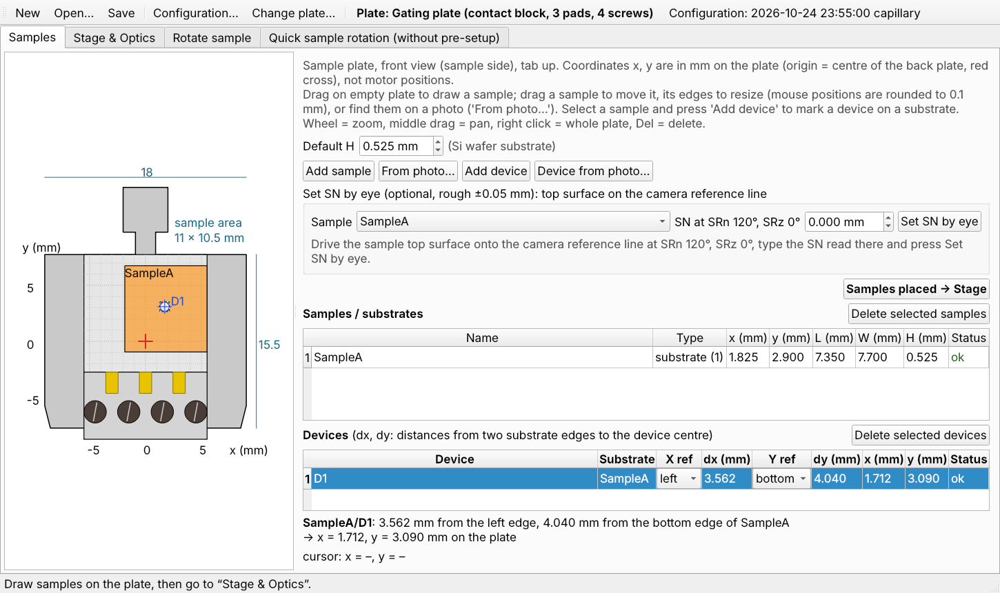
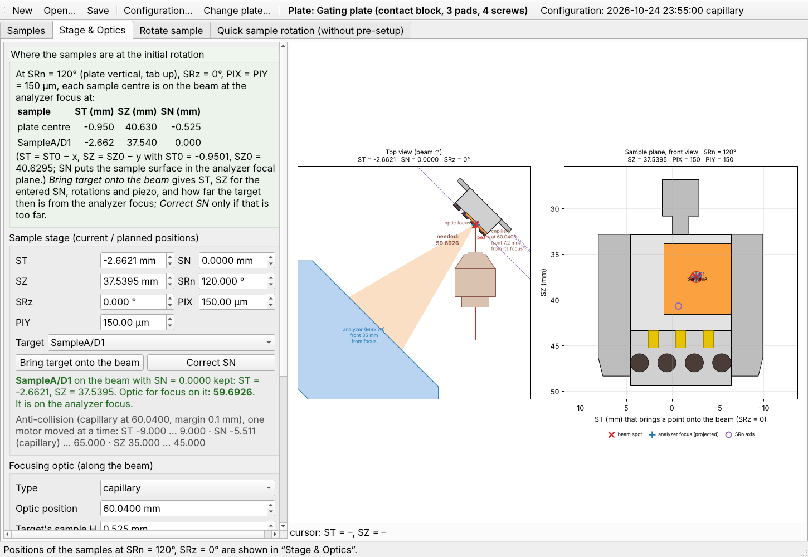
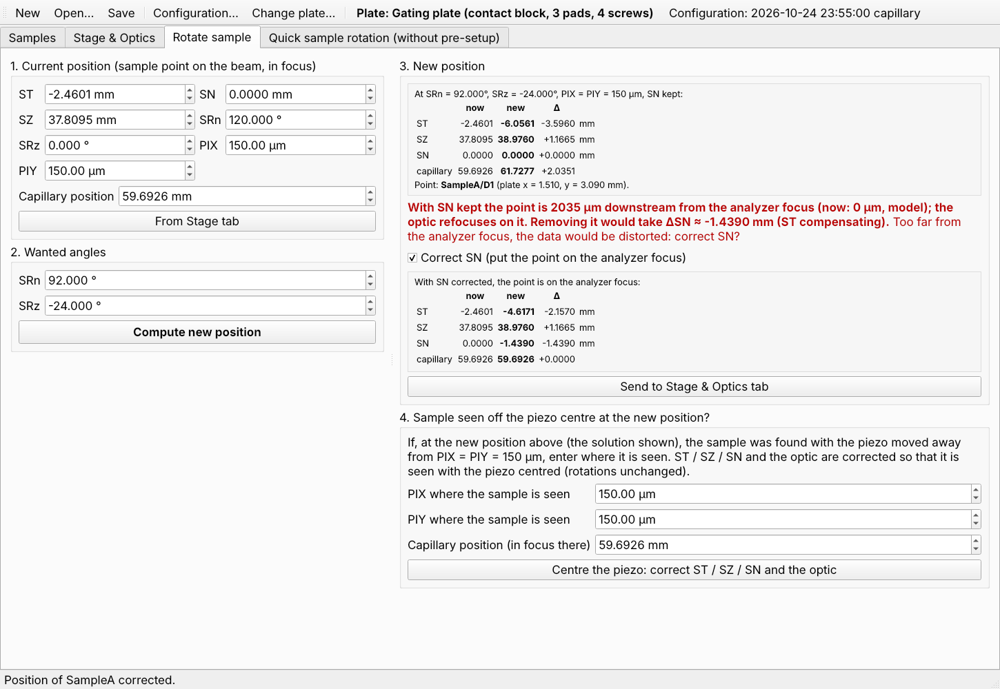
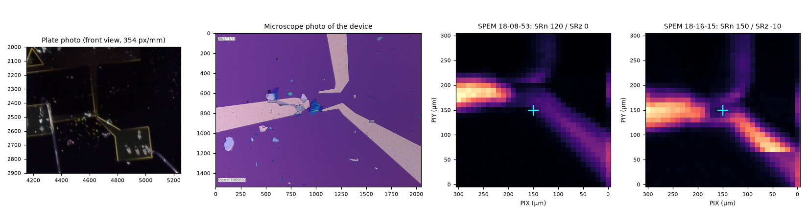
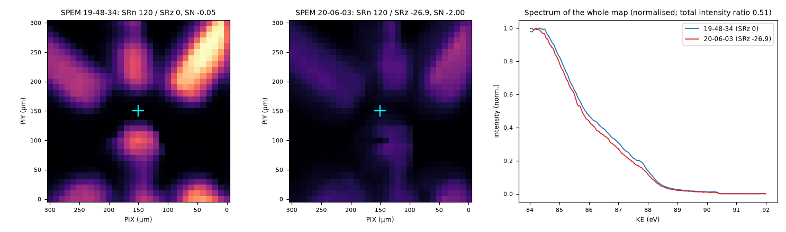

# QuickAlignment (ANTARES, SOLEIL)

Find your samples on the ANTARES sample stage in minutes, turn them without losing them, and keep them in focus.

| | program | what it is for | who |
|---|---|---|---|
| 🔎 | [**QuickAlignment**](QuickAlignment/) | photo of the plate → sample positions (ST, SZ, SN) → rotations, optic focus | users |
| 🧪 | [**RealSampleCalibration**](RealSampleCalibration/) | calibrate the stage on one feature of a real sample | beamline staff |
| 🤖 | [**Agent**](Agent/) | optional: the same computations for an AI assistant (MCP) | – |

User guide: [English](QuickAlignment/docs/pdf/QuickAlignment_user_guide_en.pdf) ·
[中文](QuickAlignment/docs/pdf/QuickAlignment_user_guide_zh.pdf) ·
[Français](QuickAlignment/docs/pdf/QuickAlignment_user_guide_fr.pdf)

## What QuickAlignment does

The beam spot is micrometric, the sample plate 18 × 15.5 mm, and every rotation of SRn / SRz moves the sample away
from the beam and out of focus. QuickAlignment turns the plate geometry and the stage calibration into motor
positions. It never moves a motor: it gives the numbers, you type them in the beamline control.

**1 · Mark the samples on a photo of the plate.** Open a phone photo of the plate, click the four corners of the
sample area and draw a box on each sample; devices are placed on a microscope photo of the substrate. Typing the
heights H finishes the plate.



**2 · Go to a sample.** The Stage & Optics tab lists, for every sample and device, the ST / SZ / SN that put it on the
beam in the analyzer focus at the start orientation (SRn 120°, SRz 0°), and the optic position (ZPS / CPS) for focus.
Once the first sample is found on the beam, **Fine tunings by ZPS/CPS** corrects the drawing (the whole plate in SZ, the sample
in ST / height): the other samples then come out right too.



**3 · Turn it without losing it.** Enter the wanted SRn / SRz: the Rotate sample tab gives the new ST / SZ that keep
the same point on the beam and the optic position that refocuses on it. After an SRz turn the point also slides along
the beam, away from the analyzer focus (2 mm at SRz −24°): the program says how far, and **Correct SN** gives the SN,
ST, SZ that put it back on the analyzer focus. Positions out of the motor ranges or where the plate would touch the
optic or the analyzer are refused. If the sample is then seen off the piezo centre on a map, one more step recentres
it.



**No time to prepare?** For a sample found on the beam with nothing prepared, the *Quick sample rotation* tab locates
it on the plate from the optic position in focus and gives the position after the rotation.

## Tested at the beamline

With the configuration of the capillary calibration of 2026-11-14, two rotations were checked with
SPEM maps (300 × 300 µm, 10 µm steps) before and after the turn
([report](RealSampleCalibration/docs/reports/2026-11-14_capillary_real_sample_calibration.pdf)):

| sample | rotation | stage moved | sample found from the prediction | focus |
|---|---|---|---|---|
| device D1 (gating plate) | SRn 120 → 150, SRz 0 → −10, SN corrected | 0.15 mm ST, 0.09 mm SZ, 0.15 mm SN | **22 µm** | capillary not touched, same spectra |
| graphene Cav | SRz 0 → −26.9, SN corrected | 0.94 mm ST, 1.95 mm SN | **27 µm** | capillary not touched, same spectra |





- **Found within 50 µm.** Once the first sample is found and corrected, the predicted positions are within 50 µm:
  22 and 27 µm after the rotations above, ≤ 34 µm at the calibration check points predicted before they were
  measured. The sample is on the first SPEM map at the new position; no search is needed. From the photo alone, the
  first sample is found within ~0.1 mm (D1: 0.10 mm in x and y on a blurred photo).
- **Not lost by the rotation.** The stage moved by up to 2 mm and the plate turned by 27°; the sample stayed on the
  beam, on the same map. On 2026-10-24 (user guide example) a turn of SRn −28° / SRz −24° was found within
  8 µm in ST and 12 µm in SZ.
- **Focus corrected automatically.** With *Correct SN* the point is put back on the analyzer focus, so the optic
  stays where it was (CPS 61.38 before and after the Cav turn, same spectral shape). With SN kept, the program gives
  the optic position instead: ZPS 54.30 predicted, 54.33 found (zone plate, SRn 140 / SRz −15,
  [2026-11-15 report](RealSampleCalibration/docs/reports/2026-11-15_zone_plate_calibration_srz_axis.pdf)).

**Photon energy.** The configurations were measured at 95 eV, and "the working distance of the optic is fixed" holds
at that energy. At another photon energy the optic positions are shifted (zone plate: focal length ∝ hv; capillary:
achromatic), from `configs/optics_vs_hv.json`, where foci measured at other energies are added as they are tested
(*Photon energy* field of the Stage & Optics tab; agent tools `align_photon_energy`, `align_add_optic_hv_point`).

The positions are as good as the stage calibration in `configs/`, made by the beamline staff with
RealSampleCalibration ([staff guide](RealSampleCalibration/docs/pdf/RealSampleCalibration_staff_guide_en.pdf)).
If *Fine tunings by ZPS/CPS* moves a sample by more than 0.3 mm, or all samples the same way, ask the staff to recalibrate.

## AI assistant (optional)

The same computations are available to an AI assistant (Claude or any MCP client) through the MCP server in
[`Agent/`](Agent/): it can read plate photos, keep track of what was measured and guide a calibration. It is not
needed: everything above is done in the QuickAlignment window. The only feature without a window is the
Brillouin-zone helper (SRn / SRz that bring K or M to the slit centre). Set-up and tools:
[Agent/README.md](Agent/README.md).

## Start

```bash
pip install -r requirements.txt
```

Then double-click `QuickAlignment/QuickAlignment.py` or `RealSampleCalibration/RealSampleCalibration.py` (on Windows
the `.pyw` files open without a console).

## Repository

```
QuickAlignment/          program, user guide, technical README
RealSampleCalibration/   program, staff guide, protocol, calculation details, reports
Agent/                   MCP server for AI assistants
OpticsGeometry/          3-D geometry of the zone plate and the capillary (separate tool, report)
configs/                 calibration configurations (newest per optic is used)
docs/rotation_formula/   the rotation formula (HTML / PDF)
docs/                    notes: alignment procedure, correction buttons (en / zh), tests to do
src/quickalignment/      shared code (core, alignment, realsample, optics, ui, agent)
tests/   devtools/       tests (python -m pytest) and documentation tools
```
