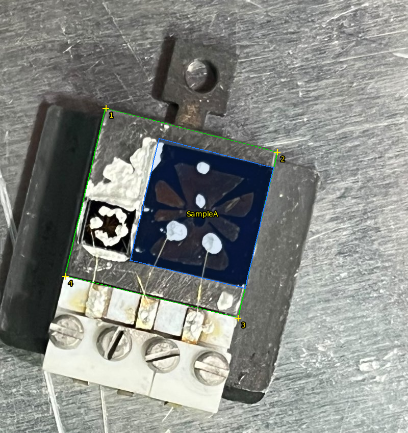

# QuickAlignment (ANTARES, SOLEIL)

Find your samples on the ANTARES sample stage in minutes, and keep them on the beam when you rotate them.
Two programs share one stage model, and an AI assistant can drive both:

| | program | what it is for | who |
|---|---|---|---|
| 🔎 | [**QuickAlignment**](QuickAlignment/) | photo of the plate → sample positions (ST, SZ, SN) → rotations, optic focus | users |
| 🧪 | [**RealSampleCalibration**](RealSampleCalibration/) | calibrate the stage with one feature of a real sample | beamline staff |
| 🤖 | [**Agent**](Agent/) | let an AI assistant (Claude) do all of the above with you, from photos | everyone |

## QuickAlignment — find the samples

Mark the samples on the plate (by hand or **from a photo**), and the program gives the motor positions of each one,
then the new positions after turning SRn / SRz, the optic position for focus, and warns before a collision.


User guide: [English](QuickAlignment/docs/pdf/QuickAlignment_user_guide_en.pdf) ·
[中文](QuickAlignment/docs/pdf/QuickAlignment_user_guide_zh.pdf) ·
[Français](QuickAlignment/docs/pdf/QuickAlignment_user_guide_fr.pdf)

## Calibrating the stage — RealSampleCalibration

The positions are only as good as the stage calibration in `configs/`. **RealSampleCalibration** measures one small,
sharp feature of a real sample at a few stage rotations, fits the stage constants (ST0, SZ0, SN_f, SRn axis, SRz axis,
optic reference), checks them at predicted test points and saves a new configuration that QuickAlignment loads at its
next start.


**The latest calibration (2026-11-14 / 15, gating plate):**

1. **Capillary, full calibration (2026-11-14).** One gold-pad corner of a device on Si, five sets (SRn 120 / 140 / 100,
   SRz 0 / −10 / −5, SN kept in the rotated sets, capillary refocused). The two check sets were predicted from the
   first three within 34 µm; all five are fitted with an rms of 6.7 µm.
2. **Zone plate, optics recalibration + SRz axis (2026-11-15).** After exchanging the capillary for the zone plate,
   only the beam spot (ST0, SZ0) and the ZPS reference were fitted, the mechanics kept. One point of sample Cav was
   then tracked with SPEM maps: an SRn 140 map moved the SRn axis by ~0.15 mm, and a series SRz −5 … −20 with the
   zone-plate focus showed that the SRz axis was 0.97 mm off *across the beam* — a direction only the focus can see,
   which the capillary had not resolved. With the corrected axis, a test at SRn 140 / SRz −15 was predicted at ZPS
   54.30 and found at 54.33.


Configurations in use: `configs/calibration_2026-11-15_151356_zone_plate.json` and
`configs/calibration_2026-11-15_151356_capillary.json`. Reports:
[2026-11-14 capillary](RealSampleCalibration/docs/reports/2026-11-14_capillary_real_sample_calibration.pdf) ·
[2026-11-15 zone plate / SRz axis](RealSampleCalibration/docs/reports/2026-11-15_zone_plate_calibration_srz_axis.pdf).

How every constant is computed (formulas, step by step, and how redundant sets and test points refine the
configuration): [RealSampleCalibration/README.md → *How the calibration is computed*](RealSampleCalibration/README.md#how-the-calibration-is-computed).

Staff guide: [English](RealSampleCalibration/docs/pdf/RealSampleCalibration_staff_guide_en.pdf) ·
[中文](RealSampleCalibration/docs/pdf/RealSampleCalibration_staff_guide_zh.pdf) ·
[Français](RealSampleCalibration/docs/pdf/RealSampleCalibration_staff_guide_fr.pdf) ·
short [protocol](RealSampleCalibration/docs/protocol.md)

## Quick alignment with an AI assistant

The same computations are available to an AI assistant (Claude Desktop, Claude Code, or any MCP client) through the
MCP server in [`Agent/`](Agent/). You talk to it at the beamline in your own language, send it photos and the
numbers you read on the motors; it does the geometry, tells you where to go, and keeps track of what was measured.



### Connect it (once)

* **Claude Code**: open Claude Code in this repository; `.mcp.json` registers the `quickalignment` server — approve it.
* **Claude Desktop**: add the server to `claude_desktop_config.json` (Settings → Developer → Edit config):

  ```json
  { "mcpServers": { "quickalignment": {
      "command": "C:\\Path\\To\\python.exe",
      "args": ["C:\\Path\\To\\QuickAlignment\\Agent\\quickalignment_mcp.py"] } } }
  ```

* Check from a console:

  ```bash
  python Agent/quickalignment_mcp.py --list-tools
  ```

Give the assistant photos as **file paths** (the server reads them at full resolution and can detect samples by
colour); a photo only pasted into the chat can be read by eye, less precisely. Details: [Agent/README.md](Agent/README.md).

### How a session goes

The assistant always starts by asking **what you want to do** (find samples or calibrate), **which plate** is mounted
(standard, gating, custom) and **which optic** (capillary or zone plate) — it never guesses them, since they change
every position.

**1 · From a photo to motor positions**

| you | the assistant | tools |
|---|---|---|
| "Here is my plate: `D:\photos\plate.jpg`, gating plate, zone plate." | starts a session with the newest configuration of that optic | `align_start` |
| | looks at the photo with a pixel grid, zooms on the four corners of the sample area and reads them to a few pixels | `align_photo_grid` |
| | registers the photo on the plate model and **shows you the overlay** to confirm | `align_register_photo`, `align_photo_overlay` |
| | finds the samples (colour detection + its own reading), asks you their **heights** (not visible from above) and names | `align_detect_samples`, `align_add_sample_from_photo` |
| "The flake on S2 is at the lower-left corner." | adds devices on a substrate, also from a microscope photo matched to the plate photo | `align_add_device`, `align_register_device_photo` |
| | asks whether you are satisfied; if not, you say what to change, or mark the samples yourself in the photo window it opens (**manual annotation**) | `align_update_sample`, `align_manual_annotation`, `align_load_annotation` |
| | gives the table of **ST / SZ / SN** of every sample and device at SRn 120 / SRz 0 | `align_sample_positions` |

An oblique photo can optionally be corrected in 3D (points at several heights: riser, back plate, tab corners;
`align_register_photo_3d`).

**2 · At the beamline: correct from what you find**

* "I'm at ST −3.50, SZ 36.54, SN −0.05, I want S3" → ST / SZ that put S3 on the beam with SN kept, or with SN
  corrected to the analyzer focus if it is too far (`align_bring_to_beam`).
* "Found S1 at ST …, SZ …, SN …" → the sample is moved on the plate model and every position recomputed
  (`align_found_here`). Several samples off by more than ~0.3 mm in the same way → the assistant suggests a
  calibration.
* "What does the beam hit here, and where is the focus?" → `align_beam_on`, `align_set_position`.

**3 · Rotations**

* "Go to SRn 140, SRz −15 and keep this point" → new ST / SZ / SN and **optic position** (SN kept and SN corrected,
  with the recommended one), motor-range and **collision** checks (`align_rotate`, `align_collision_check`).
* "Turn this edge along the slit" (two points on the photo) → the SRn to set (`align_align_edge`).
* "Put the K point at the slit centre" (Γ and K read on a measured map, its SRn / SRz and hv) → SRn / SRz
  (`align_bz_angles`), or a K / M point moved to chosen angles at another photon energy (`align_bz_point_to`).

**4 · Calibration with the assistant**

The assistant leads a real-sample calibration one step at a time and never writes a configuration without your
explicit "save":

1. It asks whether **only the optic was realigned** (mode *optics*, the usual case — e.g. capillary → zone plate) or
   the **motors were re-homed** (mode *full*), the reference feature (plate x, y, height H) and, in optics mode,
   whose mechanics to keep (`rsc_start(configuration=…)` — on 2026-11-15 the recent capillary configuration was kept
   rather than an old zone-plate one).
2. For every set it says **what to set** (SRn, SRz, PIX / PIY) and **where the feature should be** (from the previous
   configuration, then from every set already measured), and collects ST, SZ, SN and the optic position
   (`rsc_guide`, `rsc_measure_set`). With SPEM maps it reads the motors and optic from the `.nxs` file and asks you
   at which PIX / PIY the tracked point is (`rsc_read_spem`).
3. `rsc_fit`: fitted constants with uncertainties, change from the previous configuration, residuals per set,
   χ²/dof and the **least-determined combination** (it warns, for example, that the SRz axis across the beam needs
   zone-plate foci at SRz −20 / −25).
4. Test points one by one ("go to SRn 150, SRz 0: ST …, SZ …, SN …, ZPS …; found?") → `rsc_answer_test`, refit,
   next round, until a round is all found.
5. When readings contradict the model, it lists the mismatches and possible causes for you to judge instead of
   freeing more constants to absorb them — this is how the SRz-axis error of 2026-11-15 was traced.
6. `rsc_save` only when you ask.

**Prompts** offered by the server: `start` (choose what to do), `find_samples` (photo → positions), `calibrate`
(step-by-step calibration). The instructions the assistant follows are in `src/quickalignment/agent/workflow.py`; the
full tool reference is generated in [`src/quickalignment/agent/API.md`](src/quickalignment/agent/API.md).

**Good to know**

* The assistant never invents measured values (motor or optic positions): it asks you.
* Numbers are always written with "." as decimal separator, whatever the language of the computer.
* Photo reading is approximate (a few pixels ≈ tens of µm); your beamline feedback (*found here*) always wins.
* The same API works from Python without an assistant: `from quickalignment.agent import AgentAPI`
  (example in [Agent/README.md](Agent/README.md#python-api)).

## Start

```bash
pip install -r requirements.txt
```

Then double-click `QuickAlignment/QuickAlignment.py` or `RealSampleCalibration/RealSampleCalibration.py` (on Windows
the `.pyw` files open without a console).

## Repository

```
QuickAlignment/          program, user guide, technical README
RealSampleCalibration/   program, staff guide, protocol, calculation details, reports
Agent/                   MCP server for AI assistants
configs/                 calibration configurations (newest per optic is used)
src/quickalignment/      shared code (core, alignment, realsample, ui, agent)
tests/   devtools/       tests (python -m pytest) and documentation tools
```
