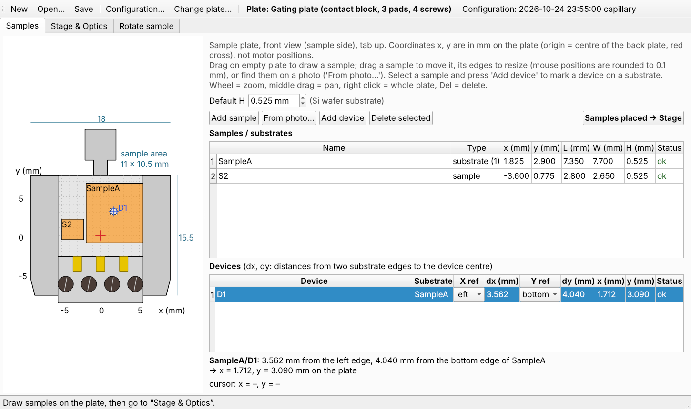
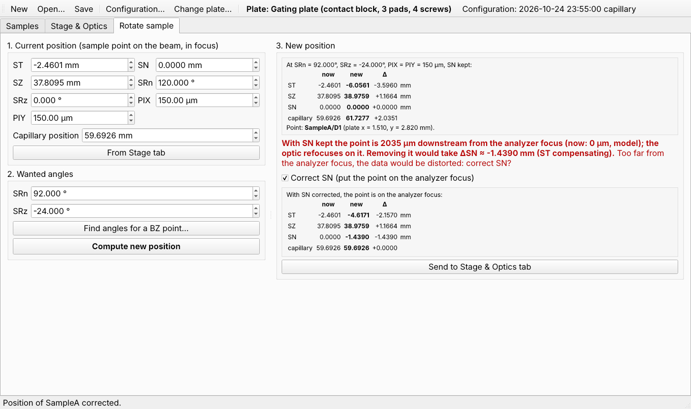
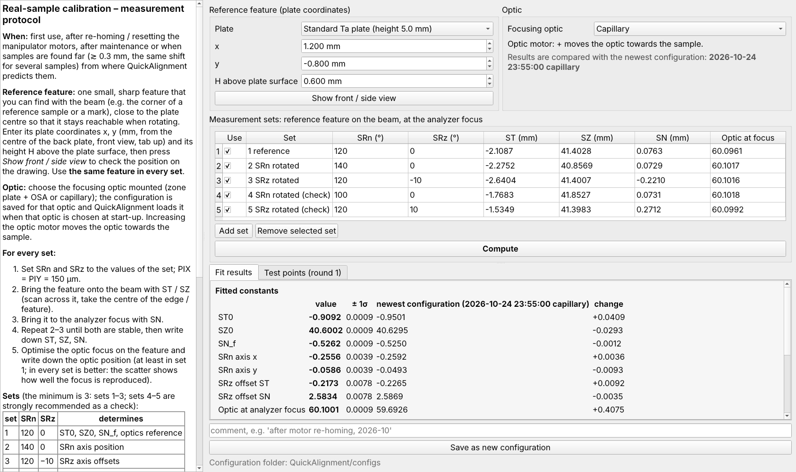
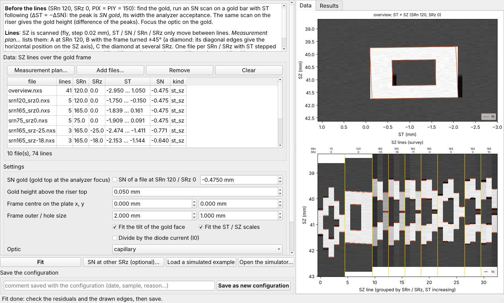
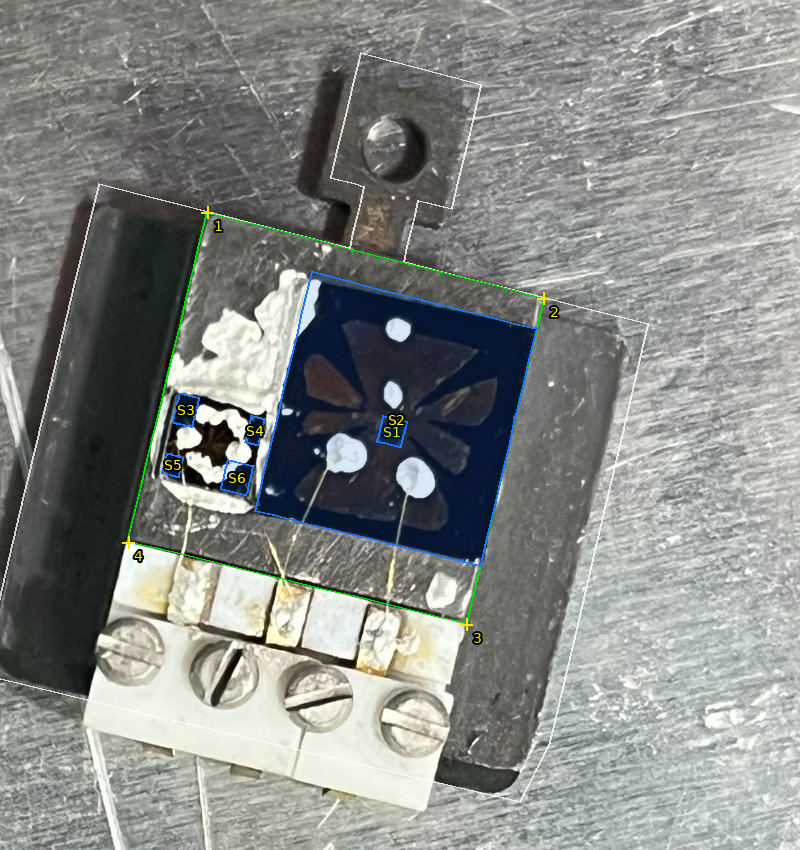

# QuickAlignment (ANTARES, SOLEIL)

Find your samples on the ANTARES sample stage in minutes, and keep them on the beam when you rotate them.
Three programs share one stage model:

| | program | what it is for | who |
|---|---|---|---|
| 🔎 | [**QuickAlignment**](QuickAlignment/) | photo of the plate → sample positions (ST, SZ, SN) → rotations, optic focus | users |
| 🧪 | [**RealSampleCalibration**](RealSampleCalibration/) | calibrate the stage with one feature of a real sample | beamline staff |
| 🟨 | [**GoldFrameCalibration**](GoldFrameCalibration/) | calibrate the stage with SPEM lines over the gold reference frame | beamline staff |
| 🤖 | [**Agent**](Agent/) | let an AI assistant (Claude) do all of the above with you, from photos | everyone |

## QuickAlignment — find the samples

Mark the samples on the plate (by hand or **from a photo**), and the program gives the motor positions of each one,
then the new positions after turning SRn / SRz, the optic position for focus, and warns before a collision.





User guide: [English](QuickAlignment/docs/pdf/QuickAlignment_user_guide_en.pdf) ·
[中文](QuickAlignment/docs/pdf/QuickAlignment_user_guide_zh.pdf) ·
[Français](QuickAlignment/docs/pdf/QuickAlignment_user_guide_fr.pdf)

## Calibrating the stage

The positions are only as good as the stage calibration in `configs/`. Two ways to make it:

**RealSampleCalibration** — one small feature measured at a few rotations, checked at test points.



Staff guide: [English](RealSampleCalibration/docs/pdf/RealSampleCalibration_staff_guide_en.pdf) ·
[中文](RealSampleCalibration/docs/pdf/RealSampleCalibration_staff_guide_zh.pdf) ·
[Français](RealSampleCalibration/docs/pdf/RealSampleCalibration_staff_guide_fr.pdf)

**GoldFrameCalibration** — 33 fast SZ lines over the 2 × 2 mm gold frame, all fitted at once.



[Experiment plan](GoldFrameCalibration/docs/pdf/GoldFrame_experiment_plan_en.pdf) ·
report: [English](GoldFrameCalibration/docs/pdf/GoldFrame_calibration_report_en.pdf) ·
[中文](GoldFrameCalibration/docs/pdf/GoldFrame_calibration_report_zh.pdf) ·
[Français](GoldFrameCalibration/docs/pdf/GoldFrame_calibration_report_fr.pdf)

## With an AI assistant

Send the photos of your plate; the assistant asks whether you want to find samples or calibrate, which plate and
optic you use, finds the riser corners and the samples on the photo, gives you the positions, corrects them from what
you find at the beamline, and computes the rotations. See [Agent/README.md](Agent/README.md) to connect it.



## Start

```bash
pip install -r requirements.txt
```

Then double-click `QuickAlignment/QuickAlignment.py`, `RealSampleCalibration/RealSampleCalibration.py` or
`GoldFrameCalibration/GoldFrameCalibration.py` (on Windows the `.pyw` files open without a console).

## Repository

```
QuickAlignment/          program, user guide, technical README
RealSampleCalibration/   program, staff guide, protocol
GoldFrameCalibration/    program + simulator, experiment plan, report
Agent/                   MCP server for AI assistants
configs/                 calibration configurations (newest per optic is used)
src/quickalignment/      shared code (core, alignment, realsample, goldframe, ui, agent)
tests/   devtools/       tests (python -m pytest) and documentation tools
```
