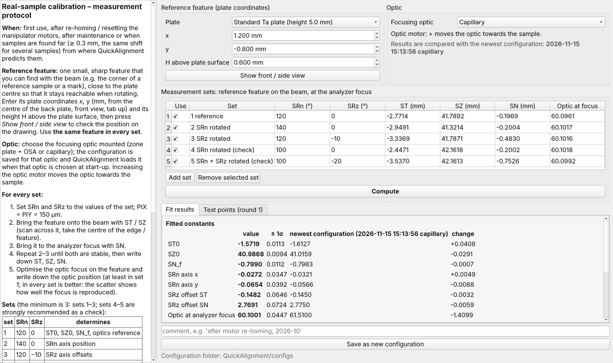
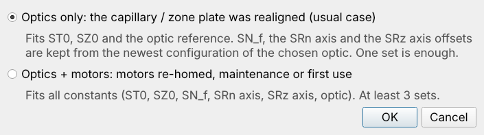
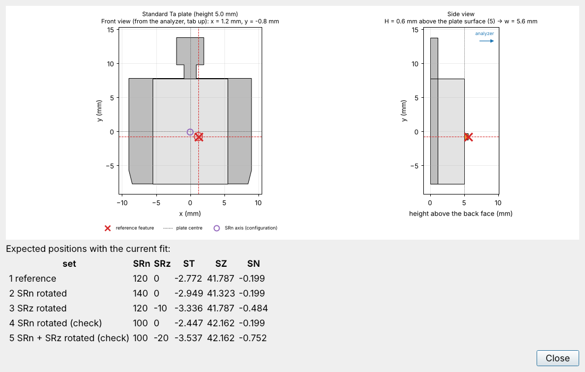
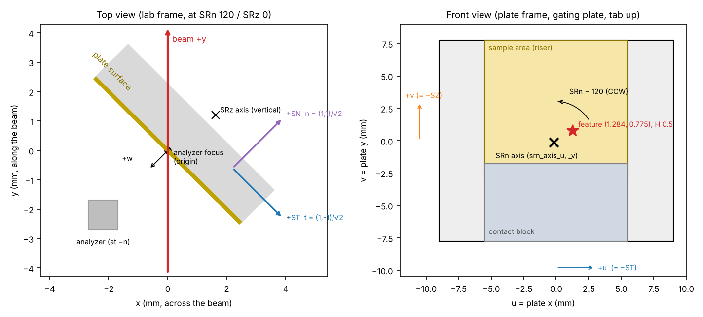
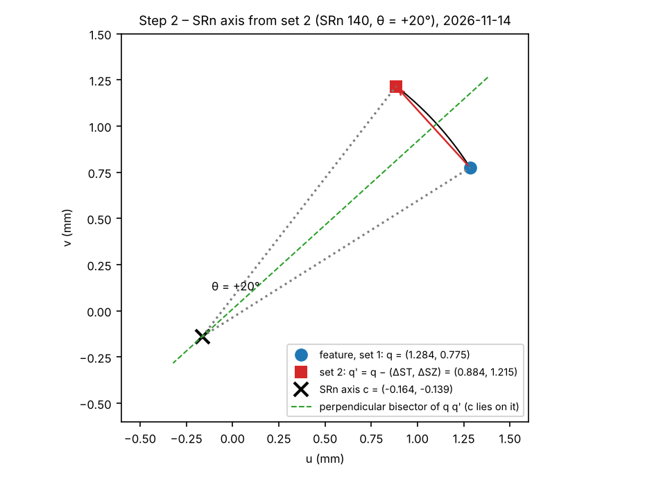
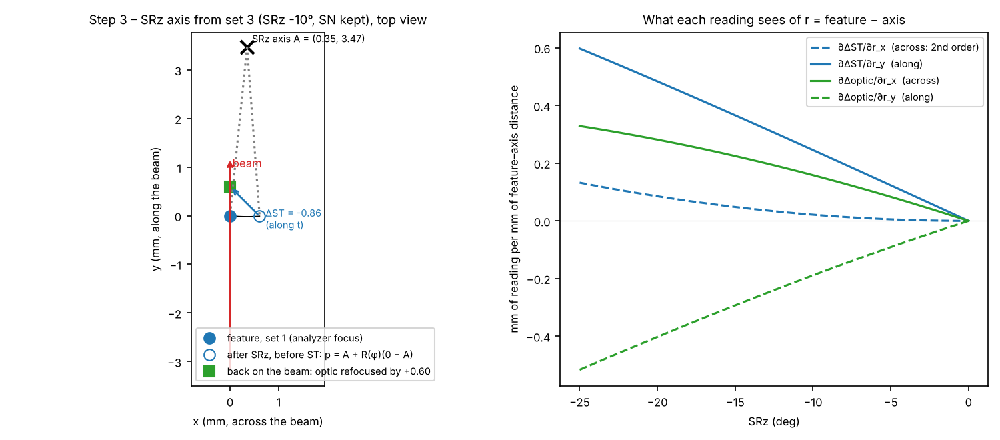
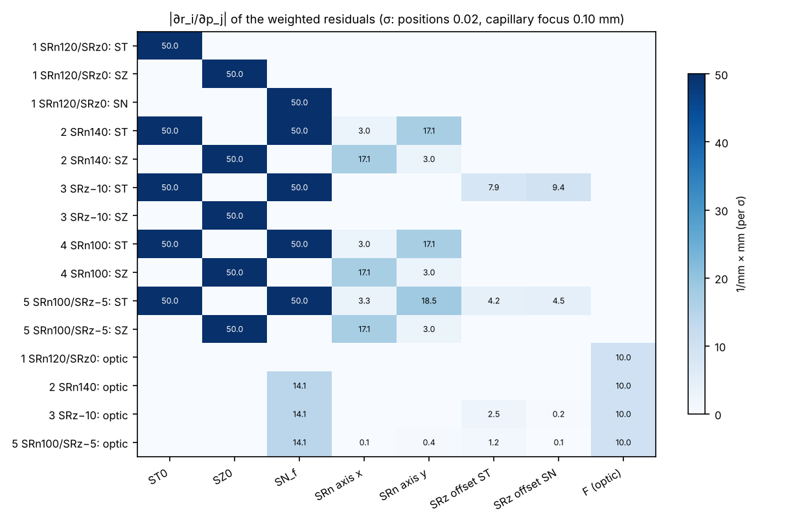
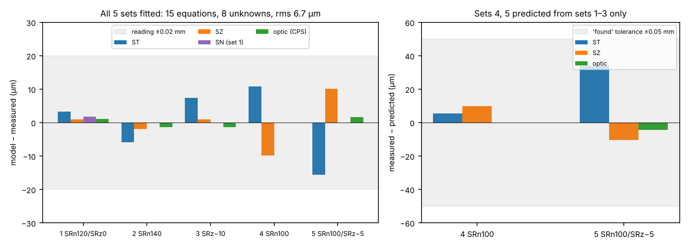
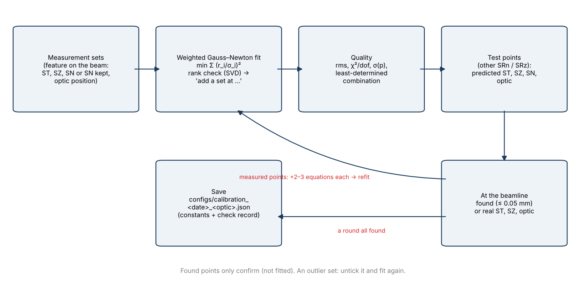
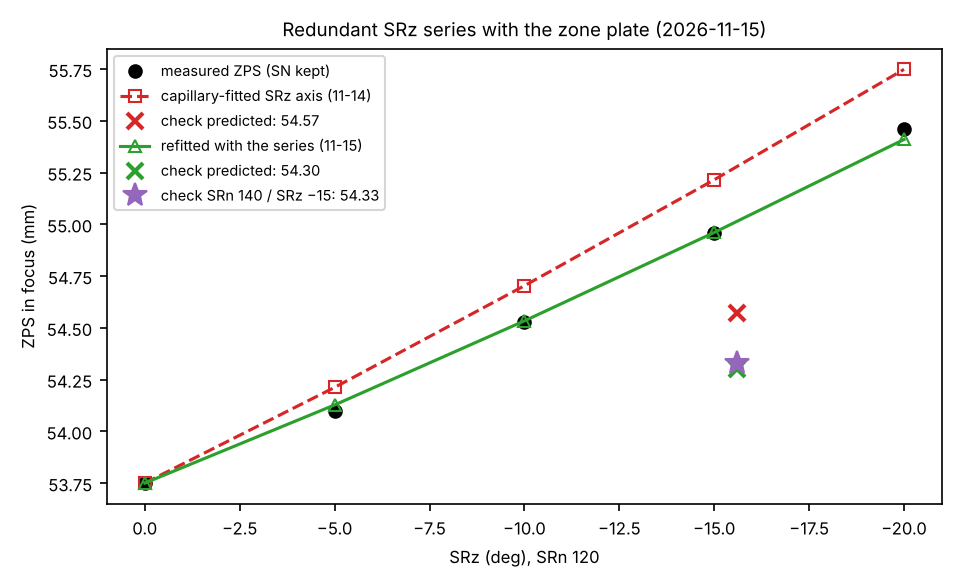

# RealSampleCalibration — technical reference

(Formerly *InitialCalibration*.) Fits the constants of the stage model (ST0, SZ0, SN_f, SRn axis, SRz axis offsets) and
the optic reference from **one reference feature of a real sample** measured at a few stage orientations, checks them
at test points, and saves a new configuration in `configs/` that QuickAlignment loads at its next start.

Beamline staff guide (PDF): [en](docs/pdf/RealSampleCalibration_staff_guide_en.pdf) ·
[中文](docs/pdf/RealSampleCalibration_staff_guide_zh.pdf) · [fr](docs/pdf/RealSampleCalibration_staff_guide_fr.pdf)
(sources `docs/STAFF_GUIDE_*.md`); short protocol: [`docs/protocol.md`](docs/protocol.md).

Code: `src/quickalignment/realsample/fit.py` (fit, test points, record), window `src/quickalignment/ui/real_sample_window.py`.
Agent / MCP access: tools `rsc_*` ([`../Agent/README.md`](../Agent/README.md)).

**How the constants are computed** (stage model, measurement equations, step-by-step solution with the data of
2026-11-14, least-squares fit, use of redundant sets and test points): [section below](#how-the-calibration-is-computed).

## Run

Double-click **`RealSampleCalibration.py`** in this folder (Windows: `RealSampleCalibration.pyw`, no console), or
`python RealSampleCalibration/RealSampleCalibration.py` from the repository root.

## What was recalibrated

At start-up the program asks what was recalibrated:

- **Optics only** (default, the usual case: capillary / zone plate realigned): ST0, SZ0 and the optic reference are
  fitted; SN_f, the SRn axis and the SRz axis offsets are kept from the newest configuration of the chosen optic. The
  sets are measured as the stage is run: SN left as it is, feature onto the beam with ST / SZ, optic refocused. One set
  (SRn 120, SRz 0) is enough; sets with SRn / SRz rotated check the kept axes (warning above 0.02 mm rms: the mechanics
  have changed, use optics + motors). Not offered when there is no configuration yet.
- **Optics + motors** (re-homing, maintenance, first use): all constants. Beamline staff measure one reference feature
  in 3 (minimum) or 5 (recommended) stage orientations, at the analyzer focus.

| set | SRn | SRz | determines |
|---|---|---|---|
| 1 | 120 | 0 | ST0, SZ0, SN_f, optics reference |
| 2 | 140 | 0 | SRn axis position |
| 3 | 120 | −10 | SRz axis offsets |
| 4 | 100 | 0 | check |
| 5 | 120 | +10 | check |

*Show front / side view* draws the plate with the entered feature to check its position:

The optic position at best focus can be noted in every set (optic + = towards the sample); all constants and the
optics reference are fitted every time and compared with the newest configuration (least squares, Gauss–Newton; the
fit says which set is missing when a constant is not determined).

## Test points

After *Compute*, test points at other rotations (SRn ±30, SRz ±15, combined) are predicted: staff go there and tick
*Found* (within 0.05 mm) or enter the real ST, SZ and optic position (SRn, SRz, SN kept). Measured points are added to
the next fit (found points only confirm); this is repeated round after round until a round is all found. The
configuration (constants, optics reference, sets, test points, residuals in its `check` record) is then saved as
`configs/calibration_<date>_<time>_<optic>.json`; the anti-collision solids of the previous configuration of the same
optic are kept. How the constants are computed from the sets and the test points: [below](#how-the-calibration-is-computed).

## Configurations in use

| optic | file | how it was made |
|---|---|---|
| zone plate | `configs/calibration_2026-11-19_123901_zone_plate.json` | standard plate, 2026-11-19: ST0 / SZ0 from one device found on the beam at SRn 120 / SRz 0 (zone-plate working distance, SN_f and the rotation axes of the 2026-11-17 configuration kept) |
| capillary | `configs/calibration_2026-11-15_151356_capillary.json` | full calibration of 2026-11-14 (5 sets on a gold-pad corner) with the axes of 2026-11-15 |

Reports: [2026-11-14 capillary real-sample calibration](docs/reports/2026-11-14_capillary_real_sample_calibration.pdf) ·
[2026-11-15 zone-plate calibration and SRz-axis correction](docs/reports/2026-11-15_zone_plate_calibration_srz_axis.pdf)
(sources in `docs/reports/src/`). Earlier zone-plate steps kept as history: `…2026-11-15_151356_zone_plate.json` (optics mode on
sample Cav, gating plate, + SRn / SRz axes from zone-plate SPEM point tracking) and `…2026-11-17_153957_zone_plate.json`
(the same, with the tracked point re-read on the plate photo: the plate frame shifted by +0.135 / −0.063 mm). Everything
that was measured is also kept in the `check` record of each file.

---

## How the calibration is computed

This section explains, step by step, what `src/quickalignment/realsample/fit.py` does with the numbers read at the
beamline, using the real data of the **2026-11-14 capillary calibration** (gating plate, reference feature = top-right
corner of the lower-right gold pad, plate x = 1.284, y = 0.775 mm, H = 0.500 mm) and of the **2026-11-15 zone-plate
SRz series**. The figures and every number below are produced by
[`docs/calculation/make_figures.py`](docs/calculation/make_figures.py) from the files in `configs/`.

Contents: [1 Frames](#1-frames-and-motors) · [2 Stage model](#2-the-stage-model-plate--lab) ·
[3 Measurement equations](#3-what-one-measurement-says) · [4 Step by step](#4-step-by-step-solving-the-constants-one-group-at-a-time) ·
[5 Least squares](#5-the-least-squares-fit-all-constants-at-once) ·
[6 Redundant data](#6-redundant-data-how-it-improves-the-configuration) · [7 What is saved](#7-what-is-written-into-the-configuration-file)

### 1. Frames and motors

**Lab frame** (mm): origin at the **analyzer focus**, $+x$ across the beam (right in the top view), $+y$ along the beam,
$+z$ up. The translations move the stage along

$$\hat t=\tfrac{1}{\sqrt2}(1,-1,0)\ (\text{+ST}),\qquad \hat n=\tfrac{1}{\sqrt2}(1,1,0)\ (\text{+SN, away from the analyzer}),\qquad \hat z\ (\text{+SZ}).$$

**Plate frame** $(u,v,w)$: fixed to the back plate, origin at its centre, $u$ right and $v$ up in the front view (tab
up), $w$ = height above the back face. At SRn = 120°, SRz = 0 the plate axes are $u\to\hat t$, $v\to\hat z$,
$w\to-\hat n$, i.e. the matrix $B=[\,\hat t\ \ \hat z\ \ -\hat n\,]$. A sample surface of height $H$ on a 5.0 mm
riser is at $w = 5.0 + H$ (feature of 2026-11-14: $w = 5.5$).

**Stacking** (bottom to top): ST / SN / SZ translations → SRz (vertical axis) → SRn (axis along the plate normal) →
piezo PIX / PIY → plate.

**The constants** to determine ($\mathbf p$):

| symbol | config key | meaning |
|---|---|---|
| $ST_0,\ SZ_0$ | `st0`, `sz0` | ST, SZ putting the plate centre on the beam at SRn 120 / SRz 0 |
| $SN_f$ | `sn_f` | SN putting $w = 5.0$ (standard riser top) in the analyzer focal plane |
| $\mathbf c=(c_u,c_v)$ | `srn_axis_u`, `srn_axis_v` | SRn rotation axis on the plate |
| $o_t,\ o_n$ | `srz_offset_t`, `srz_offset_n` | SRz axis offset along ST and SN |
| $F$ | `optics.optic_position` (via §7) | optic position focusing on the analyzer focus (+ = optic towards the sample) |

$SRn_{ref}=120°$ and the piezo centre (150 µm) are fixed, not fitted: with a single feature the SRn zero angle cannot
be separated from the SRn axis position.

### 2. The stage model (plate → lab)

For motor positions $m=(ST,SN,SZ,SRn,SRz,PIX,PIY)$ a plate point $(u,v,w)$ is at the lab point $\mathbf P$:

$$\mathbf q=\begin{pmatrix}u\\v\end{pmatrix}+\frac{1}{1000}\begin{pmatrix}PIX-150\\-(PIY-150)\end{pmatrix},\qquad
\mathbf q' = \mathbf c + R_2(\theta)\,(\mathbf q-\mathbf c),\quad \theta = SRn-120°$$

$$\boldsymbol\ell=(q'_u,\ q'_v,\ w),\qquad \mathbf a=(o_t,\ 0,\ 5.0-o_n)\quad(\text{a point of the SRz axis, plate coordinates})$$

$$\boxed{\ \mathbf P = \mathbf T(m) + B\,\mathbf a + R_z(\varphi)\,B\,(\boldsymbol\ell-\mathbf a),\qquad \varphi=-SRz\ }$$

$$\mathbf T(m) = (ST-ST_0)\,\hat t + (SN-SN_f+5.0)\,\hat n + (SZ-SZ_0)\,\hat z$$

$R_2$ is the 2-D rotation (counter-clockwise seen from the analyzer), $R_z$ the rotation about $+z$ (SRz < 0 turns the
plate counter-clockwise seen from above). Code: `StageModel.plate_to_lab` (`src/quickalignment/core/stage.py`).

Note what the SRz offsets mean physically: the horizontal lab position of the SRz axis is

$$\mathbf A = (ST-ST_0+o_t)\,\hat t + (SN-SN_f+o_n)\,\hat n ,$$

so $o_t$, $o_n$ are the axis position measured from the point where ST = ST0, SN = SN_f put the plate centre / the
reference plane.

### 3. What one measurement says

The feature is a known plate point $(u,v,w)$. Write $\mathbf P_0$ for $\mathbf P$ computed with $ST=ST_0$, $SZ=SZ_0$
(and $SN = SN_f-5.0$ or the SN read). Because $\mathbf T$ is linear in the motors:

**(a) Feature at the analyzer focus** ($\mathbf P = 0$; a full set, e.g. set 1) — 3 equations:

$$ST = ST_0 - \mathbf P_0\!\cdot\hat t,\qquad SN = SN_f - 5.0 - \mathbf P_0\!\cdot\hat n,\qquad SZ = SZ_0 - \mathbf P_0\!\cdot\hat z$$

**(b) SN kept, feature brought onto the beam with ST / SZ, optic refocused** (how the stage is run; `sn_kept` sets,
mode *optics*, measured test points) — 2 equations + 1 for the optic. ST moves along $\hat t$, so cancelling $P_x$
costs $\Delta ST=-\sqrt2 P_x$ and slides the point by $+P_x$ along the beam:

$$ST = ST_0-\sqrt2\,P_{0,x},\qquad SZ = SZ_0-P_{0,z},\qquad \text{optic} = F + P_{0,x}+P_{0,y}$$

(the optic focus is at $y = \text{optic}-F$). Code: `on_beam`, `StageModel.motors_for_target`.

**(c) The optic in a set of kind (a)**: the feature is at $y=0$, so $\text{optic}=F$.

**At the reference rotation** (SRn 120, SRz 0, piezo centred) the model reduces to

$$ST = ST_0-u,\qquad SZ = SZ_0-v,\qquad SN = SN_f+w-5.0 .$$

Counting: 7 constants (+ $F$); each full set gives 3 equations, an SN-kept set 2 (+1 with the optic). An SRn rotation
moves only ST, SZ; an SRz rotation moves only ST and the position along the beam. Hence **3 sets minimum** (reference,
SRn rotated, SRz rotated), 5 recommended.

### 4. Step by step: solving the constants one group at a time

The fit does everything at once (§5), but with the three minimum sets the problem separates into closed-form steps.
This is the clearest way to see *which reading fixes which constant*. Data of 2026-11-14 (capillary, positions
±0.02 mm, CPS by eye ±0.1 mm):

| set | SRn | SRz | ST | SZ | SN | CPS | kind |
|---|---|---|---|---|---|---|---|
| 1 | 120 | 0 | −2.90 | 40.24 | −0.30 | 61.45 | analyzer focus (a) |
| 2 | 140 | 0 | −2.50 | 39.80 | −0.30 | 61.45 | SN kept (b) |
| 3 | 120 | −10 | −3.76 | 40.24 | −0.30 | 62.05 | SN kept (b) |
| 4 | 100 | 0 | −3.12 | 40.80 | −0.30 | – | SN kept, check |
| 5 | 100 | −5 | −3.54 | 40.78 | −0.30 | 61.76 | SN kept, check |

**Step 1 — ST0, SZ0, SN_f, F from set 1** (reference rotation, §3):

$$ST_0 = ST_1+u = -2.90+1.284 = -1.616,\qquad SZ_0 = SZ_1+v = 40.24+0.775 = 41.015$$
$$SN_f = SN_1-w+5.0 = -0.30-0.5 = -0.800,\qquad F = \text{CPS}_1 = 61.45$$

**Step 2 — SRn axis from set 2** (SRn rotated by $\theta=+20°$, SRz 0). With SN unchanged the feature stays in the
focal plane; on the plate it moved from $\mathbf q$ to $\mathbf q'=\mathbf q-(\Delta ST,\Delta SZ)$, and
$\mathbf q'=\mathbf c+R_2(\theta)(\mathbf q-\mathbf c)$ gives

$$\boxed{\ \mathbf c = \big(I-R_2(\theta)\big)^{-1}\big(\mathbf q' - R_2(\theta)\,\mathbf q\big)\ }$$

$\mathbf q=(1.284,\,0.775)$, $\Delta ST=+0.40$, $\Delta SZ=-0.44$ → $\mathbf q'=(0.884,\,1.215)$ →
$\mathbf c=(-0.164,\,-0.139)$ mm. Geometrically, $\mathbf c$ is the apex of the isosceles triangle with base
$\mathbf q\mathbf q'$ and apex angle $\theta$:

Error propagation: $\|(I-R_2)^{-1}\| = 1/(2\sin\frac{\theta}{2}) = 2.88$ for 20°, so ±0.028 mm on a difference of two
readings gives about ±0.08 mm on the axis. Larger rotations (|SRn − 120| ≥ 20°) and more SRn sets reduce it.

**Step 3 — SRz axis from set 3** (SRz = −10°, i.e. $\varphi=+10°$, SN kept). In the horizontal plane the feature,
first at the origin, turns about the axis $\mathbf A$: displacement $\mathbf d = (R_z(\varphi)-I)\,\mathbf r$ with
$\mathbf r$ = feature − axis. ST brings it back onto the beam and the optic measures where it ends along the beam:

$$d_x = -\Delta ST/\sqrt2,\qquad d_y = \Delta\text{optic}-d_x,\qquad
\boxed{\ \mathbf r = \big(R_z(\varphi)-I\big)^{-1}\mathbf d,\quad \mathbf A=-\mathbf r\ }$$

$$o_t = \mathbf A\cdot\hat t-(ST_1-ST_0),\qquad o_n = \mathbf A\cdot\hat n-(SN_1-SN_f)$$

$\Delta ST=-0.86$, $\Delta\text{CPS}=+0.60$ → $\mathbf d=(0.608,\,-0.008)$ → $\mathbf r=(-0.350,\,-3.471)$ mm →
$o_t=-0.923$, $o_n=2.202$.

To first order in $\varphi$:

$$\Delta ST=\sqrt2\,[(1-\cos\varphi)\,r_x+\sin\varphi\,r_y],\qquad \Delta\text{optic}=(\cos\varphi-1+\sin\varphi)\,r_x+(\cos\varphi-1-\sin\varphi)\,r_y$$

**ST sees the axis position across the beam ($r_x$) only to second order**; it is the optic focus that measures it
(right panel). With σ = 0.02 mm on ST and 0.10 mm on the capillary focus, one SRz −10° set fixes $r_y$ to ±0.13 mm but
$r_x$ only to **±0.82 mm**; with a zone-plate focus (±0.02 mm) ±0.20 mm. This is exactly the error found on 2026-11-15
(§6.4).

These three steps reproduce the least-squares fit of sets 1–3 exactly (ST0 −1.6160, SZ0 41.0150, SN_f −0.8000, SRn
axis −0.1637 / −0.1393, SRz offsets −0.9228 / 2.2024, F 61.450): with the minimum data the fit *is* this
calculation.

### 5. The least-squares fit: all constants at once

With more data the steps are coupled (set 5 sees the SRn and the SRz axis together, set 2 sees SN_f through SN kept,
…), so `fit_real_sample_calibration` solves them together.

**Residuals.** For every used set and every *measured* test point, the model prediction (§3) minus the reading,
divided by its reading error:

$$r_i(\mathbf p)=\frac{\text{model}_i(\mathbf p)-\text{reading}_i}{\sigma_i},\qquad
\sigma_{ST,SZ,SN}=0.02\ \text{mm},\quad \sigma_\text{optic}=\begin{cases}0.10 & \text{capillary}\\0.02&\text{zone plate}\end{cases}$$

**Cost and Gauss–Newton.** $\displaystyle \min_{\mathbf p}\ \chi^2=\sum_i r_i^2$. Start from the previous configuration
(and $F$ = mean optic reading), then iterate

$$J_{ij}=\frac{\partial r_i}{\partial p_j}\ (\text{finite differences, }10^{-6}),\qquad
\Delta\mathbf p=-\big(J^{\mathsf T}J\big)^{-1}J^{\mathsf T}\mathbf r\ \ (\text{solved by lstsq}),\qquad
\mathbf p\leftarrow\mathbf p+\Delta\mathbf p$$

until $\max|\Delta p|<10^{-12}$ (at most 30 iterations).

**Is every constant determined?** Before each step the singular values $s_k$ of $J$ are checked. A value
$s_k < 10^{-6}\max(s_0,1)$ is a direction of $\mathbf p$ the data cannot see; the constants with a component > 10⁻³
in it are reported with what to measure (e.g. *"Not enough data to determine SRz offset SN. Add a set with SRz rotated
(SRn = ref), at the analyzer focus or with its optic position noted."*).

Which reading carries which constant is visible in $J$ (2026-11-14, weighted):

The SRz offsets appear only in small entries (ST of set 3 / 5 and, weakly, their CPS): they are the least determined
constants.

**Mode *optics*.** Only $ST_0$, $SZ_0$ (+ $F$) are free; $SN_f$, $\mathbf c$, $o_t$, $o_n$ are taken from the chosen
configuration and every set is of kind (b). $\mathbf P_0$ does not depend on $ST_0$, $SZ_0$, so one set gives them
directly: $ST_0 = ST_1+\sqrt2\,P_{0,x}$, $SZ_0 = SZ_1+P_{0,z}$, $F = \text{optic}_1-P_{0,x}-P_{0,y}$. Further sets
at other rotations are redundant and check the kept mechanics (§6).

### 6. Redundant data: how it improves the configuration

Every equation beyond the number of constants is **redundancy**: degrees of freedom $\nu = N_\text{eq}-N_\text{par}$.
On 2026-11-14: 5 sets → 15 equations (3+1, 2+1, 2+1, 2, 2+1), 8 unknowns, $\nu=7$. Redundancy is used in five ways.

#### 6.1 Least squares averages the readings

The two check sets (SRn 100 and SRn 100 / SRz −5) are not wasted: they enter the same fit and pull the constants
towards the values that fit *all* readings. From 3 to 5 sets: SRn axis −0.164 / −0.139 → **−0.166 / −0.107**,
ST0 −1.616 → −1.613, SN_f −0.800 → −0.798, with an rms of all residuals of **6.7 µm** and the largest 16 µm:

#### 6.2 Uncertainties, χ² and outliers

With $\nu>0$ the covariance of the constants is

$$C = \big(J^{\mathsf T}J\big)^{-1}\cdot\max\!\Big(\frac{\chi^2}{\nu},1\Big)\quad(\text{weighted}),\qquad \sigma_{p_j}=\sqrt{C_{jj}}$$

$\chi^2/\nu\approx1$ means the readings scatter as much as their σ say; $\gg 1$ means a reading or the model is wrong
(look at the per-set residuals; a set that stays an outlier is unticked and the fit redone); here
$\chi^2/\nu = 0.24$ (the readings were better than ±0.02 mm). Results (weighted, 5 sets):

| constant | value (mm) | σ (mm) |
|---|---|---|
| ST0 / SZ0 / SN_f | −1.613 / 41.016 / −0.798 | 0.015 / 0.009 / 0.015 |
| SRn axis x / y | −0.166 / −0.108 | 0.035 / 0.034 |
| SRz offset ST / SN | −0.85 / 2.25 | **0.53 / 0.46** |
| F (CPS at analyzer focus) | 61.458 | 0.068 |

#### 6.3 The least-determined combination

The largest eigenvalue $\lambda_{max}$ of $C$ and its eigenvector give the combination of constants the data fix worst.
On 2026-11-14 it was $0.75\,o_t+0.66\,o_n$ with $\sqrt{\lambda_{max}}=0.69$ mm, i.e. the SRz axis across the beam —
`rsc_fit` warns when it is above `WEAK_SIGMA` = 0.05 mm, and tells what to measure.

#### 6.4 Predictions that are then measured: test points and extra sets

Redundant data are most useful when they are **predicted before they are measured**. Sets 4 and 5 were predicted from
sets 1–3 and found within 34 µm (right panel above): the configuration was confirmed before being used.
After every fit the program predicts **test points** (SRn ±30, SRz −15 / −25, combinations) with the ST, SZ, SN and
optic position of the feature. At the beamline each is

* **found** (within `FOUND_TOLERANCE` = 0.05 mm): it confirms the configuration and is **not** fitted (it would pull
  the fit towards the prediction with a 0.05 mm error);
* **measured**: SRn, SRz, SN kept, the real ST, SZ (and optic) are entered: equations of kind (b) **added to the next
  fit**, all constants refitted, a new round predicted.

The loop ends when a whole round is found. Every answered test point is written to the `check` record, so the next
calibration can see where the configuration was tested.

**Example — the SRz axis corrected by redundant zone-plate data (2026-11-15).** With the capillary readings the SRz axis was
the weakest combination (6.3). With the zone plate (focus ±0.02 mm) on sample Cav, four extra SN-kept sets at SRz −5, −10, −15,
−20 were measured. Applying step 3 to all four together (8 equations for $\mathbf r$, least squares) gives one axis
that fits all four within 32 µm, **0.97 mm across the beam** from the capillary value: SRz offsets −0.924 / 2.188 →
**−0.145 / 2.775**. A test point not used in it, SRn 140 / SRz −15, was then predicted at ZPS **54.30** and found at
**54.33** (capillary axis: 54.57):

#### 6.5 Rules learned

* The SRz axis across the beam is measured only by the focus: use the zone plate and SRz down to −20 / −25.
* Track the point with SPEM maps (PIX / PIY of the point, ±4 µm) rather than ST / SZ readings (±0.02 mm).
* When a reading contradicts the model (large χ²/ν, a focus far from the prediction), list the possible causes and
  test them; do not free more constants to absorb it.

### 7. What is written into the configuration file

`real_sample_record` builds `configs/calibration_<date>_<time>_<optic>.json`:

| JSON key | content |
|---|---|
| `stage_config` | $ST_0, SZ_0, SN_f$, `srn_ref` (120), `pi_center` (150), $\mathbf c$, $o_t, o_n$ |
| `optics.motors` | the motors of set 1 |
| `optics.surface_w` | $w$ of the feature |
| `optics.optic_position` | $F + y_\text{ref}$, $y_\text{ref}$ = where the beam meets the plane $w$ at the set-1 motors (≈ 0 when set 1 is at the analyzer focus) |
| `check` | mode, plate, feature $(u,v,w)$, all sets, fitted constants, $F$, rms, answered test points, previous configuration |
| `collision` | the anti-collision solids of the previous configuration of the same optic |

QuickAlignment then puts the optic, for a surface at $y$ along the beam, at
optic = `optic_position` + ($y - y_\text{ref}$), and the stage at the motors of §3 for every sample.
