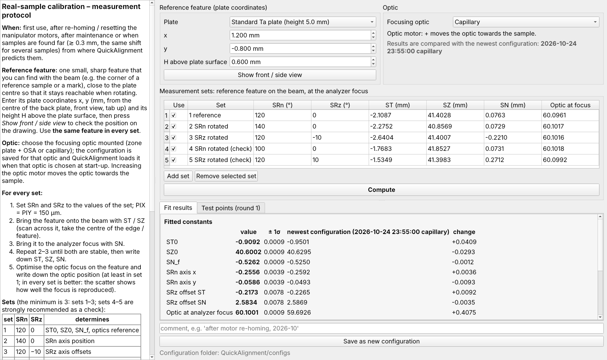
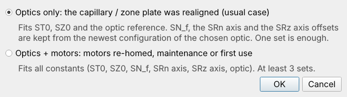
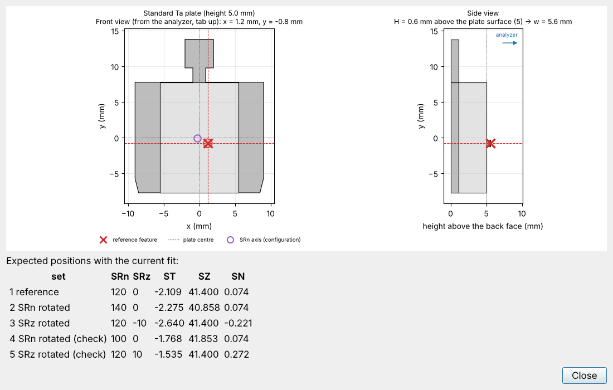

# RealSampleCalibration — technical reference

(Formerly *InitialCalibration*.) Fits the constants of the stage model (ST0, SZ0, SN_f, SRn axis, SRz axis offsets) and
the optic reference from **one reference feature of a real sample** measured at a few stage orientations, checks them
at test points, and saves a new configuration in `configs/` that QuickAlignment loads at its next start.

Beamline staff guide (PDF): [en](docs/pdf/RealSampleCalibration_staff_guide_en.pdf) ·
[中文](docs/pdf/RealSampleCalibration_staff_guide_zh.pdf) · [fr](docs/pdf/RealSampleCalibration_staff_guide_fr.pdf)
(sources `docs/STAFF_GUIDE_*.md`); short protocol: [`docs/protocol.md`](docs/protocol.md).

Code: `src/quickalignment/realsample/fit.py` (fit, test points, record), window `src/quickalignment/ui/real_sample_window.py`.
Agent / MCP access: tools `rsc_*` ([`../Agent/README.md`](../Agent/README.md)).

## Run

Double-click **`RealSampleCalibration.py`** in this folder (Windows: `RealSampleCalibration.pyw`, no console), or
`python RealSampleCalibration/RealSampleCalibration.py` from the repository root.

## What was recalibrated

At start-up the program asks what was recalibrated:

- **Optics only** (default, the usual case: capillary / zone plate realigned): ST0, SZ0 and the optic reference are
  fitted; SN_f, the SRn axis and the SRz axis offsets are kept from the newest configuration of the chosen optic. The
  sets are measured as the stage is run: SN left as it is, feature onto the beam with ST / SZ, optic refocused. One set
  (SRn 120, SRz 0) is enough; sets with SRn / SRz rotated check the kept axes (warning above 0.02 mm rms: the mechanics
  have changed, use optics + motors). Not offered when there is no configuration yet.
- **Optics + motors** (re-homing, maintenance, first use): all constants. Beamline staff measure one reference feature
  in 3 (minimum) or 5 (recommended) stage orientations, at the analyzer focus.

| set | SRn | SRz | determines |
|---|---|---|---|
| 1 | 120 | 0 | ST0, SZ0, SN_f, optics reference |
| 2 | 140 | 0 | SRn axis position |
| 3 | 120 | −10 | SRz axis offsets |
| 4 | 100 | 0 | check |
| 5 | 120 | +10 | check |

*Show front / side view* draws the plate with the entered feature to check its position:

The optic position at best focus can be noted in every set (optic + = towards the sample); all constants and the
optics reference are fitted every time and compared with the newest configuration (least squares, Gauss–Newton; the
fit says which set is missing when a constant is not determined).

## Test points

After *Compute*, test points at other rotations (SRn ±30, SRz ±15, combined) are predicted: staff go there and tick
*Found* (within 0.05 mm) or enter the real ST, SZ and optic position (SRn, SRz, SN kept). Measured points are added to
the next fit (found points only confirm); this is repeated round after round until a round is all found. The
configuration (constants, optics reference, sets, test points, residuals in its `check` record) is then saved as
`configs/calibration_<date>_<time>_<optic>.json`; the anti-collision solids of the previous configuration of the same
optic are kept.

## Configurations in use

The SRn axis position on the plate comes from the configuration (`configs/calibration_2026-10-24_170000_zone_plate.json`:
standard plate, zone plate data WWS2 2025-10-01/02). Capillary: `configs/calibration_2026-10-24_235500_capillary.json`
(gating plate, joint fit of two devices on Si measured at two rotations each; details in `../QuickAlignment/README.md`,
*Anti-collision* section end, and in the file's `check` record).
