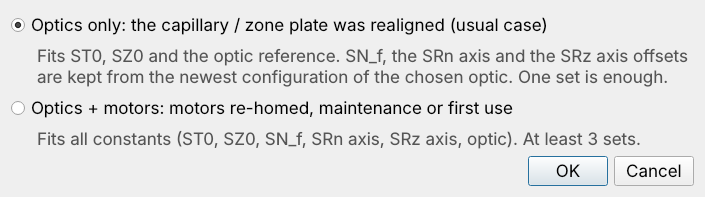
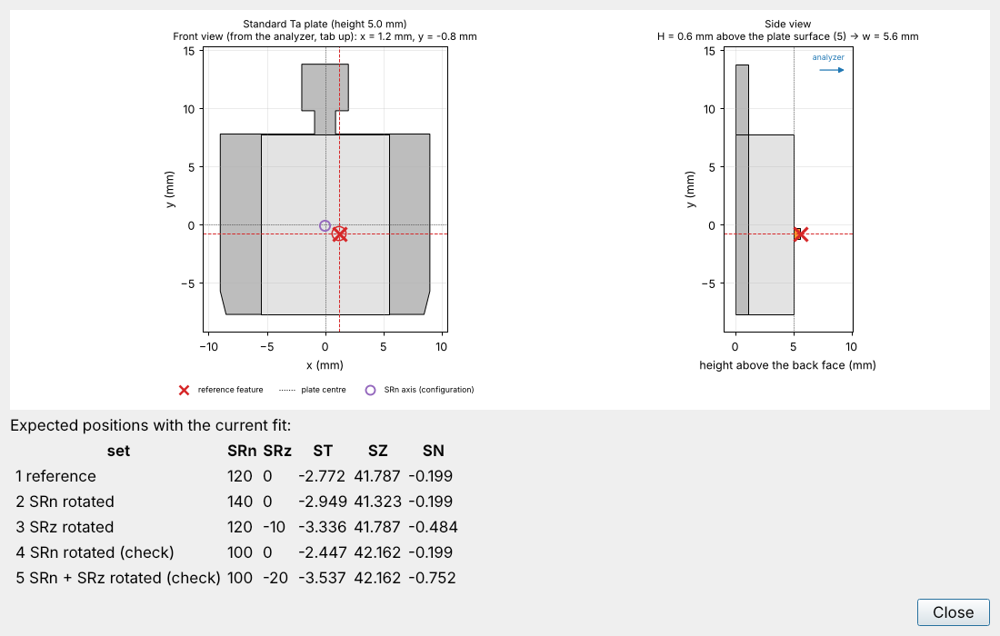
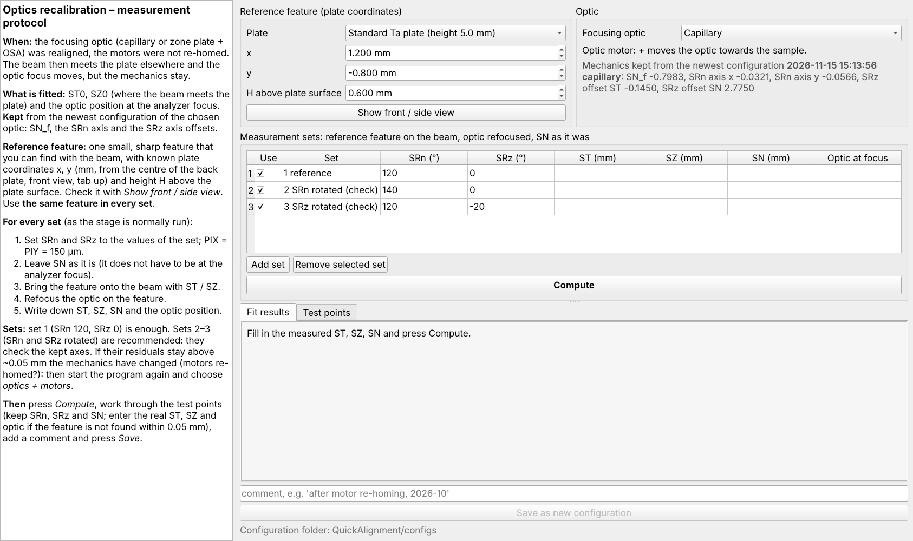
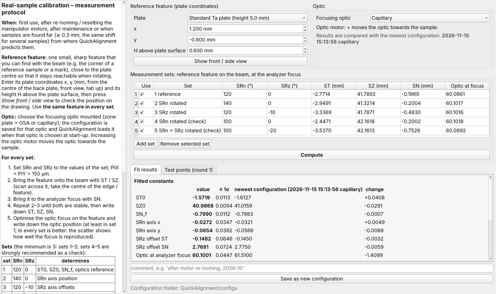
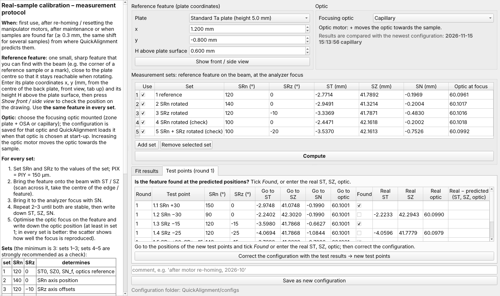

# RealSampleCalibration — Beamline Staff Guide

ANTARES beamline (SOLEIL) · calibrating the stage model with RealSampleCalibration, and looking after the program

## Contents

1. [What the staff are responsible for](#what-the-staff-are-responsible-for)
2. [The stage model and its constants](#the-stage-model-and-its-constants)
3. [When to recalibrate](#when-to-recalibrate)
4. [Starting RealSampleCalibration](#starting-realsamplecalibration)
5. [Optics only (the usual case)](#optics-only-the-usual-case)
6. [Optics + motors (full calibration)](#optics--motors-full-calibration)
7. [Test points: checking and correcting](#test-points-checking-and-correcting)
8. [Saving and how QuickAlignment uses the file](#saving-and-how-quickalignment-uses-the-file)
9. [What the November 2026 calibrations showed](#what-the-november-2026-calibrations-showed)
10. [Looking after the program](#looking-after-the-program)
11. [Troubleshooting](#troubleshooting)

---

## What the staff are responsible for

Users only *read* the stage calibration: QuickAlignment loads the newest **configuration file** for the chosen optic
and has no way to change it. The configuration is made by beamline staff with the separate program
**RealSampleCalibration** and stored in `configs/`:

```
configs/calibration_YYYY-MM-DD_HHMMSS_<optic>.json      optic: zone_plate or capillary
```

One file per calibration, never overwritten. What remains for a user (mostly the error of drawing a sample on the
plate) is corrected by *Fine tunings by ZPS/CPS* in the Stage & Optics tab.

## The stage model and its constants

Stack, bottom to top: ST / SN / SZ translations → SRz → SRn → PIX / PIY piezo → plate. Top view: the beam runs
along +y, the analyzer focal plane at 45°, ST along it and SN perpendicular to it.

| constant | meaning | determined by |
|---|---|---|
| ST0, SZ0 | ST / SZ putting the plate centre on the beam (SRn 120°, SRz 0°) | set 1 |
| SN_f | SN putting the standard plate's raised surface (5.0 mm) in the analyzer focal plane | set 1 |
| SRn axis x, y | position of the SRn rotation axis on the plate | a set with SRn rotated |
| SRz offset ST, SN | offset of the SRz axis from the plate-surface centre line | a set with SRz rotated |
| optic reference | optic position putting the focus on the analyzer focus | optic position noted in the sets |
| plate tilt u, v | tilt of the plate in its holder: the surface rises towards the analyzer by sin(tilt) per mm along +x / +y; turns with SRn and the piezo; 0 = flat | measured apart (below); a stage property: the newest value serves every configuration; not fitted |

SRn = 120° (plate vertical, tab up) is the mechanical reference; PIX = PIY = 150 µm during calibration. The optic is
modelled as a focus point moving along the beam: ST, SZ and SRn do not change the surface plane, so they need no
optic move; SN, SRz and the sample height do (1 mm along SN moves the spot √2 mm along the beam).

### Plate tilt in the holder

A plate does not always sit flat in its holder. The tilt (`plate_tilt_u`, `plate_tilt_v` in `stage_config`, degrees)
is a fixed tilt of the plate: it turns with SRn and the piezo, about the plate centre on the standard riser top, so
ST0, SZ0 and SN_f keep their meaning. QuickAlignment then computes positions, the SN of a height (at the sample's
x, y) and the starting normal of the Brillouin-zone tools with the tilted plate. The tilt is a property of the
sample stage, not of the optic: QuickAlignment and RealSampleCalibration read **every** configuration, capillary and
zone plate, older ones too, with the tilt of the newest file that records one (*Configuration…* names it);
RealSampleCalibration fits the other constants with that tilt and writes it into the new file.

- **Measure it** at SRn 120°, SRz 0° on features of a known flat surface far apart on the plate (2026-11-27: the
  gold lines S of the gating plate), along x and along y: the SN that puts the surface on the analyzer focus (or the
  zone plate focus, converted to a height) at two points Δy apart gives `plate_tilt_v = asin((SN(+y) − SN) / Δy)`,
  and the same along x for `plate_tilt_u`. A check at other SRn (e.g. 90 / 150°) must give the same tilt: a plate
  tilt turns with SRn, an error of the SRn axis does not.
- **Enter it** like the anti-collision solids: edit a copy of the newest configuration (`"stage_config"`:
  `"plate_tilt_u"`, `"plate_tilt_v"`), refit if needed, save it as a new file: from then on it serves every
  configuration of either optic. To go back to a flat plate, save a file with 0 (a file without the entry, as
  before 2026-11-27, records no tilt and is read with the newest one).
- **It belongs to one mounting**: after the plate is taken out and put back, measure it again (or set it to 0 and
  rely on *Fine tunings by ZPS/CPS*).

## When to recalibrate

| situation | mode |
|---|---|
| capillary or zone plate realigned (beam meets the plate elsewhere, focus moved) | **optics only** |
| motors re-homed / reset, manipulator maintenance, receptacle changed | **optics + motors** |
| first use, or no configuration for this optic yet | **optics + motors** |
| users' *Fine tunings by ZPS/CPS* corrections above ~0.3 mm, same shift for several samples | check with optics only; full if the residuals stay large |

## Starting RealSampleCalibration

Double-click **`RealSampleCalibration.py`** (Windows: `RealSampleCalibration.pyw`). The first question is what was
recalibrated:



*Optics only* is offered only when a configuration exists already (the mechanics are taken from it).

In both modes, first enter the **reference feature**: one small, sharp feature that can be found with the beam (the
corner of a reference sample, a mark), close to the plate centre so that it stays reachable when rotating. Enter its
plate coordinates x, y (mm, from the centre of the back plate, front view, tab up) and its height H above the plate
surface, and choose the **focusing optic**. **Show front / side view** draws the plate with the feature and lists
where each set should find it with the current configuration (motor ranges checked):



Use the **same feature in every set**.

## Optics only (the usual case)



Fitted: ST0, SZ0 and the optic reference. Kept from the newest configuration of the chosen optic: SN_f, the SRn axis
and the SRz axis offsets. For every set, as the stage is normally run:

1. Set SRn and SRz of the set; PIX = PIY = 150 µm.
2. **Leave SN as it is** (it does not have to be at the analyzer focus).
3. Bring the feature onto the beam with ST / SZ.
4. Refocus the optic on the feature.
5. Write down ST, SZ, SN and the optic position.

Set 1 (SRn 120°, SRz 0°) is enough. Sets 2–3 (SRn and SRz rotated) are recommended: they check the kept axes. If
their residuals stay above ~0.05 mm the mechanics have changed: restart the program and choose *optics + motors*.

## Optics + motors (full calibration)

All 7 constants and the optic reference are fitted. The feature is put **at the analyzer focus** in every set.

| set | SRn | SRz | purpose |
|---|---|---|---|
| 1 | 120 | 0 | ST0, SZ0, SN_f, optic reference |
| 2 | 140 | 0 | SRn axis |
| 3 | 120 | −10 | SRz axis |
| 4 | 100 | 0 | check (recommended) |
| 5 | 120 | +10 | check (recommended) |

**Minimum 3 sets** (each gives ST, SZ, SN); **5 recommended**, so that a wrong measurement shows up in the
residuals. Larger rotations give more precise axes (|SRn − 120| ≥ 20°, |SRz| ≥ 10° as far as the geometry allows).
Untick a set that was not measured; *Add set* adds one at other angles.

For every set:

1. Set SRn and SRz; PIX = PIY = 150 µm.
2. Bring the feature onto the beam with ST / SZ (scan across it, take the centre of the edge or feature).
3. Bring it to the analyzer focus with SN.
4. Repeat 2–3 until stable; write down ST, SZ, SN.
5. Optimise the optic focus on the feature and write down the optic position: at least in set 1, preferably in
   every set (+ moves the optic towards the sample).

Press **Compute**:



- **Fitted constants** with their 1σ uncertainty, the value of the newest configuration and the change.
- **Residuals** per set (model − measured, mm) for ST, SZ, SN and the optic. With 5 sets they should be
  ≲ 0.01–0.02 mm. One large residual usually means that set was measured on another point or out of focus:
  re-measure it, or untick it.
- Warnings: *Not enough data* (which constants the sets cannot determine), *minimum data set* (mistakes cannot be
  detected), residuals above 0.05 mm, no optic position entered (optic reference not calibrated).
- A fit on impossible numbers (typing errors, NaN) is reported instead of being saved.

## Test points: checking and correcting

After *Compute*, the **Test points** tab predicts rotations not used in the sets (SRn ± 30°, SRz ± 15°, SRn and SRz
combined) with the ST, SZ, SN and optic position where the configuration puts the feature:



For each test point:

1. Go to the predicted SRn, SRz, ST, SZ, SN and optic position.
2. If the feature is on the beam and in focus **within 0.05 mm**, tick **Found**.
3. If not: keep SRn, SRz and SN, bring the feature onto the beam with ST / SZ, focus the optic and enter the **real
   ST, SZ and optic position** (optic optional). Red predictions are outside a motor range: change the angles of
   that test point (it is predicted again).

**Correct the configuration with the test results → new test points** adds the real positions to the fit (found
points only confirm), fits all constants again and predicts a new round. Answered rounds stay in the table,
read-only, with their deviations. Repeat until all test points of a round are found, or the deviations are small
enough; a set that stays an outlier was probably measured wrongly: untick it and correct again.

## Saving and how QuickAlignment uses the file

Add a comment (date, reason, what was measured) and press **Save as new configuration**. The file is written
atomically (a failed write leaves no partial file) and contains the constants, the optics reference, the sets,
the test points and their residuals, for the record.

- QuickAlignment loads, at every start, the **newest file of the optic chosen** by the user. A zone-plate
  configuration does not replace the capillary one and vice versa.
- If there is no file for that optic, the stage constants of the newest file are used and the optic position is
  shown as uncalibrated.
- Damaged or foreign files in `configs/` are skipped. To withdraw a bad configuration, move its file out of
  `configs/` (do not edit it).
- Users can choose an older configuration for their session in *Configuration…* (read-only).
- The motor limits of ST, SZ, SN, SRn and SRz can be changed in *Configuration…* → *Motor limits*; they are saved in
  `configs/motor_limits.json` (delete the file to go back to the built-in limits).

### Anti-collision solids

The analyzer nose, the zone plate and OSA and the capillary are modelled as simple solids (QuickAlignment/README.md, *Anti-collision*).
The zone plate / OSA dimensions are **placeholders** (the capillary working distance, 7.2 mm, is the beamline value): measure them
(distance of each front from the focus, width, thickness; for the OSA, the OSA_S position they belong to) and put
them in the configuration under `"collision"` (edit a copy, then save it as a new file). RealSampleCalibration keeps the
solids of the previous configuration of the same optic.

## What the November 2026 calibrations showed

Reports: `RealSampleCalibration/docs/reports/` (2026-11-14 capillary, 2026-11-15 zone plate / SRz axis).

- **What a good configuration gives users.** After the 2026-11-14 calibration, rotations were predicted within
  22 µm (device, SRn 120 → 150 / SRz −10) and 27 µm (Cav, SRz −26.9 with SN corrected), checked on SPEM maps, with
  the capillary left at the same CPS: the sample stays on the same 300 × 300 µm map and in focus. Check points
  predicted before they were measured agreed within 34 µm.
- **Weights of the fit.** Positions are read to ±0.02 mm, the optic focus to ±0.10 mm with the capillary and
  ±0.02 mm with the zone plate (`measurement_sigmas` in `realsample/fit.py`).
- **The SRz axis across the beam is seen only in the focus.** It changes ST only to second order, so ST / SZ readings
  cannot fix it, and capillary foci are not precise enough: on 2026-11-15 a series SRz −5 … −20 with the zone plate
  (SN kept, ZPS noted) showed it 0.97 mm off. Measure SRz sets with the zone plate when possible, in the SRz range
  that will be used (down to −20 / −25).
- **SN_f** is judged on the camera reference line; on 2026-11-14 the surface was in focus at SN −0.3 instead of 0.
  Measure it once on a sample of known thickness.
- **Another plate.** A configuration made with the gating plate is used for the standard plate and vice versa: on
  2026-11-19 the gating plate was found to sit at the same height in the holder as the standard plate (within
  0.08 mm).
- **Plate tilt (2026-11-27, zone plate, gating plate).** The plate was found tilted in its holder: −0.263° along x,
  +1.595° along y, from the foci on the gold lines S at SRn 120 (a fit on the gold lines alone over SRn 90 / 120 / 150
  gave −0.10 / +1.53 ± 0.14°, consistent). With it
  the joint fit of the day reproduces positions within 6 µm and ZPS within 0.014 (configuration
  `calibration_2026-11-27_215418_zone_plate.json`; the 2026-11-17 … 11-20 zone plate ones, made without the tilt,
  are in `configs/archive/`). SN_f was kept from 2026-11-20, not checked with this mounting.
- **When readings contradict the model**, list the mismatches and test the possible causes one by one against all the
  data, instead of freeing more constants to absorb them (how the SRz-axis error was found).

## Looking after the program

**Installation** (Python ≥ 3.9): `pip install -r requirements.txt` (PyQt5 or PySide6, numpy, matplotlib; pytest for the
tests). Start with `QuickAlignment/QuickAlignment.py` / `RealSampleCalibration/RealSampleCalibration.py` (`.pyw` on Windows without console).

**Tests**: `python -m pytest` in the repository folder (about 230 tests, ~1 min; Qt runs off-screen). They cover
the stage model, rotations, calibration fits, file loading and the main windows.

**Limits that may need editing** (one place each):

| what | where |
|---|---|
| motor travel ranges ST, SN, SZ (input fields and warnings) | `MOTOR_SPECS` in `src/quickalignment/core/motors.py` |
| usable SRn / SRz, deflector limits, accepted offsets, photon energy range, zone-plate energy, work function | constants at the top of `src/quickalignment/alignment/bz_target.py` |
| analyzer slit orientation and the signs of slit / deflector angles | `AnalyzerGeometry` in `src/quickalignment/alignment/rotation.py` |
| plate drawings (standard, gating) | `src/quickalignment/core/geometry.py` |

**Robustness**: an unexpected error in the program is shown in a dialog (with details) and the program keeps
running, so that entered positions are not lost; please collect these details. Sessions and configurations are
written atomically; unreadable sessions give a message instead of a crash; impossible table entries (nan, inf, text)
are refused.

**Guides**: the screenshots are made by `python devtools/guide_screenshots.py`, the PDFs by
`python devtools/build_guides.py` (needs pandoc and Playwright with Chromium). Sources: `QuickAlignment/docs/USER_GUIDE_*.md`,
`RealSampleCalibration/docs/STAFF_GUIDE_*.md`.

## Troubleshooting

| symptom | likely cause / action |
|---|---|
| all samples found shifted by the same amount | ST0 / SZ0 changed (optic realigned): *optics only* |
| shift depends on the rotation | axes changed (motors re-homed): *optics + motors* |
| *Optics only* residuals of sets 2–3 above 0.05 mm | mechanics changed: *optics + motors* |
| one set with a large residual | wrong point, out of focus or typing error: re-measure or untick |
| *Not enough data: …* | the listed constants need a set with SRn and/or SRz rotated |
| a set needs SN below the collision limit | the feature is too low; use a feature on a higher sample |
| QuickAlignment shows *default* configuration | no readable file in `configs/` for any optic |
